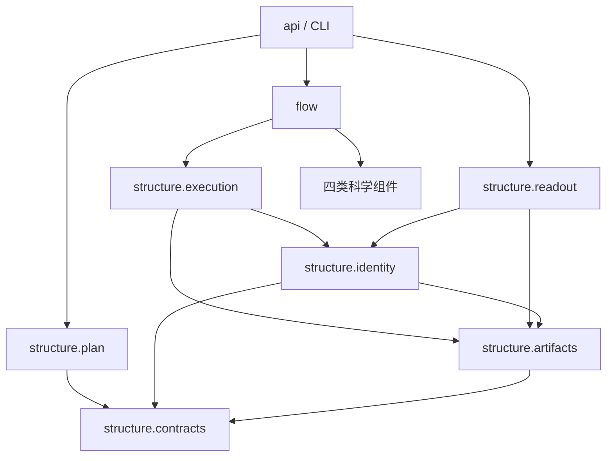

更新日期：2026年10月28日。本文定义 RPipe 当前采用的目标源码结构、模块职责、正式用例与依赖。工作拆解、实现差距及执行状态由开发计划和日期记录维护。

# 一、结构原则与约束程度

## （一）两柱分工

structure 承载声明、身份、执行与产物机制，以及 data/model/algorithm/system 科学能力。flow 承载阶段、装配、研究接入、所属进程及命令路由。包根只提供版本、公共用例和模块命令入口。

模块按职责、状态所有者和变化原因组织。一个模块的输入输出、依赖及失败边界必须明确；独立的来源身份和后端共享训练状态分别拥有自己的落点，避免依附于无关职责。相同职责的调用共用同一实现，不建立平行框架或通用 utils 总包。

## （二）固定原则与灵活结构

| **对象** | **约束程度** | **规则** |
| --- | --- | --- |
| 两柱分工、单向依赖、状态与资源所有权 | 必须守住 | 不以目录或回调方式绕过边界 |
| 正式用例、状态含义、科学计算口径 | 由设计合同约束 | 输入输出与失败语义明确，改变合同须说明必要性和验证依据 |
| 柱内文件拆合、目录深度、内部名称 | 可按职责调整 | 保持内聚和依赖清晰，不按文件数量或对称树验收 |

下面的目录是目标职责的源码落位。包标识按实际 Python 包发现需要设置，不聚合装载科学实现。目录不额外产生抽象层，函数和类的组织服从职责及正式合同。

# 二、目标目录

```text
src/rpipe/
├── __init__.py
├── __main__.py
├── api.py
├── structure/
│   ├── contracts.py
│   ├── identity.py
│   ├── plan.py
│   ├── execution.py
│   ├── artifacts.py
│   ├── readout.py
│   ├── comparison.py
│   ├── data/
│   │   ├── factory.py
│   │   ├── profile.py
│   │   └── resume.py
│   ├── model/
│   │   ├── factory.py
│   │   ├── architectures.py
│   │   └── input_norm.py
│   ├── algorithm/
│   │   ├── factory.py
│   │   ├── batch.py
│   │   ├── evaluation.py
│   │   ├── evaluation_support.py
│   │   ├── hf_map.py
│   │   ├── kwargs.py
│   │   ├── metrics.py
│   │   ├── optim.py
│   │   ├── progress.py
│   │   ├── resume.py
│   │   ├── state.py
│   │   ├── tracker.py
│   │   ├── train.py
│   │   └── transformers_trainer.py
│   └── system/
│       ├── factory.py
│       ├── logger.py
│       ├── origin.py
│       ├── runtime.py
│       ├── resources.py
│       ├── torchvision_load.py
│       └── transfers.py
└── flow/
    ├── cli.py
    ├── run.py
    ├── supervision.py
    ├── native.py
    ├── huggingface.py
    ├── stages.py
    ├── study.py
    └── exports.py
```

# 三、入口与核心机制

| **模块** | **职责** | **输入输出与状态边界** |
| --- | --- | --- |
| 包标识与模块命令 | 版本、包发现、转入统一命令路由 | 导入包不执行科学装配 |
| api.py | 正式公共用例 | 接收明确请求，协调声明、执行和观察；科学后端按需装配 |
| structure/contracts.py | 纯配置、规格、执行观察、状态投影及错误类别 | 仅标准库；不读文件、不装载后端、不持有执行资源 |
| structure/identity.py | 运行身份、源码与输入来源、环境观察及准入核验 | 对明确来源作只读核验；不发布结果或取得 Run 执行权 |
| structure/plan.py | 声明展开、因素分组、seed 及训练依赖 | 只接已解析合法数据，输出不可变规格，不写盘或加载研究代码 |
| structure/execution.py | 单 Run 生命周期与正式终态 | 拥有 attempt、执行权、配置不变性、首错、清理和发布顺序，使用纯合同中的状态规则；不选择科学后端 |
| structure/artifacts.py | 布局、受保护文件 I/O、原子发布、缓存锁与执行权原语 | 只操作明确路径和所属资源，原语不决定科学质量或阶段时序 |
| structure/readout.py | 正式状态、日志、轨迹读取和纯统计 | 以明确身份及正式记录投影观察，不执行、修写或装载科学实现 |
| structure/comparison.py | 显式条件和状态深比较 | 接受明确受信输入，必要时延迟装载 Tensor，输出可定位差异；不反向依赖 flow |

identity 与 artifacts 的边界是来源事实和受保护存取。前者回答内容属于谁及是否满足声明，后者执行路径保护和文件操作。execution 决定何时允许发布及整体状态，读端以相同状态规则解释持久化事实。

# 四、科学模块职责

## （一）数据与模型

| **模块** | **职责** | **边界** |
| --- | --- | --- |
| data/factory.py | 数据对象构造、明确组件选择与迭代器管理 | 拥有本次 loaders、采样资源和关闭，不依赖模型或算法工厂 |
| data/profile.py | 正式数据准备用例的统计计算及 stats 核验 | 明确配置与外部目标，逐批归约，关闭所属数据；计划阶段不运行 |
| data/resume.py | 采样游标及生成器状态 | 恢复未消费索引，不重放已消费随机变换 |
| model/factory.py | 模型构造与明确领域扩展 | 仅通过必要数据元信息连接形状，不持有 DataLoader |
| model/architectures.py | 网络计算与参数结构 | 不读取研究目录或决定执行流程 |
| model/input_norm.py | 输入归一化及受训练状态控制的增强 | 转换位置、随机性和数值口径明确，不与数据端重复处理 |

## （二）算法

| **模块** | **职责** | **边界** |
| --- | --- | --- |
| algorithm/factory.py | 正式算法运行合同、组件选择与构造 | 按明确条件选择实现，不承载训练循环或系统 I/O |
| algorithm/batch.py | 批次解包、形状和设备适配 | 不决定训练预算或评测时机 |
| algorithm/evaluation.py | 独立评测执行 | 使用明确训练依赖与测量范围 |
| algorithm/evaluation_support.py | 训练周期评测、best 方向和停止规则 | 指标完整归约后作判定，不代替独立评测用例 |
| algorithm/metrics.py | 指标定义、单位与样本归约 | 区分批次和完整数据指标，不判研究结论 |
| algorithm/optim.py | 优化器、scheduler、裁剪及学习率观察 | 构造及观察与训练时序分开 |
| algorithm/progress.py | step/epoch 单位、预算、周期及保存节点 | 不执行操作系统期限或文件 I/O |
| algorithm/state.py | 两后端共用的训练状态和循环观察构造 | 汇集明确的模型、优化器、进度与数值状态，不运行训练或选择保存时点 |
| algorithm/resume.py | 目标状态的恢复准入与应用 | 来源和条件明确，不决定磁盘存取方式 |
| algorithm/tracker.py | 数值累计、正式轨迹和恢复视图 | 不持有执行权，不推断研究整体质量 |
| algorithm/train.py | 原生训练更新、评测和保存时序 | 维护完整训练状态与精确恢复合同 |
| algorithm/transformers_trainer.py | HF 训练及评测的实际后端执行 | 使用明确共用状态，不把原生恢复语义强加给后端 |
| algorithm/hf_map.py | 科学配置到后端参数的明确映射 | 不静默替换科学默认或丢弃有效条件 |
| algorithm/kwargs.py | 本算法领域的构造参数解析 | 仅服务明确构造点，不扩为全局工具层 |

共用状态独立于任何一个训练后端。学习率观察归优化器职责，循环观察归明确状态合同，训练与评测时序分别属于相应算法。合作取消使用 system 的运行时能力，不反向引用 flow。

## （三）系统

| **模块** | **职责** | **边界** |
| --- | --- | --- |
| system/factory.py | 设备对象与正式状态存取 | 不选择 best、训练周期或科学阈值 |
| system/logger.py | 有界诊断、关联身份、脱敏与输出健康 | 不取代科学轨迹和正式终态 |
| system/origin.py | 来源策略、端点作用域及受约束获取 | 明确输入许可和目标位置，不自行改变环境策略 |
| system/runtime.py | 随机数、精度/确定性设置及合作取消 | 在科学对象构造前应用，不负责批次调度 |
| system/resources.py | 所属 OS 资源及输出增长观察 | 不设置实验默认预算，不将采样值解释为硬配额 |
| system/torchvision_load.py | 科学库的明确按需装载 | 错误边界有界，不吞任意导入故障 |
| system/transfers.py | 来源操作内部的 SDK/HTTP 适配 | 只处理所属调用和流，不提供全局代理或调度权 |

# 五、流程与研究接入

| **模块** | **职责** | **拥有的状态** |
| --- | --- | --- |
| flow/cli.py | 正式请求解析、用例路由、呈现和退出状态 | 命令请求，不复制执行机制 |
| flow/run.py | 父子进程协议、所属 worker 与装配连接 | 请求标识、进程句柄和响应核验，不重判执行权 |
| flow/supervision.py | 显式有界批次监管 | 本批许可、期限、所属资源观察及独立报告 |
| flow/native.py | 原生科学组件装配与作用域收尾 | 本次科学对象、临时注册及清理 |
| flow/huggingface.py | HF 装配选择 | 复用统一生命周期，不形成另一套发布协议 |
| flow/stages.py | 六阶段顺序、交接及校验时点 | 阶段上下文和候选观察，不取得正式发布权 |
| flow/study.py | 正式研究扩展装载与作用域 | 本次研究组件和阶段接入，不共享活动训练对象 |
| flow/exports.py | 正式轨迹的曲线和 TensorBoard 导出 | 本次目标文件及图句柄，输入输出双向分离 |

具体研究负责选择科学条件、实现专用计算与判据，并通过正式接入合同连接核心。领域算法不被包装成大量接入胶水，接入也不复制执行框架。宿主领域包独立于研究，核心不静态导入研究包。

# 六、正式用例合同

| **用例** | **明确输入** | **输出和副作用** |
| --- | --- | --- |
| 计划 | 研究声明、显式运行根及研究版本 | 不可变规格与明确依赖，只读 |
| 规格发布 | 同一来源及输出域的合法规格 | 配置和计划索引，受保护发布 |
| 执行 | 明确规格、预算及取消 | 按所属生命周期返回执行、科学和证据观察 |
| 有界批次监管 | 明确规格、资源停止线和独立证据根 | 所属资源监管报告，不代替 Run 终态 |
| 状态、日志与报告 | 明确运行身份及正式记录 | 只读观察，不启动或修复 |
| 研究汇总 | 明确集合与目标根 | 可重建派生摘要，不训练或覆盖科学事实 |
| 比较 | 明确身份、比较条件和受信状态 | 有范围与单位的差异观察 |
| 数据准备与导出 | 明确来源、选择、许可及目的地 | 外部数据准备观察、统计或派生文件 |

每个用例由一个正式入口协调，配置字段具有实际语义，未知字段严格失败。内部辅助不因可导入就成为公共表面。普通导入和读取不加载科学后端，昂贵或写入操作必须由相应正式用例明确发起。

# 七、依赖与状态存储

structure 不依赖 flow/api；contracts 仅依赖标准库；plan 只依赖 contracts。identity 可以使用 artifacts 的只读原语，artifacts 不反向依赖 identity，写入需要的身份由调用方明确提供；两者不依赖执行或科学装配。execution 依赖合同、身份和受保护产物，通过注入调用运行实现。readout 不依赖 execution、科学后端或流程，与执行端共用纯合同的状态规则；comparison 的重读取按请求显式发生。

data/model/algorithm/system 在各自领域及明确底层能力间传递必要元信息，不依赖流程。flow 装配这些能力，公开用例协调 plan、flow 和 readout。注册回调不改变源码允许方向，动态导入和类型引用同样受约束。



外部运行根保存声明发布、Run 配置、正式科学结果、明确 attempt 的执行事实、所属资产及研究派生摘要。源码、科学输入、执行证据和可重建输出分开。路径必须解析并保护来源和输入；原子写入和执行权检查参与每个正式发布，不通过日志或时间戳推断权威。

# 八、测试与交付结构

tests 按实际源码职责镜像，分层、重要性、成本及数值条件用标签表达，不机械生成占位文件。核心合同验证、领域数值、研究接入和安装旅程分别提供信号。每个进程使用独立临时目录，测试回执和大报告位于显式外部根。

声明、身份、计划、执行、产物、读端、科学组件、阶段及所属进程各有可定位行为与失败验证。fixture 仅提供最小可重建合成输入，不使用真实研究 Run 作清理对象。静态依赖检查与导入/执行行为检查分别验证。

统一测试入口负责选择、成本和结果协议，制品旅程负责实际安装包在源码树外的正式命令及最小研究流程。包发现只包含核心实现，来源元数据及许可证随交付保留，输出不打包成源码依赖。

职责与质量依据见 [架构设计](<架构设计 Architecture Design 研究流水线.md>)，实施任务、现状差距与验收安排见 [开发计划](<开发计划 Development Plan 研究流水线.md>)。
