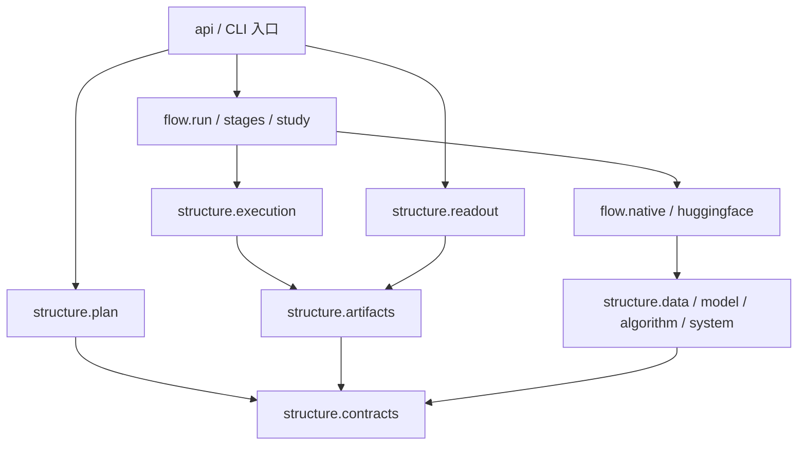

更新日期：2026年10月27日。本文维护当前确认采用的源码结构方向、模块职责、依赖与公开入口。实际现状与目标的差距单列，不将尚未实现部分记为现有能力。

# 一、结构方向与适用边界

## （一）两柱与文件粒度

RPipe 实现只分 `structure/` 和 `flow/`。structure 包含声明、配置、执行与产物机制、读取及 data/model/algorithm/system 科学组件；flow 包含阶段、后端装配、Study 加载、所属进程和 CLI。包根只保留入口、版本，不设平级 payloads，也不把它整体塞进 structure。

依据架构的质量场景与状态所有权，将通用计算能力和执行时序分开。跨Run不共享可变训练状态，计划与读端不因引用类型而加载科学实现，宿主算法包不被迫采用研究模板的内部结构。

声明合同、展开、执行权、产物及读取各有实际消费者，因此分别落在contracts、plan、execution、artifacts、readout。稳定公共用例集中在api，领域计算保持data/model/algorithm/system的职责。只有接口或变化原因独立时才增加模块，不为目录对称增加转发门面。

一个文件围绕实际变化和调用方组织；真实重复才提取辅助函数，同一职责过大或独立变化再拆。新生态名称、六阶段名称和测试标签都不自动产生包，不建空目录、utils 总包或通用插件框架。

## （二）当前设计与实现差距

第二至第七章给出当前确认采用的模块结构及其实现映射，逐文件登记是定位工具，不将文件数量设为优化目标。共享状态、外部I/O、发布、取消和清理边界不得因拆文件改变。未落实的能力在本章与开发计划登记，不把现状缺口描述成目标设计。

# 二、仓库与包目录

## （一）仓库骨架

```text
RPipe/
├── README.md                       # 项目说明、使用边界和资料入口
├── AGENTS.md                       # 协作规则与规范导航
├── LICENSE.md                      # MIT 许可证
├── pyproject.toml                  # 打包、依赖、CLI、pytest marker
├── .importlinter                   # 两柱、纯合同、纯计划、读端依赖合同
├── .github/workflows/
│   ├── branch-flow.yml
│   ├── unit-tests.yml
│   └── package-check.yml
├── src/rpipe/                      # 可安装的唯一通用实现
├── studies/                        # 源声明和研究薄适配
│   ├── _template/
│   ├── main_probe/
│   └── main_exp/
├── tests/                          # 产品/Study 镜像、辅助数据及研发入口
└── docs/
    ├── 通用调研 General Research 研究流水线.md
    ├── 架构设计 Architecture Design 研究流水线.md
    ├── 代码结构设计 Code Structure Design 研究流水线.md
    ├── 开发计划 Development Plan 研究流水线.md
    ├── 缺陷记录 Bug Report 研究流水线.md
    ├── 开发记录 Development Record/
    ├── 运行记录 Run Record/
    ├── 文献调研 Literature Review 研究流水线.md
    └── 研究计划 Research Plan 研究流水线.md
```

`.tmp/` 是忽略的本地工作区，不是交付结构。build/dist、环境、缓存、测试结果和研究运行根不进入源码树设计。法律许可保留，不计作技术文档。不新增修复、进度、交接、测试说明或 Study 计划等重复正文。

## （二）当前 50 个包内 Python 文件

```text
src/rpipe/
├── __init__.py
├── __main__.py
├── api.py
├── structure/
│   ├── __init__.py
│   ├── contracts.py
│   ├── plan.py
│   ├── execution.py
│   ├── artifacts.py
│   ├── readout.py
│   ├── comparison.py
│   ├── data/
│   │   ├── __init__.py
│   │   ├── factory.py
│   │   ├── prepare.py
│   │   ├── profile.py
│   │   └── resume.py
│   ├── model/
│   │   ├── __init__.py
│   │   ├── architectures.py
│   │   ├── factory.py
│   │   └── input_norm.py
│   ├── algorithm/
│   │   ├── __init__.py
│   │   ├── factory.py
│   │   ├── batch.py
│   │   ├── evaluation.py
│   │   ├── evaluation_support.py
│   │   ├── hf_map.py
│   │   ├── kwargs.py
│   │   ├── metrics.py
│   │   ├── optim.py
│   │   ├── progress.py
│   │   ├── resume.py
│   │   ├── tracker.py
│   │   ├── train.py
│   │   └── transformers_trainer.py
│   └── system/
│       ├── __init__.py
│       ├── factory.py
│       ├── logger.py
│       ├── origin.py
│       ├── runtime.py
│       ├── resources.py
│       ├── torchvision_load.py
│       └── transfers.py
└── flow/
    ├── __init__.py
    ├── cli.py
    ├── run.py
    ├── supervision.py
    ├── native.py
    ├── huggingface.py
    ├── stages.py
    ├── study.py
    └── exports.py
```

下列登记覆盖全部 50 个文件。路径以 src/rpipe 为根，主要符号用于定位，未列私有辅助函数不表示它们是可随意调用的公共 API。

# 三、Python 文件职责与接口

## （一）入口及包标识

| **文件** | **主要内容与入口** | **边界及消费者** |
| --- | --- | --- |
| `__init__.py` | `__version__` | 导入只读版本，不递归加载两柱或科学依赖 |
| `__main__.py` | `python -m rpipe` 转入 CLI | 不复制参数或业务判断 |
| `api.py` | plan/run/cancel/make/launch/supervise/process；暴露明确读端与 compare 接口 | 用户、CLI、宿主 Study 的稳定用例入口；科学装配延迟导入 |
| `structure/__init__.py`、`flow/__init__.py` | 柱标识 | 不聚合导入所有实现、不启动执行 |
| `structure/data/__init__.py`、`model/__init__.py`、`algorithm/__init__.py`、`system/__init__.py` | 四领域包标识 | 不把领域 import 变成递归后端加载，不建立第二公共门面体系 |

## （二）structure 核心机制

| **文件** | **主要符号及唯一职责** | **状态、副作用及调用方** |
| --- | --- | --- |
| `structure/contracts.py` | 配置/Control、RunSpec/RunOutcome、Budget/SupervisionLimits/Cancellation，纯合并/ID/project_execution、validate_run_root | 仅标准库；RunSpec 只读观察路径和源码根标记并拒绝重叠，不读取配置内容/加载后端/写盘；纯投影服务执行和读取 |
| `structure/plan.py` | expand：声明展开、轴/seed/版本、Experiment 分组与 train_id | 只依赖纯合同；api.plan 提供已解析输入和实际摘要 |
| `structure/execution.py` | RunContext、execute、Cancelled、error_record；明确 attempt、owner 最后释放、首错/清理、科学/派生发布与终态 | 注入四方法，不选科学后端；统一纯投影，release 后不写 Run，unknown 不重放 |
| `structure/artifacts.py` | 布局/identity/source_digest/validate_source/validate_train、input_provenance/environment_snapshot/read_execution/safe_error_record、发布/owner/锁/输入原语 | 明确索引及 pins 校验、输入输出保护、安全异常记录，读取不建目录；实际 I/O 仍在负责入口 |
| `structure/readout.py` | read_run/read_legacy、aggregate/logs/report/compare；轨迹加载、曲线摘要、train/eval 配对与差值 | 只读，不 import 执行/科学后端；api、exports 及 Study 分析使用。旧辅助读端不等于核心准入来源 |
| `structure/comparison.py` | compare_runs/format_compare/write_compare；Tensor、复杂数、大整数、checkpoint 和轨迹深比较 | 显式重操作，可延迟读受信 Torch；只接注入 checkpoint reader，不反向导入 flow 或猜 Study 根 |

contracts.py 同时提供科学配置与执行数据类，artifacts.py 同时包含布局、身份和发布原语。它们不是必须永远保持大小的“万能模块”；当前没有为目录对称而继续拆分。若协议独立演进或修改互相干扰，先说明实际调用方及收益，再在同柱内拆分，不恢复多层空 api。

## （三）structure/data

| **文件** | **主要接口及责任** | **依赖与消费者** |
| --- | --- | --- |
| `structure/data/factory.py` | Data.iter_batches/close/training_state/restore_training_state、DataRegistry、DataFactory.build、vision_root | 构造 loaders/meta，管理本次迭代器，默认 raw 别名发布须留在自有共享根；使用 contracts、artifacts、data.resume 和 system 明确工具，由 Native/recipe 使用 |
| `structure/data/prepare.py` | prepare_shared_data、announce | 明确请求下准备共享 raw，去重实际输入，保护临时环境及 endpoint；不是 make 自动步骤 |
| `structure/data/profile.py` | load_stats/summarize_batches/profile_study | 接受 CLI 传入的已选有效 configs，保留 source/path、拒绝同输出异输入，float64 逐批归约与 Data 关闭；不加载 recipe、不在 plan 中运行，大数据成本未实测 |
| `structure/data/resume.py` | BatchCursor、loader_spec、generators、generator_states/restore_generators、cursor_loader | loader/sampler 游标与可恢复生成器，不选训练预算或 checkpoint；由 Data 及原生恢复使用 |

## （四）structure/model

| **文件** | **主要接口及责任** | **依赖与消费者** |
| --- | --- | --- |
| `structure/model/factory.py` | Model/ModelRegistry/ModelFactory.build、init_param、resolve_shape | 配置加数据元信息构造 module/meta，复用 architectures/InputNorm 和 system 来源/装载工具；不导入 DataFactory 或流程 |
| `structure/model/architectures.py` | Linear/MLP/CNN/ResNet/WideResNet 及内部块 | 实际网络定义，保持参数初始化与 forward 语义，不读研究目录 |
| `structure/model/input_norm.py` | InputNorm.forward | 输入归一化与既有训练增强，Torch/kornia 按实际需要使用；不在数据层重复该变换 |

## （五）structure/algorithm

| **文件** | **主要接口及责任** | **依赖及写入边界** |
| --- | --- | --- |
| `structure/algorithm/factory.py` | Algorithm/AlgorithmHook、AlgorithmRegistry/Factory | mode/source 分派，原生/HF 实现按需加载；不建立后端外第三柱 |
| `structure/algorithm/batch.py` | maybe_flatten_images、prepare_tensors | 解包、形状适配及 Tensor 转移，不拥有训练时序 |
| `structure/algorithm/evaluation.py` | EvalAlgorithm.run、run | 独立原生评测，显式恢复所需权重、计算测量 |
| `structure/algorithm/evaluation_support.py` | eval_batch_limit/eval_test_split/should_early_stop/best_spec | 评测范围、空样本拒绝、完整指标归约后写出、best 方向与早停判定，供原生/HF 复用 |
| `structure/algorithm/hf_map.py` | hf_optim_name/hf_scheduler_name/training_arguments_kwargs | 现有配置到 HF 参数映射，不能静默改变原生默认 |
| `structure/algorithm/kwargs.py` | filter_args/algorithm_blob/torch_attr | 已支持构造参数解析/过滤，不变成通用 utils 或丢弃所有未知科学条件 |
| `structure/algorithm/metrics.py` | MetricBundle、accuracy_value/loss_value/mse_value、名称与 I/O 规范化 | 测量定义、batch/full 汇总，evaluate 等仅相应路径使用 |
| `structure/algorithm/optim.py` | make_optimizer/make_scheduler/clip_gradients | optimizer/scheduler 构造与梯度裁剪，更新顺序由训练实现决定 |
| `structure/algorithm/progress.py` | ProgressBudget/EtaClock、resolve_budget、周期/百分比/checkpoint_names | 进度单位、实际预算和保存节点；不负责文件 I/O 或 OS 资源限制 |
| `structure/algorithm/resume.py` | capture_rng/restore_rng、resolve_checkpoint_ref、sibling_train_dependency 等 | RNG、恢复选择与兼容判断；System 负责文件；旧 sibling/index 辅助不替代核心 train_id 核验 |
| `structure/algorithm/tracker.py` | AlgorithmTracker、make_tracker，evaluate/append/flush/state_dict/load_state_dict | 加权累计、JSONL/状态、恢复视图与轨迹边界；不判研究质量 |
| `structure/algorithm/train.py` | TrainAlgorithm、run/bind_step_train_loader/budget_for | 原生更新、评测、checkpoint 一致时点和恢复顺序；保留计算首错及 flush 二错 |
| `structure/algorithm/transformers_trainer.py` | HfTrainAlgorithm/HfEvalAlgorithm、build_training_arguments | 真实 Trainer 构造、回调、取消、指标、best、恢复剩余预算与累计坐标，不承诺原生 exact resume |

AlgorithmHook 在算法周期内调用，不对应 Study 六阶段 hook。模型对象、优化器、scheduler 和 tracker 只存在当前执行，不能由于这些文件归 structure 就变成全局共享状态。

## （六）structure/system

| **文件** | **主要接口及责任** | **依赖及资源边界** |
| --- | --- | --- |
| `structure/system/factory.py` | System/SystemFactory、place_module/save_checkpoint/load_checkpoint/to_result_snapshot | 设备及 checkpoint bundle/staging/镜像；不选 best 和保存频率，不存在 SystemRegistry |
| `structure/system/logger.py` | Logger.debug/info/warning/error/critical/exception/report、bind/close 与诊断状态 | JSONL、脱敏/限额/保留及单路失效隔离；复用现有锁，无新日志柱；实际限制见架构设计 |
| `structure/system/origin.py` | normalize_origin/model_hub/endpoint_for/bind_endpoint、download_model/load_hf_dataset | 来源、固定文件检查、endpoint 作用域与实际下载入口，调用 transfers 内部适配 |
| `structure/system/runtime.py` | apply_runtime/make_generator/worker_init_fn/check_cancelled | RNG、确定性/精度标志、合作取消；算法使用此入口，不能导入 flow.native |
| `structure/system/resources.py` | WindowsJob、output_snapshot/output_growth | 标准库 ctypes 适配匿名 Job、成员/RSS、所属终止及退出确认；输出身份去重及观察失败，不含批次调度、实验默认预算或科学导入 |
| `structure/system/torchvision_load.py` | import_torchvision | 延迟装载及已有兼容边界，不在纯读路径导入 |
| `structure/system/transfers.py` | 私有 SDK/HTTP 传输适配 | 已有下载读取、线程/进程上下文与 owned stream 保全；只服务明确 origin 入口，不作为全局网络代理 |

system.source 当前是配置/元信息，不选择任意系统后端；设备 .to、TF32/确定性设置不等于自动 GPU 调度或硬内存控制。来源函数和传输适配不导入调用方算法/flow。

## （七）flow

| **文件** | **主要接口及责任** | **状态和调用方** |
| --- | --- | --- |
| `flow/cli.py` | main(argv=None) | 参数、显式命令路由、呈现和退出码，调用 api；内部 _worker 进入 flow.run，_supervisor-coordinator 进入 stdin 放行入口，不复制生命周期 |
| `flow/run.py` | configure/run/worker、ProcessRun、WorkerFailure | 父监督/子执行、请求 nonce/identity、deadline、owned Popen；配置回调注入 execution；不重写训练循环 |
| `flow/supervision.py` | supervise/coordinator | 显式 Windows 外层监管、stdin 放行、逐格授权、期限/取消、RSS/输出观察及独立报告；复用 api.run 和 Run owner，不修改普通 launch 策略或绕过 owner |
| `flow/native.py` | NativeRun.prepare/execute/collect/close | 四领域装配、prepare.before/recipe 时机、注册表快照恢复、本 Run close；不能给领域层反向引用 |
| `flow/huggingface.py` | HuggingFaceRun.prepare | 在 Native 装配职责上选择 transformers_trainer，复用默认阶段，不建第二条发布协议 |
| `flow/stages.py` | pipeline | 六阶段中前五阶段的顺序与检查、result_draft、hook 时机；process 由正式发布后入口处理 |
| `flow/study.py` | RecipeContext、recipe_path/load_recipe/apply_recipe、study_phase_files/run_study_phase | 私有加载空间、入口形状校验、同名/晚导入/受信类兼容；清理只限所属模块 |
| `flow/exports.py` | collect_curve_groups/write_learning_curves/export_tensorboard 及路径函数 | 显式派生输出，调用只读曲线工具；自己创建的 figure 总要关闭，PNG 用原子替换 |

# 四、依赖、导入与公开入口

## （一）允许方向

| **调用方** | **允许依赖** | **禁止与理由** |
| --- | --- | --- |
| 包根 api | structure 用例与按需 flow | 不在模块 import 时载入科学后端 |
| contracts | 必要标准库 | 不 import 任一实现，否则计划和类型随科学栈加载 |
| plan | contracts | 不 import 磁盘/执行/读端/科学；api 在调用前读声明 |
| artifacts | contracts、标准库及实际 YAML I/O 依赖 | 不反向依赖执行/flow，布局不决定流程 |
| execution | contracts、artifacts | 通过注入调用实现，不选择具体科学组件 |
| readout | contracts、artifacts、必要纯统计/标准库 | 不依赖 execution、comparison 或科学组件，守住普通只读边界 |
| comparison | 明确存储/纯读工具及按需科学读取 | 不导入 flow，Study pickle reader 由 api 注入 |
| data | contracts/artifacts，本领域及 system 来源、runtime、装载工具 | 不 import model/algorithm 工厂和 flow |
| model | contracts、本领域、system 明确工具 | 不持有 DataLoader，不 import flow 或数据工厂 |
| algorithm | contracts/artifacts、本领域与实际 data/system 类型、恢复工具 | 不 import flow/native；合作取消用 system.runtime |
| system | contracts/artifacts、本领域与必要第三方 | 不 import algorithm/flow，不决定算法时机 |
| flow | structure、其它明确 flow 模块及按需后端 | 不把业务实现放包根或新平级实现包 |
| Study/宿主 | Study 可 import api、明确领域接口及宿主公共科学包 | 宿主不能反向 import Study，RPipe 不静态 import 正式 Study |

允许表列边界，不要求每文件都导入全部允许项。动态 import、函数内 import 和类型引用也遵守。注册回调在运行时反向被调用，不等于允许源码反向导入。

`.importlinter` 声明四条合同：structure 不依赖 flow/api；contracts 不依赖实现；plan 不依赖磁盘/执行/读端/科学；readout 不依赖执行/科学。Import Linter 未安装时不宣称该工具通过。现有 AST 边界测试可查静态 import，包括函数内导入；动态字符串与导入副作用还需行为验证，不能互相替代。



上图表示静态导入及类型依赖，不是进程或完整时序。structure 不导入 flow/api；contracts 不导入实现；plan 只依赖纯合同；readout 不依赖执行及科学组件。科学目录比较是显式重操作，不给普通读端增加 Torch 依赖。

执行时 execution 通过 flow 注入的方法调用具体运行实现，属于依赖反转，不需要 Payload 总包。算法合作取消归 system.runtime，不能借此反向依赖 NativeRun。领域间只传实际需要的元数据、设备与 checkpoint 接口，具体方向见代码结构设计。

## （二）公共 Python 用例

| **入口** | **签名与返回** | **调用约束** |
| --- | --- | --- |
| api.plan | `(study_dir, *, run_root, version=None) -> tuple[RunSpec, ...]` | run_root 显式，不执行 recipe/科学栈 |
| api.run | `(spec, *, payload=None, budget=None, cancellation=None, retry=False) -> RunOutcome` | 四方法参数兼容；retry 仅对无 result 的已知失败/取消，unknown 拒绝 |
| api.supervise | `(specs, *, limits, evidence_dir, cancellation=None, retry=False) -> dict` | 显式 SupervisionLimits，无资源默认值；新建外部证据根与 Run/输入/源码分离，Windows Job 所属树监管；报告不替代各 Run 终态 |
| api.cancel | `(cancellation) -> None` | 只请求本次信号，停止事实看 RunOutcome |
| api.make / launch | make(specs) -> dict；launch(specs, *, budget=None, cancellation=None, retry=False) -> tuple | 同一 Study/source/version 输出域，launch 当前串行 |
| api.read_run/aggregate/report/logs | 单规格或明确集合 → dict/文本 | 实现归 readout，零执行零写 |
| api.process | `(specs) -> dict` | 重核所有规格来源及实际目标后写外部 summary、触发 Study scope process，不训练 |
| api.compare | `(a, b, *, differences=()) -> dict` | 配对同 seed/source/version，条件差异显式声明 |
| api.compare_runs | 转发目录深比较，额外 `study_dir=None` 注入受信 reader | atol/rtol 默认 0，checkpoint 列表显式；不自动验证旧来源 |
| api.write_compare | `(path, body)` | 显式输出，不写比较输入目录 |
| flow.exports | write_learning_curves(study_root,index, *, title=None)；export_tensorboard(study_root,destination, *, run_ids=None) | 默认实际 runs，可显式选择；普通 report 不调用，调用方保护未知输入 |

Config/Control/RunSpec 是可直接引用的纯合同。内部辅助函数、未承诺 registry 全局操作和旧私有路径不自动成为稳定公共 API。注册真实数据/模型/算法时在 recipe 引用对应 factory；需要扩展约束时同步其行为合同和消费者，不加几十层旧路径转发。

## （三）CLI 与写入分类

| **命令** | **当前行为** | **选择和失败边界** |
| --- | --- | --- |
| plan | 输出实际规格/身份/路径/train_id | 读取，不发布 |
| status/logs/report/shared | 执行/科学/派生状态、JSONL及旧日志、报告或共享路径 | 读取，不创建/训练/修复；status/report --legacy 为显式旧目录读取 |
| make | 配置与 index 发布 | 不生成 jobs/脚本、不准备科学数据 |
| run / study | make 后 launch | study 是同一路径的命令别名，不是独立框架 |
| launch / run-one | 明确规格执行；run-one 多一个位置 run_id | --id/位置 ID 须属于当前计划，统一 owner 和 train 屏障 |
| supervise | 显式限额的 Windows 顺序批次 | 必须提供 evidence-dir/run-seconds/batch-seconds/rss-bytes/output-bytes，另可 poll-seconds/cleanup-seconds/retry；不自动 make 或改写索引 |
| process [--figures] | 写 summary，可显式导出学习曲线 | 不写源码 docs/NUMBERS，不训练 |
| data [--download] | 对所选有效输入生成完整原始数据 profile | 同输出异输入先拒绝，可用 --id；无 --download 不授权下载，显式 path 不下载，输出链接不得越根 |
| tensorboard --out | 输出受约束坐标的 event 文件 | 显式新目标，不能位于源码/输入输出树重叠范围 |
| compare left right --legacy | 目录深比较；--atol/--rtol/--checkpoints/--study-source/--out | 必须 --legacy，标 verified=False；--out 才写，受信类来源显式提供 |
| _worker | 父进程内部请求/响应协议 | 非研究者公共命令，不绕过默认准入独立使用 |

常规 Study 命令要求 --run-root，可选 --version、--id；执行命令另收 --timeout/--memory-bytes/--retry，支持范围见架构设计第四章。tensorboard --id 传明确 Run 选择；CLI 校验 Study/库/checkout 及已知输入（含默认缓存）与目的地分离。compare 不用 Study 计划，legacy status/report 单独读路径。未知旧参数明确拒绝。

# 五、Study、宿主与本仓消费者

## （一）最小 Study 结构

```text
studies/<name>/
├── study.yaml                     # 比较因素、seed、来源与扩展开关
├── experiment_config.yaml         # 基础有效配置
├── recipe.py                      # 声明需要时才有 register
├── structure/<实际领域>/           # 本研究专用计算或宿主薄接入
└── flow/<实际阶段>.py              # 或阶段包 __init__.py，不两者并存
```

只有两个 YAML 是模板当前必备声明。recipe 和阶段按真实职责创建，不生成完整空树。可跨研究复用的科学实现优先在宿主公共包，Study 不复制库。阶段 before/run、上下文键和加载生命周期见架构设计第五章。

## （二）当前 Study 文件登记

| **位置** | **源码职责和消费关系** |
| --- | --- |
| `_template/study.yaml`、`experiment_config.yaml` | MNIST/CUDA 的 20 epoch 示例声明，直接复用默认阶段，无 recipe；不是离线 CPU smoke，不应直接当作本轮验证执行 |
| `main_probe/study.yaml`、`experiment_config.yaml`、`recipe.py` | 声明配对探针及注册研究算法，选择自己的显式 version/输入 |
| `main_probe/structure/algorithm/__init__.py`、`paired.py` | 研究专用配对算法与接入；作用域清理自有 writer、hook、Data 和评估 logger，恢复临时绑定，经 close 上报清理失败；使用实际 structure 接口，不实现第二执行框架 |
| `main_probe/flow/prepare/__init__.py`、`run.py`、`data.py`、`inputs.py` | before/run 接入；科学准备前核固定原始数据哈希与已加载 RPipe 来源，只引用清单成员，清理本地准备对象；运行产物进入外部根 |
| `main_probe/flow/execute/__init__.py`、`run.py` | 执行期研究接入，不取得正式 result 发布权 |
| `main_probe/flow/collect/__init__.py`、`run.py`、`comparison.py` | 收集观察与配对差异，记录真实缺口 |
| `main_probe/flow/summarize/__init__.py`、`run.py` | 研究候选摘要 |
| `main_probe/flow/write/__init__.py`、`run.py` | 写明确观察产物，正式科学 result 仍由协调者发布 |
| `main_probe/flow/process/__init__.py`、`run.py` | Run/Study scope 派生处理，按 scope 判断 |
| `main_exp/study.yaml`、`experiment_config.yaml`、`recipe.py`、`runtime-requirements.txt` | 正式实验声明、领域注册及研究自己的依赖条件，不因此自动安装/执行 |
| `main_exp/structure/__init__.py`、`api/__init__.py` | 研究内 install、bootstrap、外部根/来源导出与归档读取；不是库 structure.api 的恢复 |
| `main_exp/structure/data/__init__.py`、`cache.py` | 研究数据注册与共享准备接入 |
| `main_exp/structure/model/__init__.py` | 研究模型注册，实际实现复用领域能力 |
| `main_exp/flow/prepare_data.py` | 独立显式数据准备工具，不是导入即执行 hook |
| `main_exp/flow/prepare/__init__.py`、`run.py` | 环境、来源和输入验证的 before/run |
| `main_exp/flow/execute/precision.py`、`capacity.py`、`speed.py` | 独立测量入口；precision 仅消费 diagnosis.json/退出码，不捕获原始 worker 输出；无目录 __init__.py 时不当默认 hook，不能为查目录启动实验 |
| `main_exp/flow/process/__init__.py`、`run.py`、`curves.py` | 研究分析/曲线；恢复来源读 result.execute 实际观察并核原判据，JSONL/旧日志仅诊断，不写回通用科学结果 |
| `main_exp/docs/EXPECTED_DATA.json`、`REFERENCE_CURVES.json` | 人工维护并有实际消费者的静态科学输入，当前暂留旧路径，见第六章 |

所有 Study 的问题、方法、数据、模型、指标、停止条件和预算只维护于项目研究计划。这里仅登记适配，不复制研究判据或历史运行数字。main_exp/main_probe的声明存在不等于研究判据满足，实际状态从运行记录定位。

## （三）变更必须到达的消费者

| **改变什么** | **需要同步核对的位置** |
| --- | --- |
| 公共 API、规格/配置 | api/cli、两个正式 Study、_template、测试 fixture、安装 smoke、README 使用入口 |
| 领域工厂或内部导入 | flow.native/huggingface、Study recipe、Study worker 生成字符串、tests/_data/recovery_worker.py 和 launch_retry_recipe.py、monkeypatch/fixture |
| 生命周期和输出协议 | execution/artifacts/readout、flow.run/stages、Study write/process、聚合/比较/导出及对应故障用例 |
| recipe 加载/受信类 | flow.study、api.compare_runs 注入、checkpoint 恢复、同名/晚导入/迁位类用例 |
| 打包或依赖 | pyproject、实际安装 wheel/sdist、CLI 与 package_smoke、两平台工作流；不把本地 editable 通过当安装通过 |

源码、测试、fixture、生成字符串、配置和导出须一并核对，不只 rg import 行。本文维护结构边界，不授权执行正式研究或修改其它仓固定副本。

<a id="二study源声明与输出"></a>

# 六、源码、输入与输出分类

## （一）按用途和实际消费者分类

| **文件用途** | **归属及规则** |
| --- | --- |
| 通用正式源码、Study 薄适配、独立编写的 verify/render/诊断脚本 | 代码，不因 .py 或被复制过就删除；重构按实际职责和授权 |
| 人工科学参数、小型静态输入、schema、真正 pin/hash | 必要源输入，按用途保留及校验；JSON 不自动等于证据 |
| 原始数据、权重、真实校准 PT | 受保护输入，外部明确根，保留身份；删除另获授权 |
| 运行复制的 source 树、展开 YAML、计划绑定、CSV、trace、checkpoint、图和大报告 | 运行/证据，外部根，不因 provenance.include 引用变成人工源输入，不给旧结果补签 |
| 许可证、第三方原件及实际接入/打包消费的来源元数据 | 保留准确必要原字节，失效第一方报告不冒充例外 |
| 测试最小合成输入与 fixture | tests/_data 或使用处，独立可再建，不混真实研究数据和旧 Run |
| 测试 manifest/events/report、构建文件、缓存、源码快照 | 调用方指定外部根或 ignored 开发目录，不进 Git、不复制成源码镜像 |

main_exp 两个静态 JSON 当前有真实消费者，暂留既有路径；main_probe 通过 study.yaml 的 provenance.inputs 固定兄弟 Study 的 EXPECTED_DATA.json 字节哈希，复用清单而不复制。未来归源码侧 inputs 时须同步消费者及 provenance/科学身份，不在设计整理中顺手移动或删除。下游真实数据和代码同样不能按扩展名清理。

## （二）当前运行目录及写入方

```text
<run_root>/
├── shared/
│   ├── data/                       # 跨 Study 明确原始输入
│   └── model/
└── <Study 源目录名>/<version>/
    ├── index.json                  # make 的当前计划视图
    ├── .planning/                  # 计划锁位置
    ├── shared/data/<name>/stats.yaml # Study profile
    ├── runs/<id>/
    │   ├── config.yaml
    │   ├── result.json             # 正式科学成功事实
    │   ├── execution.json          # schema=1，明确 active attempt 与候选终态
    │   ├── .execution/owner.json   # 活动或未确认执行权
    │   ├── attempts/<uuid>/
    │   │   ├── worker-request.json
    │   │   ├── worker-output.json
    │   │   └── outcome.json        # execution.json 明确索引的同一候选
    │   └── assets/
    │       ├── logs/events.jsonl   # 轮转/首错由 Logger 自管，旧 run.log 仍可读
    │       ├── tracker/scalars.jsonl
    │       ├── tracker/tracker_state.json
    │       └── checkpoints/<stem>.pt  # 同名目录镜像及自有 staging
    └── summary/
        ├── process.json
        └── figures/               # 明确请求的派生图
```

布局表示可能出现的位置，不保证每 Run 都创建全部文件：同进程注入没有 worker 请求，启动前取消不创建 attempt，没有 checkpoint 的运行也不造空目录。共享锁、准备 manifest 及数据源自身目录按对应原语创建。资产还可有明确 samples/cache/weights，不能为规整树批量创建。

run_root 必须由调用方给定。RunSpec/validate_source 解析真实路径及不存在的后缀，拒绝与 Study、库源码及可定位的完整 .git checkout（含 worktree 的 .git 文件）/宿主项目根双向重叠；嵌套 pyproject 不提前停止寻找完整 checkout。受控写路径须仍在运行根，mutable Study 输出与声明/pin 输入分离。ArtifactLayout 只计算路径，不创建目录。不能隐式搜索某机器个人目录。

通用框架没有自动建立完整 provenance/ 源码归档目录；main_exp 自有显式来源导出。输入 pins 采用 study.yaml 的 provenance.inputs（文件 path/sha256 或目录 path/files 完整摘要清单），实际环境和引用缺口随 execution/result/readout 保存，不复制大数据、不回签旧 Run。

## （三）文件责任与消费

| **内容** | **主要写者 → 读者** |
| --- | --- |
| config/index | api.make 或执行配置发布 → worker、身份校验、明确 index 分析 |
| result/execution/outcome | execution → readout/研究分析；execution 明确索引当前 attempt，副本一致性及 owner 参与投影；旧记录不猜最近项 |
| worker request/output、JSONL | ProcessRun/worker/Logger → 配对监督及安全诊断；nonce 防串读，raw stdout 默认不采集 |
| checkpoint | Algorithm 选时点，System 发布 → 明确恢复、独立 eval、受信深比较 |
| tracker JSONL/state | AlgorithmTracker → collect、恢复、曲线、TensorBoard |
| profile/raw/model | 显式 prepare/profile/受许可来源操作 → 当前 Data/Model 构造 |
| summary/figures/export | api.process、Study process、flow.exports → 人与分析工具；可重建，不反向修写科学事实 |

# 七、测试镜像、研发入口及打包

## （一）目录映射

| **源码目标** | **tests 下的位置** | **核对合同** |
| --- | --- | --- |
| 包入口与 api | rpipe/test_main.py、test_api.py、test_architecture.py | 入口、纯计划导入、两柱与反向依赖 |
| contracts/plan | rpipe/structure/test_contracts*.py、test_plan.py | 配置、ID、预算、展开与 train 屏障 |
| execution | rpipe/structure/test_execution.py、test_execution_results.py | 执行权、取消、阶段与结果、首错/清理和配置不变 |
| artifacts | rpipe/structure/test_artifacts*.py | 原子、路径、共享输入、JSON/YAML、peer 与 staging |
| readout/comparison | rpipe/structure/test_readout*.py、test_comparison.py | 只读、缺失、样本 std、来源及受信深比较 |
| data 四文件 | rpipe/structure/data/test_factory_data.py、test_factory_runtime.py、test_factory_svhn.py、test_prepare.py、test_profile.py、test_resume.py | 构造、worker/下载、统计、共享准备及游标 |
| model 三文件 | rpipe/structure/model/test_factory_model.py | 模型构造、形状、归一化及注册；独立 architectures/InputNorm 行为随实际拆分，不造占位文件 |
| algorithm | rpipe/structure/algorithm/test_factory_algorithm.py、test_batch.py、test_evaluation_support.py、test_hf_map.py、test_metrics.py、test_optim.py、test_progress.py、test_resume_sibling.py、test_tracker.py、test_train*.py、test_transformers_trainer.py | 数值、周期、best、恢复、HF 与轨迹；evaluation/kwargs 现有通过入口测，镜像未逐文件齐备 |
| system | rpipe/structure/system/test_factory_system.py、test_factory_recipe.py、test_logger.py、test_origin*.py、test_runtime.py、test_torchvision_load.py | checkpoint、受信类、日志、SDK/来源/并发与运行时；transfers 通过来源边界测 |
| flow | rpipe/flow/test_cli.py、test_run.py、test_native.py、test_huggingface.py、test_stages.py、test_study.py、test_study_recipe.py、test_exports*.py | 参数、所有权、装配、加载、阶段、显式输出 |
| Study | tests/studies/main_probe/、main_exp/、mnist_train_size/、mnist_native_vs_hf/ | main_probe 镜像准备准入、配对清理及最终状态；原 flow 下两个真实数据场景已迁位；CPU 替身与故障注入不等于正式数据/GPU矩阵 |

保持完整有效目录骨架及实际行为落点，不强制“一源码恰一测试文件”。同模块多个独立合同可后缀分文件，不递归生成占位测试。

工厂测试使用 test_factory_data/model/algorithm/system 等不同 basename，当前 pytest 导入方式下避免同名模块冲突。后续若变导入模式，先核收集身份和安装环境，不为树对称重新制造冲突。五维标签、数值上下文、计划和结果协议只在架构设计第十章维护。

资源监管镜像为 structure/test_supervision_limits.py、structure/system/test_resources.py、flow/test_supervision.py、flow/test_supervision_cli.py，分别核纯限额、所属操作系统资源、批次协议及显式 CLI。fixture 仅建立微型临时输入和 CPU 子孙进程；外部报告、进度和采样不进 Git。复用来源与软/硬边界见架构设计第四章，不复制清理项目内部测试。

## （二）研发入口与辅助资源

| **位置** | **唯一职责** |
| --- | --- |
| tests/run.py | 非交互选择/成本/pytest 转发，显式 results-root；计划、批次预算/重试监督及磁盘报告重建 |
| tests/conftest.py | marker/成本/结果元数据、最终 selected/required、静态豁免、逐阶段/逐项证据与缺口；不复制产品流程 |
| tests/rpipe/conftest.py | 多个包测试实际复用的 fixture |
| tests/_data/ | 最小声明、受控 recipe/worker 和合成数据，不存真实研究运行物 |
| tests/test_run_entry.py、test_manifest_bootstrap.py、test_event_timing.py、test_git_metadata.py | 研发入口、结果协议和来源元数据自身合同，不属于产品运行依赖 |
| tests/package_smoke.py | 实际安装制品的 CLI 与离线合成旅程；不是 pytest 产品单元测试 |

优先使用使用处局部 fixture，真实多处复用再提取。测试不得把 tests/ 作为会遮蔽 rpipe 产品包的导入根。子进程 fixture 不直接接管真实 Run 或共享个人数据。

## （三）配置与交付

pyproject 使用 setuptools 的 src 布局，包发现只含 rpipe*，CLI 是 rpipe.flow.cli:main，`python -m rpipe` 走同一路径。当前声明 Python >=3.10，运行依赖包括 Torch/torchvision、NumPy/SciPy、PyYAML、matplotlib、kornia；dev/tensorboard/hf 分组为可选依赖。纯读路径不 import 科学栈，不等于安装元数据没有科学依赖，也不等于任意声明版本已验证。

仓库当前无 MANIFEST.in，不为文档结构增加打包文件。实际 wheel/sdist 成员、许可、安装入口和源码树外旅程由 package 检查确认。Study、测试与运行产物不是通用包内实现；具体 sdist 是否包含文件以真实制品清单核对，不只凭 packages.find 推断。

pytest marker 中仍有 module_api/control/artifact 等实际用例沿用的历史分类，不表示对应旧源码目录恢复；准确 target 优先实际模块。测试身份以最终nodeid和manifest为准，不以标签名称推定源码目录。

# 八、实施差距与验收衔接

本设计是当前确认采用的结构方向。职责或允许依赖改变先回到架构核对，目录和文件划分按真实消费者更新，不用历史目录或删行数量证明设计优越。

| **设计要求** | **实现差距与处理入口** | **验收范围** |
| --- | --- | --- |
| 普通执行与显式监管能力分明 | 只提供已登记平台能力；硬RSS/磁盘、任意后代控制与GPU分配不在当前支持内 | 不支持时拒绝或明确未知，不以采样值冒充硬限 |
| 公共入口与产物合同可交付 | 发布版本、迁移及安装制品仍需独立准备，见DP5 | API、CLI、实际wheel/sdist与源码树外旅程分别验证 |

每次实现变更核对调用方、Study适配、测试镜像、安装成员及README。开发记录解释设计调整，运行记录保存实际验证；本文不保存迁移经过、PR流水或旧验收数字。
