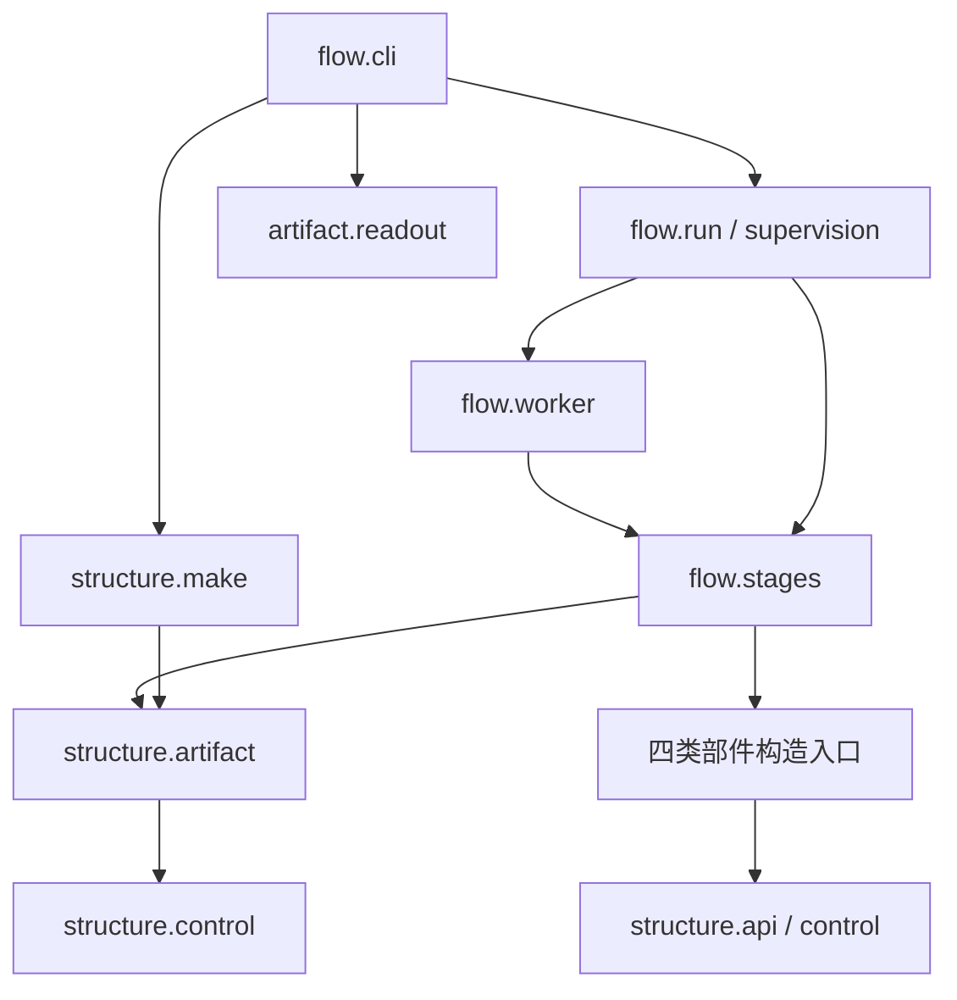

更新日期：2026年10月28日。本文依据[完整架构设计](<架构设计 Architecture Design 研究流水线.md>)定义目标目录、模块职责、接口和允许依赖，全部内容维护在本文件。它是后续实现的设计依据，不表示源码已完成重组；实现差距、调用影响、工作顺序与验收状态见[开发计划](<开发计划 Development Plan 研究流水线.md>)。

## 目录

1. [设计范围与约束程度](#一设计范围与约束程度)
2. [目标目录与入口](#二目标目录与入口)
3. [Structure 模块职责](#三structure-模块职责)
4. [Flow 模块职责](#四flow-模块职责)
5. [接口与数据合同](#五接口与数据合同)
6. [依赖与装配规则](#六依赖与装配规则)
7. [运行状态与持久化](#七运行状态与持久化)
8. [研究代码与模板使用](#八研究代码与模板使用)
9. [测试与验证落点](#九测试与验证落点)
10. [可调整项与科学合同边界](#十可调整项与科学合同边界)

# 一、设计范围与约束程度

RPipe 是供研究者复制、阅读并直接修改的 research pipeline 模板。源码组织首先服务“实验由什么构成、怎样执行、留下什么证据”，不承担长期公共 package 或统一研究接入平台的责任。

structure 对应 api、control、data、model、algorithm、system、artifact、make 八类职责；flow 对应执行生命周期、六阶段和研究协作。职责可以对应文件或目录，不按八个概念机械建立八套目录，也不要求每个阶段拥有一个包。

| **程度** | **对象** | **约束** |
| --- | --- | --- |
| 必须守住 | 两柱方向、有效条件不变、状态与资源归属、输入和结果保全 | structure 不依赖 flow；科学对象不发布正式 Run 终态 |
| 接口合同约束 | 部件输入输出、阶段交接、结果发布、恢复与统计口径 | 改变行为需同步设计和相应验证 |
| 可按职责调整 | 内部文件拆合、辅助函数、类与函数选择 | 不因目录对称或文件数量增加抽象、转发文件和空实现 |

保留原生与 HF 的实际计算职责，后端差异在算法内明确表达。最小示例只依赖其需要的部件；有可选依赖的模块按明确请求加载，不要求使用者理解全部后端和资源监管功能才可开始实验。

# 二、目标目录与入口

## （一）仓库层次

```text
RPipe/
  README.md
  AGENTS.md
  pyproject.toml
  src/rpipe/
    __init__.py                 版本与包标识
    __main__.py                 转入 flow.cli
    structure/
      api.py                    轻量部件接口合同
      control.py                配置、条件与纯校验
      make.py                   声明展开与计划发布
      data/
        factory.py              数据对象及实际构造
        profile.py              显式数据准备与统计
        resume.py               采样游标及生成器状态
      model/
        factory.py              模型对象及实际构造
        architectures.py        具体网络结构
        input_norm.py           输入归一化与增强实现
      algorithm/
        factory.py              算法选择、构造和循环协作点
        batch.py                批次解包与必要形状适配
        train.py                原生训练循环
        evaluation.py           独立评测
        evaluation_support.py   周期评测、best 和停止判断
        metrics.py              指标定义及归约
        tracker.py              数字累计、轨迹和统计状态
        optim.py                优化器与学习率调度
        progress.py             预算、进度单位及周期
        resume.py               恢复准入与状态应用
        transformers_trainer.py HF 实际计算
        hf_map.py               HF 参数语义映射
        kwargs.py               算法构造参数解析
      system/
        factory.py              System 与设备能力构造
        runtime.py              随机性、精度与确定性
        logger.py               文本日志
        resources.py            所属 OS 资源原语
        origin.py               明确来源与获取策略
        transfers.py            来源传输内部适配
        torchvision_load.py     按需科学库装载
      artifact/
        io.py                   布局、路径保护、锁与原子存取
        provenance.py           源码、输入与环境来源
        checkpoint.py           完整快照存取与发布
        readout.py              正式状态、日志与结果读取
        comparison.py           明确对象与条件的比较
    flow/
      cli.py                    命令解析与路由
      context.py                执行与阶段交接数据
      run.py                    单 Run 生命周期及收尾
      worker.py                 科学子进程协议与所属资源
      stages.py                 六阶段及实际组件装配
      study.py                  明确的研究协作与加载作用域
      supervision.py            批次依赖、派发和显式监管
      process.py                Run/Study 派生统计
      exports.py                图表、数字表与明确导出
  studies/
    _template/                  最小完整示例
    <研究实例>/                 声明与需要的研究实现
  tests/
    rpipe/                      按实际职责组织行为验证
    studies/                    研究实例的接入验证
    _data/                      最小静态合成输入
  docs/                         各成果各一份完整正文及日期记录
  .github/workflows/            工程检查与分支交付
```

树中列出有真实职责的实现落点。Python 包标识按包发现需要补充，入口只导出必要名字，不装载全部科学模块。内部辅助文件在承担独立复杂性时保留；同一职责保持一份实现，不以薄转发增加层数。

## （二）调用入口

模块命令 `python -m rpipe` 和控制台命令 `rpipe` 进入 `flow.cli.main`。程序化调用直接使用实际负责的模块，如 structure.make 的展开/发布、flow.run 的执行、artifact.readout 的读取；包根不再增加一层汇总业务门面。

`structure.api` 是部件交互合同，不是 CLI，也不负责汇总全部用例。它不导入具体构造器，不在导入时创建 Registry、模型或数据。四类部件的实际构造函数在各自 factory 模块，prepare 直接调用这些入口，并通过 api 合同交接对象。

# 三、Structure 模块职责

## （一）api、control 与 make

| **模块** | **职责与输出** | **边界** |
| --- | --- | --- |
| api.py | 定义 DataPort、ModelPort、AlgorithmPort、SystemPort 的最小交互合同及共享观测描述 | 仅标准库和纯数据类型；不导入部件实现或执行流程，不要求所有内部对象继承基类 |
| control.py | 解释四类配置、合并本次条件、校验纯字段和兼容声明，定义 Control/RunSpec/RunRef，计算配置身份 | 纯数据操作；不读文件、不建构科学对象，不持有执行权或进程状态 |
| make.py | 将 Study 的固定条件、因素轴和 seed 展开为 RunSpec 与明确依赖；另提供计划发布操作 | 展开不写盘，发布经 artifact 写配置和清单；不加载研究代码、不下载、不启动 |

control 区分 DataConfig、ModelConfig、AlgorithmConfig、SystemConfig 与实际运行对象。Study 声明、基底和因素补丁的优先级明确，序列化保留最终有效值。算法参数进入算法配置，不把第三方训练器键变成全局必填条件。

make 内的展开函数与发布函数分开：纯展开便于审阅实验设计，显式发布负责保护已存在配置和研究清单。来源摘要由调用方通过 provenance 取得，再交给展开/发布，不在配置身份计算中隐式扫描文件。

## （二）data 与 model

| **模块** | **实际工作** | **拥有的状态及边界** |
| --- | --- | --- |
| data/factory.py | 按名称、来源和有效条件建构数据，提供划分、批次和元信息 | Data 拥有 loaders、迭代器及关闭；未知来源不回退占位输入 |
| data/profile.py | 显式准备指定数据并统计规模、形状和数值范围 | 准备与统计使用明确外部位置，不在计划或导入时执行 |
| data/resume.py | 提供采样器、游标和生成器状态的捕获/恢复 | 仅对有支持合同的数据实现恢复，不重放已消费随机变换来假装定位 |
| model/factory.py | 由模型条件和必要 data_meta 构造模型、加载初始权重 | Model 持有计算对象；不保存整个 Data，也不选择优化器 |
| model/architectures.py | 网络结构、前向与参数初始化 | 不读 Study、不推进阶段、不发布结果 |
| model/input_norm.py | 按声明实现归一化及训练态增强 | 数据语义归 data，具体变换可在模型入口执行；同一变换只有一个执行位置 |

模型构造通过 data_meta 获得输入形状、目标空间等必要信息。显式模型条件与推导值的优先级须可解释；不兼容时拒绝，不能静默改形状。归一化或增强的实际位置、随机性与顺序属于科学行为，模块整理不自动改变这些条件。

## （三）algorithm

| **模块** | **实际工作** | **边界** |
| --- | --- | --- |
| factory.py | 选择计算模式及实现，构造 Algorithm；定义实际使用的循环协作点 | 不承载整轮 Study 派发，不强制每个来源使用同一训练循环 |
| train.py | 原生更新、梯度累积、评测、保存及停止时序 | 拥有 optimizer/scheduler 和更新顺序，不发布正式 Run result |
| evaluation.py | 对明确模型或 checkpoint 进行独立评测 | 不建训练优化器，不猜测训练来源 |
| evaluation_support.py | 训练内周期评测、best 方向与 early-stop 判断 | 与独立 eval 区分；使用完整指标口径 |
| batch.py | 批次字段、输入/目标与必要形状适配 | 设备操作使用传入 System，不自行改变预算或计算任务 |
| metrics.py | 批次及整段指标、单位、加权与归约 | 不依赖流程状态，不将缺失指标补为零 |
| tracker.py | weighted_sum/n、统计窗口、真实进度和有效轨迹 | 数字记录与文本 Logger 分开；提供可恢复状态及摘要 |
| optim.py | 优化器、scheduler 构造、裁剪与学习率观察 | 构造能力不代替训练循环决定更新时点 |
| progress.py | batch/step/epoch、预算、周期和保存节点 | 不处理 OS 超时和 I/O，不把 batch 当 optimizer step |
| resume.py | 核支持范围和条件，将明确快照状态应用到计算对象 | 不扫描其它 Run，不通过可读文件推断完整恢复 |
| transformers_trainer.py | HF 的实际训练/评测及后端观测 | 明确自身预算、回调与恢复条件，不假装与原生逐步等价 |
| hf_map.py | 算法条件到 HF 参数的明确映射 | 不能静默丢弃有效条件或接受语义不同的默认值 |
| kwargs.py | 仅解析实际构造点的算法参数 | 未采用参数说明或拒绝，不扩展为全局工具包 |

AlgorithmHook 是算法循环中明确的评测、checkpoint、停止等协作点，与 Flow 六阶段分开。无实际需求的 hook 不添加空实现。共用纯计算或状态投影放在真正负责它的模块，不预设独立的“大而全训练状态层”。

## （四）system

| **模块** | **实际工作** | **边界** |
| --- | --- | --- |
| factory.py | 创建 System、设备放置与实际精度上下文 | 不建优化器、不选择 best，也不负责完整快照文件协议 |
| runtime.py | 先应用 seed、确定性和精度设置，捕获/恢复受支持 RNG | 在数据和模型建构前执行；完整数值确定性仍需实测 |
| logger.py | 有身份、阶段和时机的文本输出与文件刷新 | 不代替 Tracker、终态或研究判断；输出失败可观察 |
| resources.py | 本次 OS 句柄、进程、资源测量与释放原语 | flow 决定何时启动/停止，原语不私自派发实验 |
| origin.py | 显式来源、端点与获取条件 | 计算来源可读元信息，不隐藏下载或改变全局环境 |
| transfers.py | 实际 SDK/HTTP 流的内部协作 | 关闭所属流，不成为全局网络框架 |
| torchvision_load.py | 科学库的按需装载与可定位导入错误 | 只在明确科学用例中调用，不吞任意异常 |

取消请求由 flow 拥有，算法通过注入的只读检查器协作停止，不从 structure 反向导入流程。System 和 Data 等有实际资源的对象提供关闭能力；没有资源的计算对象不为对称性增加无操作 close。

## （五）artifact

| **模块** | **实际工作** | **边界** |
| --- | --- | --- |
| io.py | 布局、路径保护、配置/清单/结果存取、RunRecord/ExecutionRecord 的纯结构约束、原子发布和排他锁原语 | 只处理明确路径和内容，不决定成功状态或阶段顺序 |
| provenance.py | 源码与静态输入摘要、计划来源及实际环境观察 | 不选择科学后端，不以接受新清单给已有结果换身份 |
| checkpoint.py | 完整快照、诊断内容和发布完成点，保护此前有效副本 | 接受算法组装的状态，不选择保存时机或恢复对象；Tensor 编解码按明确请求加载 |
| readout.py | 正式状态、日志、摘要与轨迹读取，输出缺失和不确定事实 | 不执行阶段、不取得执行权、不加载部件构造器或补写结果 |
| comparison.py | 比较明确指标、轨迹和受信 checkpoint | 显式容差、单位和缺项，按需加载数值库，不修改输入 |

provenance 和 checkpoint 可使用 io，io 不反向导入它们。readout 使用已保存的身份与记录，不依赖 run、worker 或科学对象。comparison 对受信状态作数值比较，不通过反序列化加载任意研究类路径。

# 四、Flow 模块职责

| **模块** | **职责** | **拥有的状态与边界** |
| --- | --- | --- |
| cli.py | 参数解析、显式用例路由、状态呈现与退出 | 不复制展开、科学计算或结果发布代码 |
| context.py | RunContext、ScienceContext、StudyProcessContext、请求/响应和内存 RunReport 描述 | 仅交接数据与状态；不拥有持久化记录格式，不导入 Torch、构造器或启动进程 |
| run.py | 单 Run 准入、执行权、取消、配置不变性、首错、收尾与正式终态 | 持有本次执行权，决定何时允许 write；不实现训练 |
| worker.py | 所属科学子进程、请求响应核验、等待和回收 | 不自行发布正式 result，不另判科学成功 |
| stages.py | 六阶段函数与实际组件装配、阶段交接和检查时点 | prepare 直接调用四类构造入口；write 只有一份正式发布实现 |
| study.py | 明确选择的研究准备、计算和阶段协作，隔离加载作用域 | 无研究差异时不加载扩展，不依目录存在自动执行工具 |
| supervision.py | 明确 Run 集合、依赖、批次派发、重试及可选资源监管 | 调同一 run；不绕过 Run 生命周期，采样不冒充硬配额 |
| process.py | 单 Run 派生与按清单的 Experiment/Study 统计 | 只消费正式结果和证据，不覆盖科学 result |
| exports.py | 学习曲线、数字表与明确选择的 TensorBoard 等导出 | 管理自己的目标文件与图句柄，不写人工研究结论 |

六阶段先在 stages.py 中以六个有实际职责的函数表达，不建立六套包和转发入口。复杂的统计、导出和进程协议各有真实实现文件；职责进一步增长时再按变化原因拆分。

原生/HF 的来源选择归 algorithm.factory，组件装配归 prepare。后端若仅检查来源再调用相同装配，不另设一套运行类。训练差异落在算法，不能复制生命周期和结果发布协议。

# 五、接口与数据合同

以下名字与调用关系是目标接口，参数类型表达必要内容，不是保证现有调用可以直接使用的声明。接口失败保留可定位原因；配置无效、未知来源、忙碌、缺失输入、来源不匹配、科学失败和收尾失败分别表达。

## （一）声明与计划

| **负责模块与操作** | **输入** | **输出与副作用** |
| --- | --- | --- |
| control.resolve_control | 已解析基底、本次因素和 seed | Control：四类有效条件及来源解释；纯操作 |
| control.validate_control | Control 与必要兼容声明 | 合法条件或明确错误；不建对象 |
| make.expand | 已解析 Study/基底、明确来源身份、外部运行根和 version | RunSpec 有序集合、Experiment 分组及显式依赖；不写盘 |
| make.publish | 同一研究及输出域的合法规格和来源记录 | 配置、index 和来源清单；显式受保护写入，不执行 |

RunSpec 包含配置身份、因素归属、seed、来源引用、输出位置和明确训练依赖；不携带模型或进程句柄。相同身份不能在同一清单重复，依赖必须存在且无环。control 定义的 RunRef 只是正式记录的身份与位置，不隐式取得写入许可。持久化 RunRecord/ExecutionRecord 的字段结构由 artifact.io 维护，readout 与写端共用，不从 flow.context 导入；flow.context 只定义请求、响应、内存报告和上下文，不能成为读端的反向依赖。

## （二）部件交接

| **构造或消费接口** | **输入 → 输出** | **必要操作与状态** |
| --- | --- | --- |
| data.factory.build_data | DataConfig、明确位置和 seed → DataPort | meta、按 split 迭代、支持范围内的数据状态、所属资源关闭 |
| model.factory.build_model | ModelConfig、必要 data_meta 和 SystemPort → ModelPort | 前向、训练/评测模式、参数与模型状态；不持有整个 Data |
| algorithm.factory.build_algorithm | AlgorithmConfig → AlgorithmPort | 执行支持的 mode，消费注入对象，返回实际观测 |
| system.factory.build_system | SystemConfig、明确位置与初始化条件 → SystemPort | 设备/精度、放置、Logger 和所属资源能力 |
| AlgorithmPort.compute | DataPort、ModelPort、SystemPort、Tracker、取消检查器 → ComputationObservation | 算法拥有更新状态和时序，观测包含真实指标来源、进度与证据位置 |

Port 只描述跨部件真正使用的能力，可以用轻量 Protocol 表达，具体对象不必继承。支持恢复的数据实现明确提供 snapshot/restore；不支持者返回明确能力观察，不实现空恢复来假装成功。Tracker 是算法对象，Logger 是系统对象，不要求通过通用服务容器取得。

## （三）阶段交接与唯一发布

| **阶段函数** | **输入 → 输出** | **执行位置和权限** |
| --- | --- | --- |
| stages.prepare | ScienceContext → 四类对象、Tracker/Logger 和资源登记 | 科学进程；有效条件只读，无成功定稿 |
| stages.execute | 已装配 ScienceContext → 实际计算观测 | 科学进程；写所属 asset，不跨 Run 汇总 |
| stages.collect | 观测与 Tracker → Collected | 科学进程；有口径的单次指标，不补跑 |
| stages.summarize | Collected、条件与元信息 → ResultDraft | 科学进程；只交出可序列化草稿 |
| stages.write | 持权 RunContext、ResultDraft 或失败事实、收尾观察 → 本次执行记录及可发布的科学结果 | 执行权所有者；只经此操作正式发布，不把请求拒绝写成目标 Run 失败 |
| stages.process | 正式 RunRecord 或明确研究清单、scope、目标 → DerivedRecord | 正式发布后；调用 process 模块，派生失败单独报告 |

write 前的研究证据和数值门在科学进程结束前完成，worker 随响应交回结果草稿与证据位置；成功发布须等科学资源关闭、所属进程退出及响应核验满足要求。取得执行权前的 busy、来源不匹配等拒绝只返回请求报告，不修改目标记录。取得执行权后，run 收集阶段或清理错误，经同一 write 保存本次启动的执行事实；未确认资源释放时保留执行权和 unknown 事实，不发布成功或覆盖此前有效科学结果，不留第二个直接写 result 的分支。

初始响应、终态响应及清理观察与 Run 身份和请求标识绑定。超时、丢响应或未确认释放不能按退出码或文件存在补成成功。执行权覆盖准入、执行、检查、发布与必要收尾；process 不再使用已经关闭的科学对象。

## （四）执行、派发与观察

| **负责模块与操作** | **输入 → 输出** | **边界** |
| --- | --- | --- |
| run.run | RunSpec、显式 Budget、Cancellation → RunReport | 启动前经 provenance 核来源；唯一单次执行旅程，分别报告执行、科学判据和证据完整度 |
| supervision.launch | 有序规格及依赖、批次条件、取消 → BatchReport | 复用 run；普通派发不要求启用资源监管 |
| supervision.supervise | 规格、明确资源停止线和独立证据根 → 监管报告 | 只监管所属进程；未知释放状态停止后续派发 |
| artifact.readout.read_run/read_study | RunRef 或明确清单 → 正式状态与记录 | 只读，不运行、不修写 |
| artifact.comparison.compare | 明确对象、比较条件和容差 → DifferenceReport | 缺项不算通过，不猜测历史格式 |
| process.process_run/process_study | 正式结果、证据和明确范围 → 派生摘要 | 单次与整轮作用域分开；独立 Study 汇总在写派生物前经 provenance 核来源 |
| exports.export | 明确派生材料、格式和外部目标 → 文件路径及导出观察 | 导出不改变科学状态或原始输入 |

# 六、依赖与装配规则

## （一）允许方向

| **调用方** | **允许依赖** | **禁止承担的职责** |
| --- | --- | --- |
| structure.api/control | 标准库；api 可用 control 的纯描述 | 具体 factory、artifact I/O、flow、科学库装载 |
| structure.make | control、artifact 的明确存取/来源接口 | 科学对象、阶段和进程 |
| 各科学部件 | 自身实现、api/control、实际第三方计算库、必要 artifact 存取，以及明确无环的 system.origin/runtime 底层能力 | flow、CLI、直接调用其它部件 factory |
| artifact.io | 标准库和 control 中必要身份描述 | provenance/checkpoint/readout 的反向调用、阶段或科学建构 |
| artifact 其它模块 | io、control、必要纯元信息；明确比较/编解码时按需数值库 | 部件构造器、run/worker 或研究目录发现 |
| flow.context | 标准库、control/api 的轻量描述，以及 artifact.io 的纯记录结构 | 实际 I/O、具体科学对象构造、阶段或进程启动 |
| flow.run/worker/stages | context、明确同柱职责、structure | 从底层回调另建生命周期或绕过 write |
| flow.process/exports | 明确结果、artifact 读取及必要统计/绘图库 | 创建训练对象、继续执行训练或覆盖正式结果 |

算法按注入对象的 DataPort/ModelPort/SystemPort 调用能力，不导入 data/model/system.factory。api 不汇总实现，因此不会形成 api → algorithm → api 的循环；延迟导入只控制成本，不能用来隐藏禁止的依赖。

数据和模型可以使用 system.origin 的明确获取能力，算法可以使用 runtime 的必要底层能力；这些底层模块不反向导入 data/model/algorithm 或其 factory。System 对象的设备、精度和资源能力仍通过注入对象交接，不把底层复用扩大为任意跨层调用。

runtime 的 seed/精度能力在 system 创建前应用；构造 System 后创建 Logger，再进行构造前研究准备及 data/model/algorithm 建构。阶段实现可以调用具体构造函数，这是装配职责，不要求再包一层转发 api。



图表示源码依赖方向。运行时对象交接、受约束回调或类型注解不改变规则；研究扩展也不能通过动态导入绕回第二套执行器。

## （二）导入与资源成本

包标识、配置解释、计划展开、状态读取不装载 Torch/HF 或扫描研究源码来执行配方。科学库在明确构造、执行、checkpoint 编解码或比较请求中加载。matplotlib/TensorBoard 只在对应导出中加载。

flow.study 只加载被明确选中的研究文件，临时注册和模块状态归本次作用域，结束恢复自有修改；不清理其它任务的全局模块。注册表若存在，服务实际的来源选择，不做插件发现框架。

# 七、运行状态与持久化

## （一）上下文与所有者

| **数据或状态** | **所有者** | **可交接内容** |
| --- | --- | --- |
| Control/RunSpec | control/make 确定；运行只读 | 明确条件、身份、依赖与位置 |
| RunContext | run | 执行权、请求、预算、取消、首错与收尾观察；不把所有权句柄传给科学进程 |
| ScienceContext | worker 中的阶段旅程 | 本次对象、Tracker/Logger、候选观测和待关闭资源 |
| StudyProcessContext | process_study | 当前清单、正式结果、聚合观察与派生目标，不含单 Run 模型 |
| ResultDraft/worker 响应 | summarize/worker | 可序列化摘要、证据位置、实际环境与清理观察 |
| RunRecord | stages.write 发布 | 分开保存本次启动的执行事实与科学 result；以配置、来源及启动身份关联，读端据此投影 |

运行对象按创建顺序登记、按依赖次序关闭；Tracker/Logger 在失去对象前保存已有观测。单个关闭失败仍尝试其它关闭，记录原始科学错误与清理错误。活句柄不进入正式 result，进程响应不携带可执行研究类。

## （二）输出域与发布

Study 源码目录保存声明和研究实现，运行物保存在调用方显式外部根；输入、源码和输出按解析后的真实路径保护，不能互相覆盖。Study 输出域包含清单/来源、共享输入引用、各 Run 的 config/result/assets 和派生摘要。Experiment 由清单分组表达，不要求为每个比较条件建立代码或磁盘目录。

io 提供排他与原子存取原语，run 持有执行权，write 解释是否可发布。失败重试和新实测区分身份与结果新鲜度；派生物关联其实际读取的结果，不靠时间戳猜测当前性。没有记录、记录不完整和明确失败分别呈现。

执行事实与科学结果各有保存位置和身份关联。新的启动尚未确定结果时保全此前科学结果，并明确它属于此前启动，不能将其显示成当前启动成功；unknown、取消和清理错误首先属于执行事实，不能通过改写科学数值抹掉差异。未确认释放时不得自动释放执行权、启动新的执行者或发布/覆盖科学结果；当前执行权所有者仍可追加本次 unknown 和清理事实。后续处置先核明所属资源及执行权，不由读端自动修复。

run 在派发科学进程前、独立 process_study 在读取并写出新汇总前，调用 provenance 的只读来源核验，检查所需源码、输入和计划身份。失配时不启动或不写派生物，保留已有结果和汇总，不自动接受新清单；持权前拒绝仍遵守只返回请求报告的边界。

## （三）Checkpoint、恢复与统计

算法组装模型、优化器、scheduler、进度和停止状态；Data 提供采样位置，runtime 提供 RNG，Tracker 提供加权累计与有效轨迹。artifact.checkpoint 发布单一明确的完整快照及必要诊断信息，提交失败保留此前有效副本，未完成片段不当作完整快照。

恢复由 resume 明确选择目标及支持范围，按依赖顺序重建对象后应用状态。权重加载、训练状态恢复、数据/RNG 连续和完整观测恢复分别报告；不支持的后端、预取或私有状态不能用空操作标为完整恢复。

process 采用真实 step/epoch 坐标、明确清单和逐点样本量，缺项不插值。统计口径和研究门限不由文件拆合决定；实现按已明确合同报告单位、标准差定义和缺口，不从同 seed 或相同配置推断数值等价。

# 八、研究代码与模板使用

最小示例含研究声明、基底配置与可复跑说明；只有实际差异才增加研究代码。研究者可以直接修改模板的 data/model/algorithm/system 和 flow，也可显式调用已有领域包，二者都不要求维持长期插件合同。

需要独立研究实现时，其 structure 负责专用建构与计算，flow 只承接准备、检查、观测及研究判据；结构按实际需求建立，不复制一套核心执行权、进程协议或正式结果发布。

构造前准备、构造后检查、计算、collect/summarize 收口、write 前证据和 process 终验各有明确时机。单 Run 与 Study 终验使用不同作用域，不把整轮成功判定分发到每个 Run。显式下载、来源导出和资源测量以手动入口执行，不因导入代码启动。

核心不静态导入具体 Study，研究代码仅在明确选择的作用域加载。科学参数、静态参考输入、来源元数据和许可证留在合适源码位置；大运行物、原始输出和临时核验材料不进入 Git。

# 九、测试与验证落点

tests/rpipe 按实际实现职责组织测试，tests/studies 验研究实例的装配与判据；不为目标树中的每个叶文件生成占位测试。每个测试进程使用独立临时目录，合成输入可重建，不拿真实 Study 或已有 Run 作为清理 fixture。

| **范围** | **有意义的验证** |
| --- | --- |
| control/make | 配置优先级、因素×seed、重复身份/依赖、展开无写入、发布保全 |
| api 与部件构造 | 轻量合同不加载科学实现；未知来源明确失败；data_meta 与配置不混入活对象 |
| 科学计算与状态 | 实际更新次数、指标归约、后端映射、checkpoint 一致性及支持范围内的恢复 |
| artifact | 路径保护、锁、原子发布、失败保全、只读状态与受信比较 |
| run/worker/stages | 唯一 write、配置不变、请求核验、阶段失败、清理失败、取消和不确定释放 |
| process/exports | scope、按清单聚合、真实坐标/样本量、缺失与派生失败不覆盖科学结果 |
| 示例与命令 | 从声明到结果再到分析的最小旅程、退出状态与无导入副作用 |
| 依赖与交付 | 禁止反向/循环导入、可选依赖隔离、源码树外安装与命令 smoke |

静态检查、合成 CPU、安装、CI、GPU、真实研究和性能分别提供证据。工程通过不替代研究判据，既有失败反例保留并在相应新合同上回归。

# 十、可调整项与科学合同边界

目录和模块拆合服从上面的职责与依赖，不能机械保留工厂、注册器或转发门面。api 选择轻量合同、stages 合并六阶段、checkpoint 独立存取、process 区分两种作用域，分别解决真实的依赖、发布和状态问题，不另建通用框架。

标准差定义、跨后端逐步等价范围、归一化/增强位置与次序、恢复支持条件和研究资源预算需由科学合同及实测确认。源码结构设计不单方面改变这些口径，也不因目标中存在文件或操作就宣称能力已验证。

目标落地工作、活动问题及确认事项统一维护在开发计划；历史来源、实现取证和实际验证分别进入开发/运行记录。此文不列迁移步骤或历史接口清单，不通过增加第二份结构正文表达不同方案。
