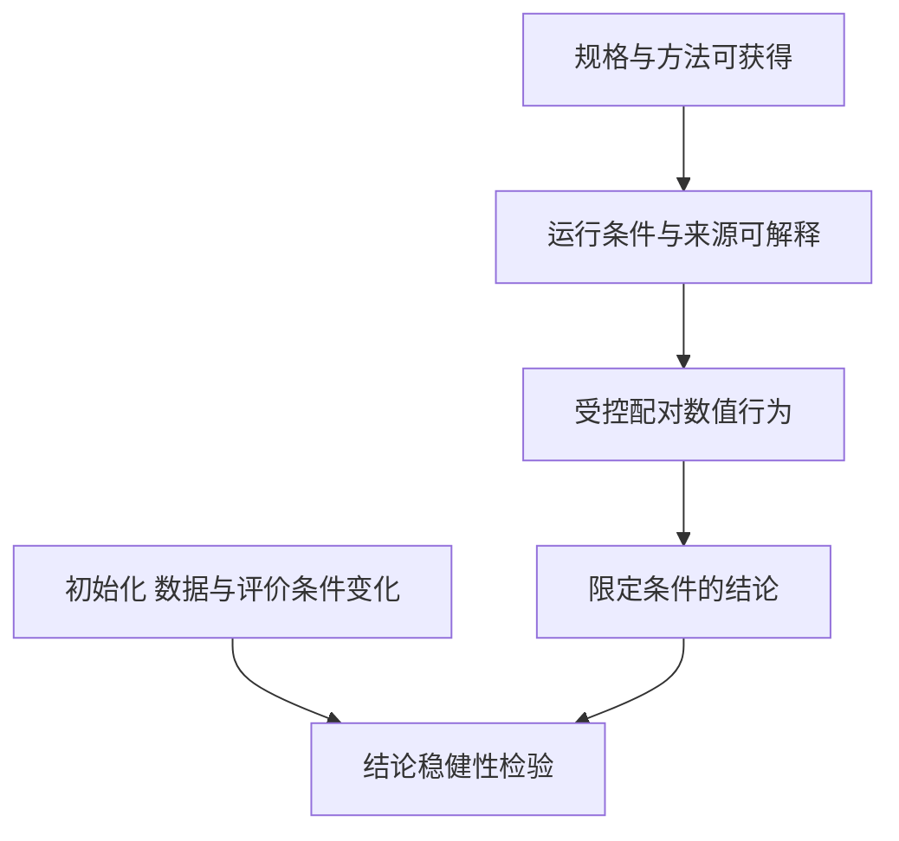

状态衔接更新：2026年10月31日；文献检索与阅读截止：2026年10月27日。范围：研究执行中规格、运行、来源与科学结论的关系。本报告按问题比较重新阅读的原始材料，不保存项目旧验收或检索执行日志；查询、访问失败、实际阅读范围和筛选过程见 [运行记录](<运行记录 Run Record/2026-10-27 文档核验.md>)。

# 一、摘要与研究判断

本课题需要分别回答三个层次：材料和运行能否被识别、失败后事实是否仍可解释、在受控条件下科学行为是否保持。已有研究覆盖复现组织、失效因素、工作流重用、来源交换与随机变异，不能将其中任一层等同于其他层。

本轮判断是继续研究RPipe在明确范围下的合同保持与数值配对，不提出“通用工作流更可靠”或“模型排名更优”的贡献。软件检查项是工程验收，数值轨迹保持是有限等价性问题，跨条件的科学结论需要独立设计。本报告的文献判断只来自下述材料及针对性源码分析；尚无外部平台对照。本仓后续固定环境的有限E3证据见[运行记录](<运行记录 Run Record/2026-10-30 main_probe CUDA配对验证.md>)，039c941固定配方/四seed的完整E4参考相近性门见[新电脑记录](<运行记录 Run Record/2026-10-30 新电脑main_exp完整矩阵执行.md>)，均不扩展文献判断或模型优越性主张。新工程修复不继承旧E4身份，后续验证从开发计划和日期记录核对，不改签为论文结果。

# 二、研究对象与共同分析轴

按材料与运行来源、方法/数值重现、结论稳健性三条轴比较。当前科学载荷是固定图像分类协议，不是自主研究代理。外部AI工作流综述用于界定边界，不据此扩成动态调度或自动选题项目。

图为本报告的分析示意，箭头表示下一层判断需要的信息，不是“前层通过必然推出后层”。例如同seed数值相同，只能支持该配对条件，不能替代不同数据/初始化下的结论检验。

# 三、复现组织与失效解释

## （一）报告材料和独立验证

Pineau等《Improving Reproducibility in Machine Learning Research》，JMLR22(164)，2021，采用代码提交、复现挑战和检查项组织复现。§3、§5及§6指出材料、评审和组织环节，并未给出这些措施对论文质量的确定因果结论。因此本项目应分开报告清单完成与实际验证，不将“文档齐全”设成质量代理。[Pineau等原文](https://jmlr.org/papers/volume22/20-303/20-303.pdf)

这是社区过程研究，不是训练算法、故障恢复或运行平台对照。本文未将其参与人数、代码提交比例或评分关联转成本项目收益，也未复现其调查。阅读深度为针对性正文，见运行记录。

## （二）研究设计到结论的因素

Gundersen等《Sources of Irreproducibility in Machine Learning: A Review》，arXiv:2204.07610v2，2023-04-14，按设计、算法、实现、观察、评价和文档讨论失效因素。§11明确不是结构化系统综述，没有新实验，也没有量化各因素影响。该框架帮助安排条件与替代解释，不能证明本项目合同或给出统一因素权重。[Gundersen等v2](https://arxiv.org/html/2204.07610v2)

对RPipe的启示是将原始输入、科学状态、执行和解释分别登记，失败既可能来自适配也可能来自比较条件。论文的分类不是新的软件分层要求。

# 四、工作流、运行来源与可重用性

## （一）文件依赖和过程可理解性

Mölder等《Sustainable data analysis with Snakemake》，F1000Research10:33，本文使用2021年v2（DOI尾号.2）。§2.1、§2.3、§2.4以规则依赖、环境和报告关联输入/输出、代码及参数，强调透明与可修改性。该文的演示和调度评价并非针对RPipe的相同故障协议，不能据此排序可靠性或速度。[Snakemake v2机构归档正文](https://duepublico2.uni-due.de/servlets/MCRFileNodeServlet/duepublico_derivate_00074511/Moelder_et_al_2021_Sustainable_data_analysis_v2.pdf)

它为文件型工作流提供直接比较路线。论文v2与本调研所用9.27.1文档分开使用，v2中的未来功能不能当当前未实现，也不能由当前功能回写旧论文结果。

## （二）流程规格与实际运行是不同对象

Wilkinson等《Applying the FAIR Principles to computational workflows》，Scientific Data12:328，2025-02-24，Table1及规格/运行示例区分可复用流程、组件、版本与运行来源。它是建议性框架及示例，不是效果试验。对本课题的作用是明确声明、运行和输入关系，不能从FAIR元数据完整推出数值正确或独立复现成功。[FAIR工作流原文](https://www.nature.com/articles/s41597-025-04451-9)

来源的交换粒度可以独立于执行平台，但本项目是否需要标准导出应由跨系统消费者决定，不为采用术语新增服务或schema。

## （三）运行与恢复的工作流尺度

Alnasir《AI-Driven Scientific Computing Workflows》，arXiv:2609.21162v1，2026-09-18，为预印本系统综述。§7.3、§8和§10–11讨论模型/运行状态、决策来源与端到端评价，声明未提出或执行新benchmark。该文用于提醒恢复检查须覆盖关联状态，不能只看模型权重，也不构成当前RPipe性能证据。[Alnasir v1](https://arxiv.org/html/2609.21162v1)

当前RPipe是预先声明的研究流程，不涉及该文完整的自适应AI控制。动态决策、跨站数据和自驱实验只作为排除范围，不进入本轮实现或必需实验。

# 五、数值相同与结论稳健性的区别

Bouthillier、Laurent和Vincent《Unreproducible Research is Reproducible》，ICML/PMLR97:725–734，2019，§3–6用图像分类分析方法/结果/结论层次。实验涉及多模型、多数据集、seed重复及有/无公平调参情景，比较Accuracy分布与排名；其图像分类和调参限制不能外推所有任务。本项目采用的是“固定seed重现不足以支持一般排名”的方法启示，不复制其训练预算。[Bouthillier等原文](https://proceedings.mlr.press/v97/bouthillier19a/bouthillier19a.pdf)

RPipe已有E3/E4是流程行为保持与固定参考协议，不是四种模型公平竞争的完整研究：配方未必逐模型公平优化，test被用于best选择，复核自身best也不是新的独立测试集。模型顺序只能解释为该协议现象，不能宣称总体模型优势或无偏泛化估计。

受控配对可记为 $\Delta_{k,s,t}=m^{new}_{k,s,t}-m^{ref}_{k,s,t}$，$k$为数据/模型条件，$s$为seed，$t$为真实更新坐标，$m$为固定口径指标。本表达是本项目比较定义，不是引文中的新理论。数值门约束这些差值，不估计跨任务的普遍提升。

# 六、证据比较与研究计划的调整

| **问题** | **已有文献支持的判断** | **本项目仍须取得的证据** |
| --- | --- | --- |
| 材料完整是否代表成功 | 报告、来源与实际验证是不同层次 | 读取、发布、缺项、取消和清理的真实合同反例，工程验收不冒充研究创新 |
| 同seed是否代表科学结论稳健 | 固定随机条件收窄结论适用范围 | E3按逐格配对检查状态与轨迹，E4保留四seed并明确其统计局限，不给跨条件显著性结论 |
| 外部工具是否更差 | 所读论文没有提供与RPipe同语义故障对照 | 先界定共同任务、终态、重试与质量，再另行确认外部对照协议；当前无优越性结论 |
| 来源模型是否足够 | 规格、输入、运行和组件版本需要关联 | pin缺口、环境、精度、checkpoint状态与实际观察必须分别核验 |

研究计划据此采用分层证据和受控配对，保留固定协议，增加test选择偏差、seed范围、未控制因素与负结果判读。未充分核实的外部来源和访问失败不用于结论。检索不是穷尽系统综述，原始论文实验及任何外部实现均未在本地复现。
