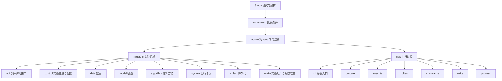
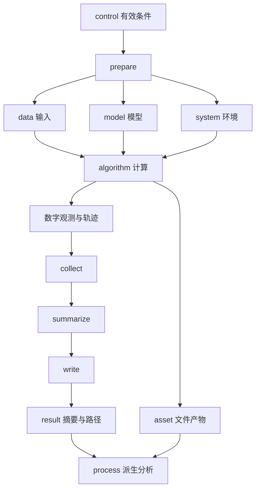

更新日期：2026年10月29日。本文维护当前选定的实验组成、两柱职责、接口语义、执行过程与产物合同，全部内容保留在本文件。具体源码落位由代码结构设计承接，实现状态、差距和验收见[开发计划](<开发计划 Development Plan 研究流水线.md>)；早期版本的复原与演进依据见[开发记录](<开发记录 Development Record/2026-10-28 研发约定核对与代码重构.md>)。

## 目录

本文包含架构的完整正文，通过章节组织，不另设分册。源码落位由独立的代码结构设计承接。

1. [定位与整体组成](#一定位与整体组成)
2. [Study、Experiment 与 Run](#二studyexperiment-与-run)
3. [Structure：实验由什么组成](#三structure实验由什么组成)
4. [Flow：实验怎样运行](#四flow实验怎样运行)
5. [一次完整研究的协作过程](#五一次完整研究的协作过程)
6. [依赖、状态与必要约束](#六依赖状态与必要约束)
7. [观测恢复与产物](#七观测恢复与产物)

# 一、定位与整体组成

RPipe 是 research pipeline 的参考模板，提供构造研究实验的 warm-up / starting point。研究者复制或 fork 仓库后，可以直接修改其中的数据、模型、算法、运行环境和流程，形成自己的研究项目。模板需要把实验怎样构成、怎样执行、怎样留下可复核结果讲清楚；衍生项目的后续结构与接口由它自己维护。

实验组织以 Study → Experiment → Run 为主干。代码语义以 structure 与 flow 两柱组织：structure 说明实验由哪些部件构成，flow 说明这些部件怎样按阶段工作。artifact 是 structure 内的持久化职责，也是运行时配置、结果与文件产物的组织方式。

图中 Run 与两柱的连线表示一次运行使用它们，不要求每个 Run 都复制一套实现。make 和 artifact 同时服务整个 Study，不只服务单个 Run。图中名称是架构部件及阶段语义，不强制一项对应一个目录、文件或类。

# 二、Study、Experiment 与 Run

| **对象** | **含义** | **持有或产出的内容** |
| --- | --- | --- |
| Study | 围绕研究问题组织一轮可比较实验 | 固定条件、因素轴、seeds、执行清单、共享输入、汇总与报告 |
| Experiment | 一组比较条件，即因素轴中的一个取值组合，不含 seed | 该条件下各次 Run 的分组，以及跨 seed 的统计摘要 |
| Run | 一个 Experiment 在一个 seed 下的具体运行 | 有效配置、运行观测、结果摘要与文件型产物 |

例如，Study 比较训练样本量；train_size=500 是一个 Experiment；train_size=500、seed=0 对应一个 Run。同一实现可以服务多个 Experiment 和 Run，不为每个因素取值复制代码。

Experiment 不要求独立磁盘目录，通过清单中的因素分组及其 Run 表达。单次 metrics 属于 Run；跨 seed 的 mean/std/min/max 属于 Experiment；整轮图表、计划和报告属于 Study。

Run 的配置身份用于关联条件与产物。配置相同但要保留不同实测时，用明确的研究 version 区分；研究 version 不等于包版本。身份生成及具体字段由代码结构设计中的声明、计划和保存记录合同承接。

# 三、Structure：实验由什么组成

## （一）组成与协作

structure 包含 api、control、data、model、algorithm、system、artifact 与 make。四类计算部件表达能力，control 表达本次取值，make 将研究声明展开为多次运行，artifact 保存声明与运行产生的内容，api 提供清楚的部件访问边界。

| **部件** | **主要输入** | **主要输出** | **职责边界** |
| --- | --- | --- | --- |
| api | 部件能力与交互要求 | 访问合同及观测描述 | 描述能力边界，不建构部件，不另写计算或执行流程 |
| control | 基底配置与本次因素、seed 等取值 | 一次 Run 的有效条件 | 描述和校验条件，不创建模型、不训练 |
| data | 数据声明、来源与运行条件 | 数据迭代接口及元信息 | 组织输入，不决定模型更新 |
| model | 模型声明、数据接口信息与权重来源 | 可调用模型及模型元信息 | 构建模型，不调度整轮研究 |
| algorithm | 数据、模型、运行环境与算法条件 | 计算观测、指标和计算状态 | 决定怎么算，不另建一套 Study 编排 |
| system | 设备、精度、随机性、路径与运行设置 | 环境、资源句柄及系统观测 | 支持计算在硬件上执行，不定义研究结论 |
| artifact | 明确内容、位置与存取请求 | 配置、结果、文件及清单 | 管理持久化，不推动阶段或选择算法 |
| make | Study 声明、基底配置、因素轴与 seeds | 各 Run 配置、分组清单与执行准备 | 展开多次运行，不执行科学循环 |

## （二）api：部件访问边界

api 描述数据、模型、算法和系统之间的交互能力及观测合同。flow 按合同调用各部件的建构入口并装配对象，第三方实现的建构细节留在对应部件内部；algorithm 消费已注入的 data、model、system。api 不成为汇总所有构造器的门面。

这里的接口指模板内部的职责边界，不构成衍生项目必须长期兼容的公共 package API。具体函数、类、注册方式与文件组织由代码结构设计承接，不恢复历史调用签名或转发门面。

## （三）control：实验变量与配置

control 表达本次运行对 data/model/algorithm/system 的取值指派，包括研究因素、seed 及实际采用的条件。基底配置可以被本次因素覆盖，合并结果形成该 Run 的有效配置。

配置是可序列化声明，运行对象是 prepare 创建的实例，两者分开。control 可以检查字段与部件间的兼容条件，但不能仅凭配置合法就证明数据可达、设备可用或科学结果有效。

## （四）data：输入如何组织

data 管理数据来源及版本、样本字段、训练/验证/测试划分、采样、批次、预处理与增强，向 algorithm 提供可消费的数据迭代接口和元信息。需要下载或缓存时，文件由 artifact 指定位置承载。

数据声明可以包含数据名称、source、划分、batch size、预处理和加载设置。数据部件不负责选择优化器、训练终止条件或跨 Run 比较。占位输入只能说明流程行为，不能替代真实研究输入。

## （五）model：计算对象如何构造

model 管理网络结构、参数初始化、权重来源、结构变体及前向接口。prepare 根据模型声明和数据元信息创建模型，execute 中由 algorithm 调用。

模型声明可以包含名称、结构参数、预训练权重、冻结范围和输入输出约定。权重文件属于 asset，模型对象留在运行内存；模型部件不拥有整个训练循环或整轮研究的调度权。

## （六）algorithm：计算怎样进行

algorithm 组织任务中的实际计算，定义 loss、优化器、调度器、梯度更新、评测和推理方法，以及指标的归约口径。train 更新模型参数，eval 测量质量，inference 产生预测或生成内容；不同研究按需要实现，不因概念存在就宣称全部支持。

训练内部的周期评测、early stop、checkpoint 时机和进度单位属于算法行为。独立评测可以是具有自己配置和结果的 Run，不与训练中的一次周期评测混为一谈。

算法的数字观测由 AlgorithmTracker 承接：记录指标及其权重、训练轨迹和必要进度，向 collect 提供单次摘要。逐步曲线保存在 asset，不把整条轨迹塞进 result 摘要。循环中的评测、记录、checkpoint 等插入点属于算法内部协作，不是另一套 Flow 阶段。

## （七）system：计算在什么条件下执行

system 管理设备、精度、随机性与确定性、并行和内存相关运行设置，以及必要的底层 I/O 与资源操作。prepare 建立环境，execute 使用这些能力，运行结束时释放所属资源。

Logger 属于 system，负责终端与文件文本日志；AlgorithmTracker 负责数字观测。日志解释发生了什么，不能代替正式 result。checkpoint 的写读可使用系统和 artifact 能力，但保存哪些模型、优化器、调度器和随机状态，以及怎样解释恢复进度，由对应计算部件负责。

## （八）artifact：哪些内容需要保存

artifact 是 Study 的持久化整体，包含配置、科学结果摘要、执行事实、文件型产物及组织它们的清单。其源码职责属于 structure，不另立第三个代码柱。

| **成员** | **内容与层级** | **生产与消费关系** |
| --- | --- | --- |
| config | Run 的有效声明 | make 写入，prepare 读取，执行过程不偷偷改写 |
| result | 单 Run 的科学摘要、质量判断、metrics 和证据路径 | collect 收集、summarize 整理，write 核实执行完成及发布条件后定稿，process 读取 |
| execution | 每次启动的身份、阶段、候选终态、首错/清理错和发布事实 | 持权 Flow 经唯一 write 保存；读端关联明确尝试后投影，不替代科学结果 |
| asset | 数据、权重、checkpoint、数字轨迹、日志和生成文件 | prepare/execute 按职责使用；大对象通过路径关联 |
| index | Study 中 Experiment 分组与 Run 的清单 | make 生成，批次执行与 Study 汇总消费 |
| docs | Study 计划、图表、数字表与研究报告 | 分析工具提供材料，研究者负责结论 |
| process 派生物 | Run 分析及 Study 汇总，其中包含 Experiment 统计 | 正式结果之后生成，不回写原始科学结果 |

共享数据和模型文件可以放在 Study 的共享域，单 Run 的可变产物归其自身。只读查询和数字报告由 artifact 的 readout 职责承接，不需要重新执行实验。

## （九）make：一次声明如何展开成多次运行

make 读取 Study 声明与基底配置，将因素轴展开为 Experiment，再与 seeds 组合成 Run；对每次运行完成配置合并，组织清单和执行准备。需要脚本或分组时由它表达计划，实际运行由 flow 驱动。

单次配置解释属于 control，多次配置展开属于 make，存取属于 artifact，阶段执行属于 flow。并发分组中，下一组必须等待前一组按计划完成，不能把启动脚本写出或进程退出直接等同于研究成功。

## （十）声明、建构与运行对象

### 1. 三种不同的内容

| **内容** | **回答的问题** | **生命周期** |
| --- | --- | --- |
| 配置声明 | 选择什么部件、采用什么条件 | make 确定并保存，运行时读取 |
| 建构规则 | 如何根据声明取得具体能力 | 部件内部解释与来源选择，prepare 调用 |
| 运行对象 | 实际供计算使用的输入、模型和环境 | 每个 Run 创建与使用，完成后收尾 |

配置往返不能夹带模型、迭代器或设备句柄。建构成功不证明科学质量，声明合法也不证明外部资源存在。部件缺失、未知来源或不支持的组合应明确拒绝，不能静默换来源、返回空模型或伪造指标。

### 2. 配置的共同语义

数据与模型使用名称、来源、资源位置和内容配置表达选择；算法使用计算模式、来源、资源位置和内容配置；系统使用环境来源、资源位置和内容配置。这是语义分类，不要求所有字段都必填，也不把第三方的全部参数提升为公共顶层字段。

资源位置可以指数据清单、权重或超参文件，不等于一个统一的 weights 路径。内容配置承接对应部件的参数。读取外部配置后如何覆盖、哪些字段可覆盖，由对应来源明确；最终有效值应可追溯，建构器不能猜测未声明的设置。

兼容关系沿消费方向检查：模型需要什么数据形状和任务信息，算法需要什么模型能力，运行环境能否满足计算条件。兼容声明不能替代实际建构与执行检查。

### 3. 注册、选择与建构

早期设计中的 Registry 表示“声明选择对应哪种建构规则”，Factory 表示“按有效配置调用规则，交出运行对象”。二者是不同职责，不意味着每个部件都必须有同名基类或注册表；system 可以按明确配置直接建构。模板不要求自动发现插件或第三方安装协议。

同一职责可以接入不同生态实现，但输入输出语义必须说清。未选择、未实现或未验证的生态只是扩展方向，不是能力承诺。研究者也可以直接修改建构代码，不必先把课题包装成通用插件。

## （十一）四类部件之间的接口

| **提供方 → 消费方** | **交付内容** | **需要明确的约束** |
| --- | --- | --- |
| data → model 的建构 | 样本形状、字段、目标空间等元信息 | 传必要描述，不因构造模型要求其取得整个可变数据对象 |
| data → algorithm | 划分、批次与有效样本数 | 输入/目标含义、最后一个批次、空数据与采样顺序 |
| model → algorithm | 前向计算、模式切换、可训练参数和权重状态 | 输入输出形状、训练/评测模式与参数更新范围 |
| system → 计算部件 | 设备放置、精度上下文、随机性与必要 I/O | 实际采用条件、支持范围和资源所有者 |
| algorithm → tracker | 指标值、样本权重、split 和进度坐标 | 指标单位、归约方法、观测时机 |
| algorithm → checkpoint 存取 | 一致的计算状态及元数据 | 算法决定内容与时机，存取方保护发布完整性 |

api 表达这些边界，避免调用者依赖无关部件内部实现。四类部件不是四步串行流水线：prepare 建构它们，execute 中 algorithm 同时使用 data、model 和 system。

## （十二）算法内部协作

优化器建构与学习率调度属于 algorithm。model 提供参数，system 提供设备与精度支持；不能在 model 或 system 中分别维护另一套优化策略。不同后端按自己的执行机制落实共同语义，不通过统一名称假装更新顺序相同。

AlgorithmHook 表示训练循环中明确的插入点，例如周期评测、checkpoint、early stop 和必要收尾。它由算法在明确时机调用，可以读观测、触发状态保存、记录日志或请求停止；不修改有效配置、不自行发布正式 result，也不变成插件总线。

训练内周期评测仍属于同一 train Run。独立 eval 是另一组明确条件下的运行，通常只加载模型权重并评测，不恢复训练优化器。inference 产生预测或样本，可以保存文件型产物；其进度与指标由研究定义，不能强行套用训练循环。

指标、预算、checkpoint 与恢复的深入合同见[观测恢复与产物](#七观测恢复与产物)。

# 四、Flow：实验怎样运行

## （一）入口、上下文与阶段链

flow 服务 Study 的执行，对每个选定 Run 使用同一套阶段语义。cli 将命令转为计划、执行、查询或汇总请求，不在参数解析处重复实现计算。

阶段间传递本 Run 的上下文：有效配置、control、产物位置、data/model/algorithm/system 实例、tracker/logger、观测与结果草稿。活的迭代器、模型、Tensor 和资源句柄留在内存，写 result 前必须转换为明确的可序列化投影。

批次监管区分启动器与实际协调器：实际协调器通过本次请求绑定的进度交回身份，活动及待继续派发时必须属于本次拥有的进程树，身份不随进度改变。已完成全部项或明确停止派发后，协调器可先于平台启动器退出，不能把这个短暂退出顺序误判成残留；最终仍须核整个所属进程树为空，其他后代不因排除协调器而获豁免。

## （二）prepare：让本次实验具备执行条件

读取并校验 config，构造 control，建立 system，再创建 data、model、algorithm 及 tracker/logger。数据元信息可以参与模型构造；必要缓存和权重由 artifact 提供位置。研究专用准备在相应部件建构之前完成。

输出是可执行的结构与上下文。此阶段不训练、不改写已确定的实验条件、不发布成功结果。配置、来源、数据、模型或设备不满足条件时，明确失败。

## （三）execute：按结构完成计算

algorithm 使用 data 提供的输入、model 提供的计算对象和 system 提供的环境，执行本次声明的训练、评测或推理。计算中更新 tracker、输出日志，并按算法规则保存必要状态或生成文件。

输出是实际观测和文件型产物。execute 不做跨 seed 汇总，不把运行时对象直接写进 result，也不在内部隐式再启动整轮 Study。

## （四）collect：收集单次观测

从 tracker 和本次计算中收集最终 metrics、必要观测和证据位置，形成内存中的 collected 内容。最终指标必须说明口径，例如最后一段评测值与训练期间最好值不能混作同一数字。

质量判定与数值观测分开交接；布尔通过/失败不参与均值或标准差。研究专用判定随正式结果保存，附属比较文件用于追溯证据，不能代替保存结果中的判断。

此阶段不重新训练，不读取其它 Run 拼凑本次结果，不修改已有轨迹与日志。

## （五）summarize：形成结果草稿

将 collected 与本次条件、结构快照和运行元信息整理为可序列化的 result 草稿。数字曲线和大文件通过路径关联，不复制活对象或全部文件内容。

摘要描述这一次 Run，不提前写跨 seed 结论。缺失观测保持缺失，不能用默认成功或零值补齐。

## （六）write：定稿并保存结果

持权流程执行者经唯一 write 保存执行事实；计算响应合法、配置/来源一致且科学资源关闭已核实时，发布本 Run 的科学结果并分列质量判断，不把执行完成当作质量通过。执行失败与取消也经同一写端记录已知事实，不另建失败写端。持权前的请求拒绝只返回报告，不给目标 Run 写失败记录；科学资源关闭尚未确认时保留执行权与 unknown，不发布新的科学结果。已保存科学结果持续保全，后续派生、执行记录或执行权释放失败单独表达。

write 不承担整轮 Study 聚合，也不通过改写原始配置使结果看起来一致。

## （七）process：从结果派生分析

process 在结果定稿后运行，可以生成统计、对照、数字表和图。单 Run process 只处理本次内容；Study process 读取此次研究清单，按 Experiment 汇总多个 seed，输出 mean/std/min/max 等统计和整轮分析材料。

Study 汇总只使用明确列入此次研究的 Run，不扫描历史目录混入其它实测。派生分析失败应单独报告，不覆盖此前已保存的科学结果，也不自动生成研究结论。

## （八）阶段读写边界

| **阶段** | **config** | **asset** | **result** |
| --- | --- | --- | --- |
| prepare | 只读 | 准备或读取必要输入与运行文件 | 不定稿 |
| execute | 不改 | 读写计算产物、轨迹和日志 | 观测留在内存 |
| collect | 不改 | 不改已有科学文件 | 收集内存摘要 |
| summarize | 不改 | 不改已有科学文件 | 整理可序列化草稿 |
| write | 不改 | 登记路径；必要研究证据在定稿前完成 | 保存正式结果 |
| process | 不改 | 读取证据，另写派生文件 | 读取正式结果，不覆盖 |

## （九）上下文与阶段间数据传递

| **内容** | **生产者** | **消费者** | **边界** |
| --- | --- | --- | --- |
| 有效配置与 control | make 确定条件，prepare 解释 | 各阶段 | 运行中不改条件 |
| data/model/algorithm/system | prepare | execute 及必要摘要 | 活对象只在本 Run 内存中使用 |
| tracker/logger | prepare 创建，execute 更新 | collect 与诊断 | 数字和文本分开，按实际间隔持久化 |
| observations | 实际准备与计算过程 | collect | 保留来源，不自动把任意备注当 metrics |
| collected | collect | summarize | 单次观测及明确口径 |
| result 草稿 | summarize | write 前检查与发布 | 可序列化，未定稿不能冒充正式结果 |
| 正式 result | 唯一 write 满足上述发布条件后发布 | process/readout | 派生过程不覆盖原始结果 |
| 执行事实 | 持权 Flow 经同一 write 保存 | readout/process | 保留启动身份、失败与清理事实，不冒充科学成功 |

上下文是阶段协作内容，不要求采用无约束的全局字典。每项共享状态须能说明谁创建、谁更新、谁释放；运行时状态不能原样序列化。Study 汇总上下文只含整轮声明、清单和聚合观察，不假装拥有某个 Run 的模型、control 或资源。

## （十）研究专用准备与扩展

### 1. 准备和计算的不同插入时机

| **时机** | **适合的工作** | **不承担的工作** |
| --- | --- | --- |
| 显式前置工具 | 原始数据准备、外部来源导出、需要单独授权的下载或测量 | 不因导入模块而启动 |
| 系统初始化后、数据模型建构前 | 研究隔离准备、来源选择与必要建构条件检查 | 不先执行正式训练 |
| 组件建构后 | 检查实际对象、设备和输入条件 | 不悄悄替换有效实验条件 |
| execute | 保存真实计算及原始观测 | 不把比较通过与否代替计算本身 |
| collect/summarize | 研究指标、对照和成功判据 | 不另跑一轮计算以填补缺失证据 |
| write 前 | 写必要证据、检查完整性并决定是否允许成功定稿 | 不要求读取尚不存在的正式结果 |
| process 后 | 派生分析及整轮终验 | 不覆盖此前各 Run 正式结果 |

显式前置数值准入工具拥有自己创建的writer、数据迭代资源及日志资源，异常或取消时仍尝试全部收尾，保留首错与关闭错；资源关闭及必要诊断未确认完整时不发布新的通过报告。工具报告是启动条件或诊断证据，不是Run正式科学结果，也不借用尚未启动的Flow替它关闭资源。

早期 recipe 表达构造前的来源注册与条件校验。恢复这一职责不要求恢复旧加载签名或固定目录。无研究差异时直接使用已有阶段，不创建空扩展；有差异时只增加承担实际工作的部分。研究者可以直接改模板，不必维持一层供长期下游调用的适配框架。

扩展源码和显式额外输入应进入来源记录；加载路径留在明确选择的范围，运行间隔离临时注册与模块状态，不让两个研究的同名对象互相污染。未启用的辅助工具不因目录存在就执行。

### 2. 单次与整轮作用域

单 Run process 消费本次结果，输出自己的派生物。Study process 在整轮汇总后使用当前清单和聚合正文做终验；它必须区分作用域，不向每个 Run 假发一个整轮成功判断。

单 Run 成功、全部计划项完成、研究对照通过及证据完整是不同判断。部分 Run 失败时可以产生明确标注缺口的汇总材料，不能以报告文件存在声称整轮通过。

## （十一）批次执行与依赖

make 产出配置和执行准备，flow 按明确批次运行。CPU 与 GPU 条件分别解释，不能根据一个设备标签猜实际配置。组内并行、组间等待用于约束资源重叠；容量估计只作为计划依据，不能冒充真实显存或吞吐测量。

独立 eval 对训练结果有依赖时，清单应明确指向所需训练及 checkpoint。训练与该波重试结束后才放行依赖者；依赖未成功不启动后续评测，不通过扫描同 seed 的历史目录猜测父项。这里恢复依赖语义，不恢复历史自动查找接口。

重复执行需要区分失败重试与新的科学实测。重试不能把上一轮的成功派生物误当成这次结果；新实测使用新的明确身份。已保存的执行准备被复用前要核配置与来源条件，不能沿用不匹配的设备或旧计划。

## （十二）异常、取消与派生失败

阶段异常保留首错、所处阶段和已知观测；失败结果保存失败时，也保留该保存错误。运行结束逐项释放所属资源，进程退出不单独证明其所有后代或句柄已释放。取消后停止新派发，处理本次拥有的资源，不影响其它任务。

影响科学成功的门放在 write 前。write 后的 process 或图表失败单独报告，不改写已保存的科学状态；失败派生文件也不能让 readout 宣称报告完整。读状态、日志与数字报告是观察用例，不是六阶段之一，不启动计算或修写运行事实。 活进度观察的短暂共享冲突可以在明确时限内重试，期间仍核取消与预算；身份或持续读取失败保持可见，不能凭旧观察放行新计算。

# 五、一次完整研究的协作过程

1. 研究者定义问题、比较因素、固定条件、seeds 和研究判据，选择或修改四类计算部件。
2. make 经 control 完成各 Run 配置，使用 artifact 保存配置与分组清单，生成执行准备。
3. flow 对选定 Run 建立上下文并推进阶段；prepare 落地四类组件，execute 进行计算。
4. collect 和 summarize 整理单次观测，write 保存结果，Run process 派生本次分析。
5. 整轮执行结束后，Study process 按清单做 Experiment 的跨 seed 汇总，readout 提供状态、日志和数字材料。
6. 研究者根据证据形成报告并决定下一轮修改；模板不内置研究选题或自主决策责任。

# 六、依赖、状态与必要约束

flow 使用 structure，structure 不反向依赖 flow。四类计算部件通过明确接口协作，第三方实现细节留在其所属部件；artifact 的存取不依赖科学计算实现，make 不直接执行阶段链。配置和接口的具体代码形式由代码结构设计细化。

一个 Run 的可变计算状态和资源归本次运行，共享输入与运行中可变产物分开。创建资源的一方负责释放；失败保留原始异常与已有观测，尽力记录失败事实，不靠文件存在、日志文案或退出码单独证明成功。取消后停止新派发并处理所属资源，不影响无关运行。

恢复需明确恢复了哪些计算状态及进度，checkpoint 文件存在不能单独证明轨迹连续。指标需带有明确样本、归约和进度单位；跨 seed 统计不能替代每次运行的有效性检查。真实输入、历史结果和原始证据按各自身份保全。

以上约束服务实验可理解、可运行和可复核。柱内目录、文件拆合和内部调用形式可以随课题调整，不要求对称目录、统一插件系统或跨项目兼容层。本文先讲清组成与过程；后续调整另行校准，不在本稿混入新的模块迁移方案。

# 七、观测恢复与产物

## （一）数字观测、文本日志与结果摘要

AlgorithmTracker 是算法的数字账本，按 split 保存 batch 值、加权累计、统计窗口与轨迹；Logger 输出带运行和阶段上下文的文本。二者服务不同目的：文本解释过程，数字支撑指标和图，正式 result 保存单次摘要与证据位置。

每个 batch 更新内存观测，按实际报告间隔持久化数字和文本，在周期边界及执行结束时刷新；失败时尽可能保留已发生的观测。不要求每 batch 重写完整状态，也不能只在运行结束时第一次保存全部轨迹。

Loss 等逐样本均值按有效样本数加权，不能无条件平均各 batch 均值。RMSE、相关系数等整段指标需保存足够统计状态或原始预测，不能把 batch 指标平均当作完整指标。单位和归约由指标定义；Accuracy 用百分比时明确 0–100，不与 0–1 混算。

result 的最后一段指标、最后一个 batch 值、历史最好值分别命名。best 同时标明 split、metric、方向与值；以 Loss 选 best 时不能把它记成 accuracy。

## （二）预算、周期与真实进度

| **概念** | **含义** | **需要防止的混淆** |
| --- | --- | --- |
| batch | 一次数据消费或前向批次 | 不一定发生参数更新 |
| optimizer step | 完成一次参数更新 | 梯度累积多个 batch 才可能推进一次 |
| epoch | 遍历数据的一轮，需有明确数据边界 | 流式输入未必具备稳定 epoch |
| 统计窗口 | 本段指标收集范围 | 不等于全部训练历史 |
| 周期 | 评测、记录或 checkpoint 的触发节奏 | 必须带 step/epoch 等单位 |

预算需明确采用什么单位；同时给出多种预算时说明推导和优先级。尾批、梯度累积和恢复位置不能导致额外训练一轮或零更新成功。实际进度记录真实发生的更新，不因图表需要伪造坐标。

优化器更新、调度器推进、checkpoint 保存的先后顺序属于算法合同。日志学习率说明刚完成更新采用的值，checkpoint 则保存下一次恢复所需的一致状态，不能用同一个数字掩盖两个时点。

## （三）Checkpoint 与恢复

### 1. 内容、策略与存取分工

algorithm 决定何时保存、选哪份、恢复哪些计算对象；model 提供模型状态，data 提供采样位置和自身可变状态，system 提供随机性与底层能力，artifact 保护文件完整性。latest 表达最近可恢复状态，best 表达按明确指标选出的状态，二者不互相替代。

checkpoint 需要有明确的完整快照与发布完成点。新快照准备失败时保留此前有效副本，诊断镜像和部分文件不能被认作完整提交；具体文件格式、原子替换和重试实现由代码结构与存取设计承接。

### 2. 恢复范围

| **恢复层次** | **必要状态** | **可以说明什么** |
| --- | --- | --- |
| 权重加载 | 模型参数与结构条件 | 可进行指定模型的评测或继续训练，不说明训练连续 |
| 训练状态恢复 | 模型、优化器、调度器和进度 | 恢复更新所需状态，仍需检查数据与随机性 |
| 数据与随机性恢复 | RNG、采样器、迭代位置、私有随机状态 | 在已验证条件下衔接输入轨迹 |
| 完整运行观测恢复 | 指标累计、early-stop 状态和有效轨迹位置 | 使统计窗口、停止策略与恢复进度一致 |

同 seed 不保证连续，恢复成功不保证逐步数值一致。多 worker/预取、自定义 transform/collate 的私有 RNG、整段指标累积、不同后端和设备均需单独验证。不同预算、数据、代码、精度或环境不能因 checkpoint 能读入就被视为同一实验前缀。

## （四）有效轨迹与跨 seed 汇总

恢复或回滚保留原始观测，同时记录哪些片段属于有效计算轨迹。不能仅按 step 大小删除旧记录，也不能以数值相同去重；同一有效轨迹、同 split/metric/坐标的重复报告可以按明确规则选择一次。

比较曲线采用真实 optimizer step 或明确 epoch 坐标，不猜 batch 记录的单位。不同单位分别统计；缺失坐标不插值制造观测，每点报告实际 n。Experiment 聚合保留均值、标准差定义及样本量；n=1 的描述不能当作稳定性证据。标准差采用哪种定义及历史口径差异，需要在研究与统计合同中明确后再落实，不靠恢复文档默认改变。

Study process 以明确清单选择 Run，拒绝重复身份或错误因素归属。Run 级文件不写整轮根，整轮汇总不扫描历史残留来补数据。派生物记录所依据的配置和结果，报告过期或缺失必须可见。

## （五）配置身份、来源与执行环境

| **记录** | **回答什么** | **不能独自证明什么** |
| --- | --- | --- |
| 配置身份 | 哪组条件、seed 和研究 version | 使用了相同源码或环境 |
| 来源清单 | 实际选择的源码、声明和额外输入 | 运行时环境完全相同 |
| 执行计划身份 | 哪些配置和 Run 列入此次研究 | 所有项目已执行成功 |
| 执行环境 | Python、依赖、设备及实际精度等事实 | 所有算子确定或跨设备等价 |

来源覆盖实际参与的模板源码、研究两柱源码、配方和显式静态输入；缓存、生成结果和未选择的私人数据不自动作为来源。额外包含范围必须明确，不能依赖阶段是否启用来漏记已参与的源码。

通用来源观察与研究专用证据分别说明覆盖范围。通用层验证显式固定的输入及可识别的配置引用，不推断研究内部如何读取外部数据；固定一份哈希表只证明该表的内容，不能单独证明表内原始文件已经核验。研究负责保存实际输入、派生规则和参考实现的核验事实，并通过本 Run 的身份与证据位置关联。来源覆盖不完整、执行证据完整与科学判据通过分别呈现，不能相互替代；后续只读核验不修改历史观察或给旧成果换身份。

执行前以及独立汇总入口应核所需来源。更新清单表示接受新来源，不会自动给旧结果换身份，也不等于保存了不可变源码快照。新实测保留新身份与实际环境，不回签旧成功结果。

## （六）比较与报告的证据边界

比较需明确对象、配置条件、来源、指标、轨迹、checkpoint 与容差。缺项标为缺失，不能计作通过；整数与布尔状态不能通过浮点转换吞掉差异，复数也不能丢掉虚部。只读比较不重跑计算、不修改输入。

来源与配置不同的对象可以进行明确设计的研究对照，但不能据此宣称逐步等价。外部实现需要转换观察格式时，由研究代码记录转换规则和原始来源，不在通用读取中猜测格式或偷偷兼容。

数字报告核当前清单及其结果身份，再写自己的派生文件，保留原始结果与人工研究报告。运行完成、数值判据满足、证据齐全和研究结论成立分别说明；报告生成工具不替研究者作结论。
