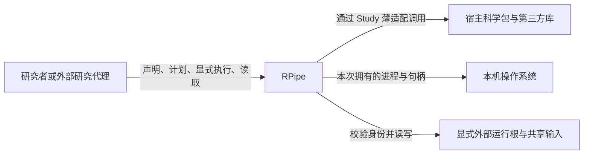
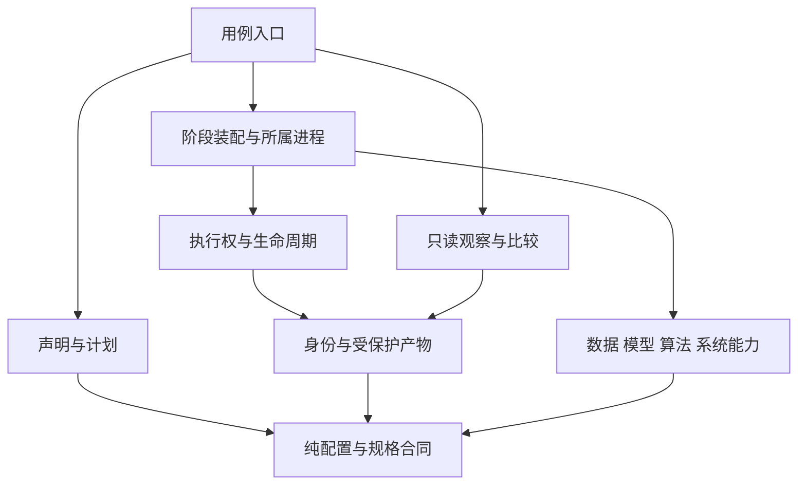
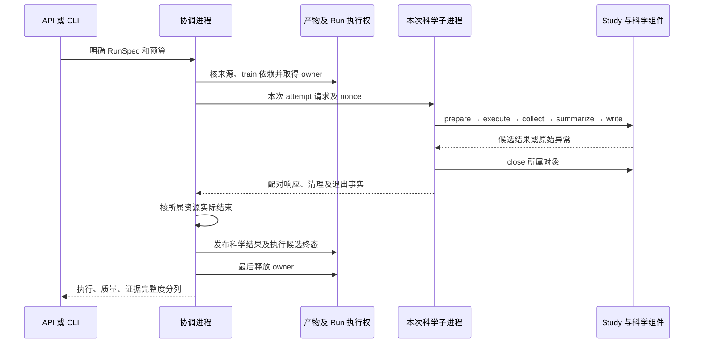
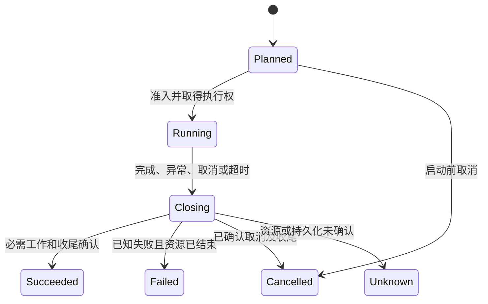

更新日期：2026年10月27日。本文维护当前确认采用的架构方向、可观察合同与取舍。当前实现的支持边界与目标未落地处明确标注，实际待办见开发计划，采用经过和验证结果只进入日期记录。

# 一、设计依据与范围

## （一）从什么推导架构

RPipe 服务于研究者声明比较因素、组织多 seed 执行、读取结果并复核结论的闭环。设计顺序为：用户旅程与科学边界 → 质量场景 → 状态和资源归属 → 职责接口 → 源码依赖与运行部署 → 验证。目录是职责的落位，不能替代这条推导链。

本项目采用两柱：`structure` 提供建构与计算能力，`flow` 决定阶段装配和执行顺序。data/model/algorithm/system 本来就属于 structure，没有将它们集中到平级 `payloads` 的职责依据，也不能在 structure 内另藏同名总包。公共 API 的兼容参数 `payload` 只表示一次注入的运行实现，不构成架构层或文件划分依据。

模块边界由变化原因、状态所有者和失败影响推导。继续采用本机协调与文件合同，避免为没有确认的集群调度、外部服务或插件生态增加持久化状态。具体模块映射和允许依赖在代码结构设计维护。

## （二）设计方法与依据

采用质量场景、职责黑盒、状态归属、静态依赖和运行时序联合描述。同一合同分别落实到科学状态、执行事实与派生结果，避免由单一退出码判完成。工程机制依据见 [通用调研](<通用调研 General Research 研究流水线.md>)，科学比较依据见 [文献调研](<文献调研 Literature Review 研究流水线.md>)。共用规范从根 AGENTS 定位，实际阅读及版本核对进入运行记录，不在架构正文维护逐轮采用流水。

## （三）系统边界

图一表示系统交互。RPipe 负责声明到执行事实的连接、生命周期及结果组织；研究者负责假设、方法、数据许可、比较口径和结论，宿主科学包负责领域算法正确性。部署为 Python 库与 CLI，默认本机协调进程加每 Run 科学子进程。包、职责和操作系统进程是不同视图。没有常驻服务、数据库、队列中心、自动 GPU 分配或跨机器调度。

# 二、研究对象、声明与质量场景

## （一）Study、Experiment、Run 与 attempt

| **对象** | **表达什么** | **内容与边界** |
| --- | --- | --- |
| Study | 一个研究问题及比较设计 | study.yaml、基础配置和必要薄适配；科学判据在唯一研究计划按 Study 维护 |
| Experiment | 同一组有效条件下的多 seed 对照 | 当前按去掉 id/seed/description/tags 的配置，加 source_digest/version 分组；不只按名称合组 |
| Run | 某个 seed 下的具体条件 | 冻结 RunSpec、配置、科学结果及资产；短配置 ID 不是完整执行身份 |
| attempt | 该 Run 的一次实际启动尝试 | 独立请求、响应、错误与收尾；不从 UUID 或文件时间猜顺序 |
| version | 调用方明确选择的输出命名空间 | 不等同包版本或 Git 提交，换 version 不证明输入环境相同 |

能力和取值分开：structure 实现能力，声明选择本次数据、模型、算法、设备与参数，flow 按同一生命周期装配。更换学习率通常改声明，增加领域算法改对应组件，改变阶段顺序才涉及 flow 合同。

## （二）声明展开与配置语义

api.plan 读取两个 YAML、计算实际源码摘要，再调用 expand。展开接已解析数据，RunSpec 构造只读观察路径和源码根标记，不写配置、执行 recipe 或导入科学后端。

| **声明或配置项** | **当前语义** | **合同边界** |
| --- | --- | --- |
| fixed、axes | 基础配置深合并 fixed，再应用轴的点路径；列表替换；轴非空且无重复 | 校验非有限数、递归值和类型，不把畸形值变默认值 |
| seeds | Study seeds 优先于轴 seed，再取 fixed seed/默认 0；互异非负整数，不接受 bool | seed 相同不是轨迹相同的充分条件 |
| version | 公共参数优先于 fixed、基础配置，再取 default | 路径组件不得越根或使用平台保留名 |
| origin | Study 统一来源策略，进入有效条件；data 不另设 origin | 路由选择不表示准许联网或已核每个输入 |
| recipe、flow | 显式 recipe 路径及阶段开关 | 计划不加载，执行准入后才运行 |
| tags、description | 展示元数据，tag 支持声明规则 | 当前 Run 哈希含 tags，Experiment 分组不含 tags；不重算旧 ID |
| 四类组件 | data/model 有 name/source/path/config，algorithm 有 mode/source/path/config，system 有 source/path/config | config 同名设置优先于兼容 extras；保留扩展字段不等于实现能力 |
| freeze、provenance、run_description | freeze 明确拒绝；provenance.include 扫描源码、inputs 固定声明输入；run_description 生成说明 | 描述只支持 data_name/model_name/mode/seed/train_size/source 六个标量占位符，不支持属性/索引/格式执行；不改旧 ID |

RunConfig 是有效配置，Control 是执行侧访问对象，RunSpec 冻结配置、来源、输出根、摘要、版本和依赖。运行上下文统一拥有配置及 Control 与冻结规格的一致性规则，执行器和流程选择准备、执行、阶段 hook 后及发布前的检查时点；改变条件须重新计划。

train/eval 在计划中配对：忽略 algorithm.mode 和说明性字段后，其余条件及 seed 相同，形成 train_id，train 排在 eval 前。独立 eval 核自己的成功 train 身份，不从邻近目录、日志、旧 index 或“最近训练”猜依赖。inference 是配置允许值，当前无通用已注册实现。

## （三）质量场景

下表是目标验收合同。时间、内存和输出上限须按平台与计划校准，未校准不宣称硬保证。

| **场景** | **触发与期望** | **职责决定** | **验收信号** |
| --- | --- | --- | --- |
| Q1 读取无执行 | 计划、状态和报告查询 | 计划与读端没有科学装配、启动及修复权 | 科学后端导入、启动、文件改写为 0；显式导出另列 |
| Q2 排他执行 | 同 Run 双启动或 make 竞争 | 一个执行权覆盖写入和收尾 | 最多一次运行实现调用，竞争者 busy，旧结果字节不变 |
| Q3 来源可解释 | 相同短 ID、不同源码或输入 | 完整身份校验，代码/输入/环境分列 | 不串读或回签，缺校验项显示未验证 |
| Q4 故障不伪成功 | 清理、派生、发布或释放失败 | 协调者决定整体状态，科学与派生事实分开 | 首错及清理错保留；返回、读端和执行权不矛盾 |
| Q5 取消有归属 | 取消、超时、进程不退出 | 仅监督本次可核验资源 | 停止新派发，未知保持 unknown/busy，不重放副作用 |
| Q6 数值可复核 | 恢复、后端与多 seed 比较 | 算法定义进度/恢复，读端限定比较 | 参数、轨迹、单位、样本与缺口可核，不能只看 seed |
| Q7 可替换研究 | 新 Study 或宿主方法变化 | Study 薄适配，宿主领域包独立 | 默认阶段复用，无反向导入和执行框架复制 |
| Q8 可交付 | 新 checkout、安装 wheel/sdist | 源码、输入、运行物分离 | 缺资产明确，实际安装包入口与最小旅程可用 |
| Q9 诊断有界 | 日志故障、大量或敏感输出 | 诊断与科学事实分开、写前脱敏 | 真实关联身份、有限输出、健康输出与首错保全 |

# 三、职责、接口与依赖

## （一）黑盒职责

职责不要求逐个建包、基类或服务，优先现有函数及少量对象。

| **职责** | **输入 → 输出** | **状态与失败边界** | **缺少的后果／持续成本** |
| --- | --- | --- | --- |
| 用例入口 | 请求 → 规格、执行或读取结果 | 只持有请求和呈现，准入错误可抛出 | 多入口重复判断／兼容维护 |
| 声明与计划 | 声明、配置 → 有序规格 | 不写盘/加载后端，RunSpec 只读观察源码根标记 | 畸形条件进入计算／字段及 ID 兼容 |
| 执行权与生命周期 | 规格、注入实现、预算及取消 → 执行观察 | RunContext、attempt、执行权、首错与终态；不选后端 | 双执行或错误成功／收尾合同 |
| 身份与受保护产物 | 身份、显式路径、内容 → 保护读写 | owner token、缓存锁、原子文件；不判科学质量 | 覆盖和串读／格式与平台兼容 |
| 四类科学能力 | 配置及明确依赖 → 对象、测量、checkpoint | 各组件拥有本次对象与资源 | 科学能力散落流程／后端及恢复合同 |
| 流程编排 | 组件与 Study 扩展 → 阶段及进程响应 | 本次装配、私有加载、句柄和 nonce | 时序分散、取消无归属／阶段及进程协议 |
| 只读观察与比较 | 明确 Run/受信目录 → 状态、统计、差异 | 无执行权，坏输入不修写，深比较才加载 Tensor | 混算来源、读取重跑／缺失及格式解释 |
| 派生导出 | 已有轨迹、目标 → 图或 TensorBoard | 只拥有本次文件和 figure | 输出污染源码／格式及范围维护 |

## （二）逻辑依赖与运行调用

图二表示职责间允许的依赖，不是进程拓扑或完整调用时序。只读观察不依赖执行，计划不加载科学实现，执行机制通过流程注入的方法调用科学实现。运行时回调不代表允许源码反向依赖。具体 Python 模块、静态导入图及检查方法集中于代码结构设计第四章。

## （三）公共用例

| **用例** | **输入 → 输出** | **副作用与失败** |
| --- | --- | --- |
| plan | Study、显式根、可选 version → RunSpec 元组 | 读 YAML/源码，不写盘、不运行 recipe |
| make | 同 Study/source/version 规格 → schema 2 index | 计划锁内逐 Run 取得 owner，发布缺失配置与 index；同配置原字节保留；不是整批事务 |
| run | 单规格、可选实现、预算、取消 → RunOutcome | 默认子进程；准入可抛错；已有任何正式 result 拒绝原地覆盖 |
| launch | 明确规格集合 → 已尝试结果 | 当前串行；取消或 unknown 停止新派发；已知 failed 不自动终止所有其余项，准入异常仍可中断调用 |
| cancel | 本次 Cancellation → None | 仅请求，是否停止由执行事实报告，不查杀旧 PID |
| read_run/aggregate/report/logs | 明确规格 → 只读事实/文本 | 不补齐、不下载、不训练、不清理；明确 attempt 投影见第四章 |
| process | 明确规格 → 派生统计并写外部 summary | 不训练；Study scope hook 可写派生物，不覆写科学 result |
| compare | 同 seed/source/version 两规格及允许变化字段 → 配对指标差 | 未声明条件差异拒绝，不能豁免 seed/version；无判据不生成胜负 |
| compare_runs | 目录、容差、checkpoint 及可选受信 reader → 深差异 | 可读受信 pickle/Tensor，旧来源不自动验证/补签；write_compare 才写指定输出 |

精确签名、CLI 与兼容破坏点在代码结构设计维护。

# 四、运行、状态与最终收尾

## （一）部署与资源所有者

图三为默认成功路径。科学子进程执行阶段及 close，协调者监督、核验与发布。同进程注入复用执行机制，不提供硬超时或系统隔离。

| **状态或资源** | **所有者** | **共享与释放边界** |
| --- | --- | --- |
| spec/config/control | 计划生成，执行只读 | 上下文副本不得改变有效条件，变化重新计划 |
| 取消、attempt、整体结果 | 协调者 | worker 有本地取消对象，父请求通过监督处理，不是跨进程共享 Event |
| loader、模型、优化器、scheduler、tracker | 当前科学执行及领域组件 | 不跨 Run 共享可变对象，逐项尝试 close 并保留错误 |
| 注册表及临时导入 | 当前 NativeRun/Study 加载作用域 | 快照并恢复自有修改，RLock 串行化，不能清空别的任务模块 |
| 共享原始输入 | 明确共享根中的不可变资源 | 缓存锁只保护准备；RNG、训练对象和 checkpoint 不共享 |
| Popen、流、figure | 创建及登记方 | 仅清理本次对象，根进程退出不证明后代全停 |

## （二）状态与三类结论

图四为逻辑生命周期，中间态不要求全变公共枚举。busy 是活动或未解除的执行权，missing 是没有正式结果，均非科学质量。执行状态、quality=True/False/None、evidence_complete 分列；没有科学判据时质量为 None。

当前优先级：资源未知 → unknown；首错/清理错 → failed；取消 → cancelled；其余 succeeded。取消异常在无其它故障时归 cancelled。启动前取消不启动 attempt。任何已有 result 都拒绝原地覆盖；无 result 的已知 failed/cancelled 仅在显式 retry=True（CLI --retry）时启动新 attempt，未知或未索引旧 attempt 拒绝重试。

## （三）科学、执行与派生事实

| **事实** | **当前位置** | **不能据此推导什么** |
| --- | --- | --- |
| 科学成功 | result.json，科学 close 后协调发布，含 identity/attempt | 不证明后置 process、owner 释放和整次调用成功 |
| 执行观察 | execution.json 与它明确引用的 attempts/<uuid>/outcome.json、RunOutcome | 双份记录须身份、attempt 和类型一致；owner 未解除时不能显示整体完成 |
| worker 响应 | 同 attempt 的 request/output，核 nonce/identity | 有文件或 exit 0 不表示属于本次或科学达标 |
| 派生分析 | summary/process.json、图及导出 | 失败不抹去科学事实，成功不补齐缺 Run |
| 当前 read_run | execution/outcome/result/owner 的统一投影 | 显式分列 status、scientific_status、derived_status、quality、evidence_complete 和 attempt；不靠科学成功推断整次完成 |

当前实现持 owner 到最后：关闭科学资源、发布科学及必要派生事实，再原子写本次 attempt/outcome 和 Run 级 execution 候选，最后释放 owner。写失败或释放失败保留 unknown/busy；仅仍持匹配 token/attempt 的执行者可尽力补记，解除执行权后不再写 Run 记录。返回绑定自身候选，不读取后继 attempt 覆盖后的状态。

`execution.json` 格式 schema=1，明确 active attempt、完整 identity、owner_token、阶段、候选终态、科学结果引用、清理及证据事实；attempt 原件保留历史，不猜 UUID/mtime。contracts 的纯 project_execution 同时服务返回与读取，artifacts 负责校验明确索引的磁盘副本。旧 result-only 仍可只读，不补签；无索引旧 attempt 或冲突记录为 unknown/incomplete。

完成判定同时核候选终态、身份、科学事实与该 attempt 的执行权已解除；候选与 owner 并存为 closing/unknown。派生 process 失败保留已发布科学结果，并将整次执行及派生状态标失败。日志诊断故障只令证据不完整，不改科学质量。

这仍是多文件协议：崩溃可能留下结果和 owner，没有目录事务或恰好一次保证。未知不自动恢复、删锁或重放；显式重试只接纳已确认失败/取消且没有 result 的记录。

## （四）取消、预算与重启

Budget 只接受有限正 timeout 和正整数 memory_bytes。所有后端当前均拒绝硬内存限制；同进程注入拒绝硬 timeout。默认子进程仅在可监督范围执行 deadline，POSIX 使用本次进程组；Windows 有 recipe、实际启用的 Study hook、DataLoader worker 或 HF 后端时拒绝硬 timeout。关闭 hook 或没有阶段文件不因此拒绝；同一后代能力判断也用于异常退出，后代未确认保持 unknown/busy。

取消不是回滚：checkpoint、下载、hook 或外部副作用不撤销。只处理本次可验证归属的句柄/进程，停止新阶段和派发。当前 CLI 未完整建立 Ctrl+C 到 Cancellation 的显式桥接，不能承诺所有键盘中断均合作取消。

重启先读事实，不自动删锁、按 PID 抢占、重放或重跑 unknown。PID 存在/消失都不足以确认可接管；新尝试先核旧资源及副作用。精确 checkpoint 恢复须满足第七章。

## （五）显式批次资源监管

Windows 的 supervise 用例在普通 run/launch 之外显式选择。调用方传入全部 SupervisionLimits：每格 run_seconds、全批 batch_seconds、聚合 rss_bytes、output_bytes，以及 poll_seconds、cleanup_seconds；四项资源上限无默认值，既有 Budget 的硬内存与默认 Windows 扩展超时拒绝规则不变。其他平台拒绝此监管入口，不以降级运行冒称能力已生效。

外层监管建立匿名 Windows Job，启动仅等待 stdin 放行的协调子进程；入组失败时不读取 Study recipe 或启动科学计算。所属树含逐格协调与 worker/后代，监督者留在树外；RSS 口径不包含外层监督者自身。每格开始前发布来源绑定的进度，调用既有 run；不逐格 make 覆盖索引、不新增队列和训练实现。全批时钟自准入准备前开始，格内期限包括准备、计算和发布。状态 failed/unknown、质量 False、证据不完整、观察失败、取消或超限均停止后续放行；质量 None 仅表示未给出科学质量，不变为“科学通过”。

RSS 为各 Job 成员当前工作集之和，共享页可能重复计入，短暂峰值可能落在采样间隔之间。输出按显式 run_root 与新建独立 evidence_dir 内文件身份去重，计新增及正增长逻辑字节；包含派生缓存和监管证据，不删除输入、旧结果或其他任务文件。基线已有身份的文件引用不重复计入，未见过的外部文件身份按新增保守计入。目录符号链接/junction 或无法读取的元数据令观察失败，普通文件链接只取目标身份/大小。输出同根的其他写入也可能触发停批，因此运行根应专用。采样与最终报告记录实测值、触发原因、超调及清理确认；RSS 与输出均为观察停止线，不是操作系统硬配额。

触发后先请求所属协调者取消，有限等待后终止所属 Job，并核确认成员清空。错误不覆盖首次触发；资源或清理未确认时为 unknown，已有 Run owner 不由外层抢占、释放或重写，已发布科学结果保留。监管报告与 Run 执行/科学状态分别解释，不能仅凭进程退出或一个批次成功字段判科学门通过。

# 五、六阶段、上下文与 Study 扩展

## （一）阶段合同与时序

| **阶段** | **输入 → 输出** | **当前默认行为和权威** |
| --- | --- | --- |
| prepare | 冻结配置 → 对象、来源及资源事实 | Native 建 system 后调用 prepare.before，再 recipe、data、model、algorithm、tracker，最后 prepare hook；失败不执行计算 |
| execute | 组件 → 计算观察及轨迹 | 算法后运行 execute hook；结束 flush 失败不掩盖计算首错 |
| collect | 原始观察 → 指标、快照及短观察 | 不序列化模型/Tensor/句柄，质量不从日志推断；hook 补真实测量 |
| summarize | collected → result_draft | 默认建立候选摘要，hook 整理，不偷换其它 Run 样本 |
| write | 候选结果 → 待发布事实 | hook 在前，协调者在 close 后统一发布正式 result |
| process | 已发布 Run 或明确 Study 集合 → 派生结果 | Run scope 在发布后；api.process 另提供 Study scope，按 scope 区分 |

运行实现需 prepare/execute/collect/close 四方法。六阶段是流程语义，不要求六个基类和空 hook。close 在 finally，阶段间检查配置和取消。collect 须映射，未包入 metrics 的普通键由默认 pipeline 归入 metrics，质量/观察/结构/路径另存。

main_probe 的 prepare.before 在科学准备开始前核对已加载 RPipe 模块及包搜索路径属于本 checkout，并逐项核对所选数据集的固定原始文件 SHA-256。固定清单沿用 main_exp 的 EXPECTED_DATA.json，通过 Study 的 provenance.inputs 固定其字节哈希；缺失或不符时不建立探针工作区、归档源码、派生缓存或模型。共享根中的未消费文件保持原样，只引用清单成员。Native 的 runtime/system 初始化仍早于此 hook，此校验不表示尚未创建任何 Run 记录。

配对探针自己建立的 writer、hook、Data 与独立评估 logger 在成功、失败和取消时均按所属作用域释放，观察用的临时 Data 绑定恢复原状；外层传入的 native 对象仍由 NativeRun 收尾。首要异常和全部已取得资源的清理异常分别保留，清理失败通过外层 close 协议影响最终状态，取消伴随清理失败应为 failed。独立评估 logger 的诊断缺口传递给外层 logger，只降低证据完整性，不改变科学质量。验收必须分别覆盖微型故障合同和研究数值，前者不能替代后者。

## （二）上下文交接

| **字段或 state 键** | **生产者 → 消费者** | **类型与生命周期** |
| --- | --- | --- |
| spec/config/control/layout/cancellation | 协调及 configure → 阶段 | 规格、配置、路径、信号；有效配置与 spec 一致 |
| study/budget/attempt | configure/协调 → 执行、监督、记录 | 声明、预算和本次身份，不从环境猜补 |
| validate_config/before_prepare/apply_recipe/checkpoint_pickle_module/process_hook | flow.configure → pipeline/Native | 明确回调，不作全局服务查找表 |
| system/logger/seed/data/model/algorithm/tracker | Native.prepare → execute/collect/close | 本次运行对象，不整体写 result |
| collected/result_draft | collect/summarize → hook/协调 | 有限 JSON 数据，发布仍核类型、身份与序列化 |
| cleanup_error_records/unknown_resources、processes | 资源创建/关闭方 → 协调 | 累积事实不覆盖首错，只登记本次对象 |

新增跨阶段键须明确生产者、消费者、类型、缺失条件和结束处理；阶段内部值留局部变量。state 不替代配置、持久化身份及公共 API。

## （三）加载与宿主边界

显式声明开启扩展。阶段支持 flow/<phase>.py 或 flow/<phase>/__init__.py，同时存在拒绝，旧根级阶段目录拒绝。prepare 可选 before；缺可选 hook 就用默认，不执行目录内任意工具。

recipe 在 Study 内并提供 register，通过 RecipeContext 注册领域工厂。Native 按 Run 快照/恢复注册表，RLock 保证同进程隔离，代价是串行。阶段使用本次私有命名空间并清理自有模块；recipe 为晚导入和受信 pickle 类可能保留更久，不能宣称 Run 后全部卸载。

同名 Study、相对/动态晚导入、迁位 pickle 类属于加载兼容合同，不能全局清空 sys.modules 或篡改标准库。动态导入也遵守两柱；名称隔离不是恶意代码沙箱。宿主领域包不机械改成 RPipe 两柱/六阶段，仅 Study 作薄适配；宿主不导入 Study，RPipe 不静态导入正式 Study。

# 六、四类科学组件

## （一）共同合同

工厂按明确选择创建对象，配置提供取值，领域对象承担计算与资源，flow 决定顺序。注册表不是自动插件发现；未知 name/source/mode 失败，不回退 Stub。Toy/Stub 仅用于明确合成验证。

| **组件** | **输入 → 输出** | **依赖与资源** |
| --- | --- | --- |
| Data | 配置、seed、共享根、取消 → loaders/meta/snapshot | 拥有迭代器/worker，close 清理所属引用；不拥有模型和优化器 |
| Model | 配置、数据形状元信息 → module/meta/snapshot | 只消费明确元信息，设备放置经 System，不持 DataLoader |
| Algorithm | mode/source/config、四类对象 → 更新、评测、测量、恢复 | 拥有 optimizer/scheduler、进度和 best，文件操作委托 System |
| System | 配置、资产根、seed/来源 → 设备、日志、checkpoint I/O | 不决定评测或 best，不判研究质量；当前无 SystemRegistry |

## （二）Data 与 Model

内置数据为 MNIST、FashionMNIST、CIFAR10、CIFAR100、SVHN 及显式 Stub。DataRegistry 按 name/source 选择，默认 torch。显式 data.path 只读既有输入，不向它隐式下载；默认共享 raw 下载也需明确许可。基础 ToTensor 与模型 InputNorm 的归一化/训练增强分开，防止双重归一化。

统计优先级为显式 stats_path、Study profile、既有常量。显式文件缺失、格式或通道数非法、非有限 mean/std、非正 std 均失败；默认 profile 缺失或无有效基础字段时可回退常量，Data 快照记录 stats_source/stats_reference。发布采用实际快照，未固定的 profile 为 unverified，不因结束时文件存在或消失改签读取来源。DataLoader generator/worker seed 必须与 sampler 共同解释，不能外推跨 worker/设备/版本同轨迹。

data 命令按当前选中的有效配置生成 profile，保留 data.source/path 及 origin，相对路径按 Study 解析，不加载 recipe。统计完整原始输入，不应用 Run 的 train_size、增强或已有归一化统计；同一输出数据集有不同输入时在构造/写入前拒绝，可用 --id 选择一个 Run。下载须 --download，显式 data.path 仍只读；输出数据集目录拒绝目录链接，stats 文件解析后须留在该数据集目录，不能改写同根 peer，默认 raw 缓存的原生/规范别名也不得越出自己的共享根。profile 逐批以 float64 累加，避免 float32 低方差抵消；持有批次数不随总数据增长，失败也关闭本次 Data/迭代器。make 不自动准备数据或 profile；类别数/批尺寸和实际大数据成本仍由调用方控制。

原生模型包括 linear/mlp/cnn、resnet10/resnet18/resnet 别名、wresnet28x2/wresnet28x8/wresnet 别名。形状优先 model.config 的 data_size/target_size，其次 data.meta 和默认形状。参数初始化为科学实现，目录整理不得暗改。InputNorm 训练增强只在 training 时启用，可由配置关闭，eval 不复用训练增强。未注册的后端不属于当前能力，有真实消费者时再设计领域适配。

## （三）Algorithm、进度与评测

已注册 custom_torch train/eval 及显式 transformers_trainer。优化器复用 Torch 构造和签名过滤，保持 config 优先及 SGD 默认 lr 等语义；scheduler 包括恒定、余弦、阶梯、多阶梯、指数和线性 warmup，周期基于实际预算。记录已完成更新的 lr，不将下一步值混入。

原生默认 step、num_steps=1；epoch 需 num_epochs，更新数受 loader 和梯度累积边界约束。不能完成一个完整累积更新的 epoch 须拒绝，不无限重启迭代器。原生完整参数更新后推进 scheduler，再保存一致 checkpoint。

评测周期默认 1，0 表示仅终点；评测步数负值为完整数据，0 非法。best 默认 test Accuracy 最大，Loss 最小；best_value 与仅 Accuracy 时的 best_accuracy 分开。AlgorithmHook 承担评测周期、tracker、logger、early stop，不是额外 Flow 阶段。

训练内周期 test 用于该 Run 选 best；独立 mode=eval 是另一 Run，核心 train_id 核同条件 train 的身份。训练默认 latest 缺失可从头开始，eval 默认 best 缺失失败；显式 resume_from 按声明引用加载，实际 sibling fallback 保留其真实引用。通用 checkpoint 尚未统一完整 Run identity 或输入字节摘要，读取成功不能证明任意外部 checkpoint 来源。HF 恢复只执行总预算中剩余的更新，checkpoint 与曲线保持累计坐标；仍保留部分恢复警告，不承诺原生 exact resume。Trainer 参数、批次、更新、优化器默认及指标须逐项对齐；momentum 由实际优化器消费，不传给不接受该参数的 TrainingArguments。

原生 Train/Eval 的 execute 摘要记录 resume_count/resume_path 及恢复 step；main_exp 用这些实际执行观察核连续训练及对应 train.best 的路径、step、身份和原有数值判据，JSONL 仅供诊断。直接曲线审计也用 execution/outcome/owner 的统一投影区分 scientific_status 与整体 status，收尾未确认、失败、副本冲突、无索引旧记录及诊断缺口不能通过最终完成门。缺少结构化恢复事实时不能从旧日志补签科学来源。字段记录不等于 checkpoint 字节固定，受控输入仍须显式 pin/校验。

## （四）指标与 tracker

原生 batch 指标包括 Loss/Accuracy/MSE，完整数据 RMSE/GLUE 等按实际后端和可选依赖使用。Accuracy 为百分数、默认 top-1，按真实样本计数，不能与 0～1 比例混合。周期按样本数加权，保存 weighted_sum/计数，collect 取完整最后评测段，不能拿最后 batch 冒充评测。完整数据指标先归约再报告/写曲线，每段只保存一次；空评测明确失败，未测量的 Accuracy/Loss 不在摘要中补零。

tracker 分开 batch 更新、周期报告、持久化及恢复坐标。optimizer_step 不等于含 test batch 的累计 step，HF epoch 可为实际分数值。JSONL 增量和 tracker_state 是测量证据，不从文本日志解析指标。

回滚用 checkpoint 的路径、进度与字节边界建立有效轨迹视图，不截断别的历史；同一有效坐标保留正确后次观察，不按数值去重；坏 offset/不同路径建新视图。恢复同时还原累加量，不以均值乘计数引入舍入漂移。

## （五）System、运行时与来源

System 默认设备为 cpu，place_module 只做明确设备放置。Native 在构建 Data/Model 前应用 Python/NumPy/Torch seed 和系统标志，并记录实际值；受影响 Windows 环境先导入 NumPy 再 Torch。deterministic 默认 False，cuDNN deterministic 默认跟随它，benchmark 默认取 cuDNN deterministic 的反值；确定性算法使用 warn_only=True，不代表所有算子强制确定。两个 TF32 选项只接受明确布尔值，省略时保留实际后端值，不宣称统一精度。

默认子进程把这些进程级影响限制在本次 worker。同进程注入的 RNG、Torch 标志和 HF_ENDPOINT 不会因注册表恢复而全部回滚；不能把 registry 隔离误称为完整运行时隔离。组件仅在有可调用 close 时关闭，不能宣称当前 System/Model 都实现资源释放或 GPU 显存已归零。

origin 的 foreign/domestic 选择数据 endpoint 和模型 Hub；已有文件的 checksum、固定 revision 及明确来源继续核对。domestic 模型下载优先 ModelScope，再 hf-mirror，失败不自动退海外；数据 SDK 对 URL、预先导入的 endpoint、媒体/streaming 及线程/子进程上下文有实际约束。局部 endpoint 和临时环境修改按自有作用域恢复，但 apply_model_origin 本身会修改当前进程 HF_ENDPOINT。它们不是任意网络访问的安全代理，也不表示所有第三方实现已通过真实联网验证。

# 七、Checkpoint 与可复现边界

## （一）保存与发布

Algorithm 决定 latest、百分比节点、best 和时机，System 只执行 I/O。当前 <stem>.pt bundle 权威，<stem>/ 镜像用于兼容/诊断；临时 bundle、staging 与 incomplete 标记区分未提交状态，bundle 最后原子替换，镜像失败不破坏旧权威。

单 stem 在本 Run 写者下发布，不保证多 checkpoint 事务或断电持久性。有 .pt 不代表内容、身份和进度有效；marker 但无有效 bundle 不冒充成功。旧分片目录按受支持协议读取，不删除用途未确认原件或 peer。

## （二）精确恢复所需状态

| **内容** | **原生恢复要求** | **当前边界** |
| --- | --- | --- |
| 模型/optimizer/scheduler | 完整 state、配置和更新位置一致 | eval 权重加载不等于训练恢复 |
| RNG | Python、NumPy、Torch 及已初始化 CUDA 状态 | 跨设备、版本和算子需另验 |
| 数据游标 | dataset 身份、sampler/generator、batch/drop_last、消费位置、前后 generator 状态 | map-style、num_workers=0、受支持 Random/Sequential；Random 使用自有 generator |
| 算法控制 | budget、step/epoch、周期、stall、百分比与 best | 不自动兼容改预算/配置，覆盖尾批和梯度累积 |
| tracker | 加权量、有效 JSONL 视图与坐标 | 当前精确保证限支持的原生指标和协议 |

先构造对象并绑定数据，再恢复游标/RNG，继续未消费后缀，不能为定位索引重跑已消费增强。原生 exact state 为 version 1。多 worker 预取、自定义 sampler/指标、完整数据指标、HF、其它设备和分布式不在通用逐位承诺内，应声明范围或拒绝不兼容状态。

## （三）信任及科学判断

Torch checkpoint 当前允许 pickle 对象，recipe reader 只解决受信类名兼容，不是安全反序列化器。摘要和扩展名不能让不受信文件变安全；status/report 不加载 pickle。

恢复等价比较拼接轨迹、参数、optimizer/scheduler、训练及 tracker 状态，不以 exit 0、文件数或 seed 代替。跨后端另列数据、模型规模、设备、dtype、依赖、seed、更新数与容差。科学阈值来自研究计划，架构不发明通过率。

# 八、身份、磁盘与读取

## （一）来源范围

短 Run ID 为配置规范表示的 SHA-256 前 16 位，排除 id/description；完整 identity 使用 id/source_digest/config_digest/version，不能仅比短 ID。路径迁移、注释等源字节变化可能改摘要，旧 Run 不回签。

source_digest 扫描当前 RPipe Python 与 Study 的 py/yaml/yml/json，排除明确运行/缓存目录，包含安全范围内 provenance.include；越根符号链接与声明引用拒绝。provenance.inputs 是显式列表：文件用 path/sha256，目录用 path/files（相对文件名到 SHA-256 的完整清单）；拒绝逃逸、畸形摘要、缺件、额外文件及漂移。只有明确 pins 扫描/哈希输入，不能把源码摘要称为全部数据、模型、宿主和环境身份。原有 pin/checksum 保留。

代码身份、输入身份和环境观察分列。执行/result/读取保留输入声明、pin 验证及未固定引用的 missing/unverified/builtin_fallback 状态；默认视觉缓存/profile 也列入，实际 Data 统计快照优先。environment 记录真实 Python、平台和已安装依赖版本，worker 返回其环境；它不是设备精度、输入字节或科学可复现保证。没有引用时不冒称完整输入身份，不自动复制大数据或回签旧结果。

## （二）磁盘角色与并发

| **位置或原语** | **职责与写入者** | **保证和限制** |
| --- | --- | --- |
| index/config | make 发布计划视图和配置，run 写本次配置 | index 非历史/状态数据库，整批失败可能已有部分配置 |
| .execution/owner.json | mkdir 排他取得，token/PID/identity/attempt | 释放核 token/attempt，不凭 PID/过期时间偷锁，busy 可为未确认遗留 |
| .planning/cache_lock | OS 锁及同物理文件重入 | 初始化字节在锁内，进程死亡由 OS 释放；不等同 Run owner |
| atomic_write_text/replace | 自有 UUID staging 完整写再替换 | 保留既有 mode；单文件可见性，无目录事务/fsync 保证 |
| prepared_resource | 定义摘要、manifest 及文件校验 | .building 非 ready，重用核内容，不清别人构建 |
| 输入引用 | 受控 symlink/hardlink 或校验复制 | 冲突拒绝，旧 peer 保全；硬链接不是只读防护 |

当前 atomic_replace 对 Windows 错误 5/32/33 最多 6 次有界重试，不改 ACL 或先删目标。close 二错不能掩盖首错。并发/失败验证要核旧内容及 peer 字节，不只断言抛错。

## （三）读端、聚合与导出

read_run 核实际来源和存储 identity；身份不同拒绝，不展示另一 Run 成功。坏 status/quality/evidence 显示 unknown 并保留原因，普通查询不建目录、迁移、清理或补写。显式 process 在写 summary 和调用 Study hook 前重新验证所有规格的源码及实际输出根，拒绝来源漂移和指向源码/已知输入的链接；聚合时某个 Run 的 invalid 状态不能代替写入准入。

aggregate 保留成功、缺失、invalid、busy；可恢复 I/O/值错误成为单项 invalid，不遮正常 peer，不吞程序错误。拒绝重复 Run/同组 seed，不同来源/版本分组不混算；数值有限且非 bool，输出 mean、样本 std(n-1)、n、缺项与完整度。当前 n=1 时 std 输出 0，仅为格式约定，不表示不确定性为零，展示需注明样本不足。缺 seed 不补零。busy/unknown/整体失败不计入成功统计；科学结果可保留在单 Run 行，整组完整度不会因 result 单独存在变真。

曲线按真实坐标并集及每点 n，step/epoch/observation 分组，不插值；旧 observation 短长度兼容与新坐标协议分列。通用样本 std 不与历史脚本总体 std 混称。report 是只读状态/完整度表；logs 读取 events.jsonl 及既有日志，按文件拼接，不保证全局时间或因果顺序。

读取按用途区分三种事实：缺失、已取得但不可解析/不合法、合法值。关键 config、identity 和所需 checkpoint 严格失败；可选诊断或展示允许带原因降级，不得将坏记录当作“没有失败”或拿显示占位符继续计算。已有纯类型值优先来自计划，结果只能补充已验证字段。可恢复解析/I/O 异常在负责边界处理，编程错误继续暴露；不能新增一个吞所有异常的安全读取框架。当前各读端实现尚不完全统一，迁移旧辅助函数时须保留其调用方的严格/可选语义。

曲线导出使用当前 index；TensorBoard 默认扫描实际 runs 轨迹，可显式 run_ids（CLI --id）选择。新目标事先不存在，不能与 Study 输出重叠；CLI 另核 Study/库/checkout 和已知输入（含默认缓存）保护，底层直接导出入口只知道自身库/checkout 与传入的 Study 输出，调用方须保护其其它输入。整数坐标/单位可表达，分数 epoch/observation 不悄悄取整；缺选中轨迹或逃逸链接在创建目标前失败，不改科学 result。

# 九、日志、故障上下文与安全

## （一）目标合同

日志解释执行，tracker 保存测量，result 保存科学事实，测试 events 保存测试协议，四者分工。实现复用 system.logger、既有原子/锁原语及 flow.run，没有新增日志柱或服务。

| **记录项** | **目标要求** |
| --- | --- |
| 格式 | UTF-8 JSON Lines，一条一物理行；终端从同一记录派生。当前写 assets/logs/events.jsonl，兼容读取既有 run.log/worker.log |
| 必需身份 | UTC RFC3339 毫秒 timestamp、level、固定点分 event、logger、message、app_name/app_version、runtime_id、process_name/pid |
| 已知关联 | Run/attempt 对应 task_id/工作流/request_id；phase/operation/outcome/duration_ms、错误码/异常。未知省略，不填假 0 |
| 严重级别 | DEBUG/INFO/WARNING/ERROR/CRITICAL；取消请求/确认、停止/清理完成分事件 |
| 故障 | 负责边界记一次完整上下文，保留首错与后置错，不只记 failed |
| 生产者与时间 | PID/时间真实，runtime_id 关联，不靠时间宣称因果，worker 不冒用协调者身份 |

## （二）隐私、成本及失效隔离

落盘前脱敏。凭据、密钥和隐藏推理不得持久化；用户输入、正文、私人路径和个人信息默认不采集，必要采集须明确类别、范围、授权与保留期限。traceback 保留必要模块/函数/行号及脱敏原因，不抓 locals 或默认复制私有源码。控制字符编码、记录限长并注明截断字段。

明确单条/文件容量、保留及溢出策略，记录丢弃与截断；上限由项目场景校准。第三方 stdout 只在明确许可的本地诊断范围内有界捕获，标服务实例和 attempt，不冒充规范 JSONL。诊断失败保留科学首错和健康输出，另记诊断不完整，不递归写错日志或用无界缓存耗内存。

当前 Logger 支持五级 JSONL、真实生产者和关联身份，父/worker 共享 runtime_id，Native/System 复用同一实例。父进程先完成原始输出不采集的策略记录，再启动 worker，避免与短 worker 的启动/退出日志争用同一个零等待文件锁；锁忙时的诊断降级合同不变。普通消息只由审查过的模板和数值摘要组成；已知凭据/路径/email/URL 脱敏不能识别任意文本中的所有秘密。任意异常 message 固定 [redacted]，只保留类型、模块/函数/行号、有界原因链及严格整数退出码，不调用任意异常 __str__。协调边界记录本地执行/发布/process 首错，已由 worker 记录的远端错误不重复完整栈。

限额为单记录 8 KiB、message 2 KiB、trace 4 KiB、单段 256 KiB、4 段轮转及 8 KiB 首 ERROR；保留 7 天，打开/写入/关闭时仅清自己的段并使用 OS 锁。中断 JSON 尾片保存在自有轮转中，新段保持逐行 JSON 并标诊断不完整。stdout/文件单路失效彼此隔离，不递归记录错误、不无限排队。worker 原始 stdout/stderr 默认不采集，明确记录未采集，不能声称已保留原始第三方诊断；故障上下文来自安全结构化记录。同步文件 I/O 无通用硬期限，空闲/退出后的定期清理须由调用方负责；限额尚未以真实长程工作负载校准。

## （三）执行信任边界

recipe/hook、依赖与 pickle 是受信代码执行。哈希解释来源，不代替审查、许可或系统权限；显式运行根防源码污染，不是沙箱。来源路由和依赖下载来自明确请求，离线计划/读取不因缺包自动联网。

# 十、测试设计及证据协议

## （一）范围与五维标签

镜像本仓有效源码，层级用标签，不建三套平行 unit/integration/e2e 目录。只测 RPipe 合同及失败，不复制宿主内部测试。不为包标识、缓存、环境和产物机械建占位测试。一个用例提供可辨信号，参数化每项有稳定 test_id。

| **维度** | **取值和约束** |
| --- | --- |
| level | unit/integration/e2e，按参与边界，不凭耗时分类 |
| type | location/content/physical，结构、行为、资源独立 |
| cost_class | c1/c2/c3/c4，GPU 至少 c3，矩阵批次另评 c4 |
| result_type/detail | categorical 或 numeric；数值分 summary/metrics/samples，纯测量 measured、verdict=None |
| priority | p1/p2/p3，按核心、数据/安全和故障损失，低频高损失仍可 p1 |

成本覆盖 setup/call/teardown 及整批，墙钟、CPU/内存、设备累计与 operation latency 分列；缺测量 null 加原因，不填 0。规范建议 C1 1 秒/256 MiB、C2 60 秒/2 GiB 只是校准起点，当前 marker/workflow 未执行这些硬限制。

## （二）合同与故障矩阵

| **合同及重要性** | **最小场景** | **必要信号** |
| --- | --- | --- |
| Q1 计划/读端，P1 | 有效声明、无效轴/seed、坏文件，隔离进程查导入 | 无启动/写盘，真实错误不吞 |
| Q2 身份/并发，P1 | 双启动、make 竞争、旧成功、短 ID 冲突 | 单执行者、busy、旧原件/peer 不变 |
| Q4 阶段/收尾，P1 | 每阶段首错加 close、日志、发布、release 故障 | 首错及清理错保全，磁盘/返回/读取一致解释 |
| Q5 取消/预算，P1 | 启动前、阶段间、运行中取消及不退出 | 停新派发，只处理自有资源，未知留执行权 |
| 产物，P1 | 截断、写失败、staging/close/replace 故障、引用冲突 | 不毁旧内容、不把构建当 ready、不越根清理 |
| 数值/恢复，P1 | sampler、尾批、梯度累积、周期/best、resume | 参数、拼接轨迹与完整状态对比，不只 exit |
| Study 加载，P1/P2 | 同名/晚导入、阶段歧义、迁位 pickle | 所属注册和模块隔离，peer 不变 |
| 统计，P1/P2 | 缺 seed、bool/非有限、重复、坏 peer、混坐标 | n/std/单位/缺口正确，无补零插值 |
| 安装，P1 | 实际 wheel/sdist，源码树外最小旅程 | 安装包可用，不靠源码 PYTHONPATH 掩盖 |
| 日志，P1/P2 | 敏感异常、控制字符、单输出失效、超量及本地/worker失败 | 可逐行读、真实生产者、已测敏感样本不落盘、有界及首错保全 |

集成/e2e 写明起止、参与者、真/假边界、前置与预期。每测试进程独立临时根，不拿真实数据/旧 Run 作清理 fixture。数值逐项注明样本、模型/参数量、设备、dtype、依赖、seed、来源、重复/基线，不用通过数量替代科学比较。

## （三）计划、执行和持久化

tests/run.py/conftest 维护唯一协议。计划含 plan_id、选择条件、最终 selected/required、未选及静态豁免原因、实际环境依赖、预算、超时与重试策略；收集后执行前写清单。默认 required 为最终选择减明确静态 skip 豁免，动态 skip/xfail/xpass、漏收集或无结果均不能算必需完成。

每执行唯一 run_id，每重试独立 attempt；外部根保存 manifest.json、逐项结束追加的 events.jsonl、可从磁盘重建的 report.md 及必要 artifacts。报告按 manifest 核对 run_id/plan_id/environment_id、已声明 attempt 和 selected test_id，错配或当前格式缺失身份的记录保留错误与缺口，不混算通过；正常重试历史仍完整保留，历史最小格式仅作兼容读取。失败/中断保留已完成项及缺口，不依赖退出前最后一次批量写；证据不进 Git。

逐项至少：run_id、attempt、test_id、level/type/priority/tags、target、result_type/detail、plan_id、cost_class、environment_id、verdict/category/metrics、cost、status、duration_ms、started_at、failure、artifacts。区分 passed/failed/measured/completed/error/skipped/xfail/xpass/timeout，质量、测量、完成不互代。必需项缺结果、失败、超时或漏收集阻断，skip/xfail 非普通成功；重试不抹第一次失败。

当前入口支持 --plan-id/--environment-id/--required/--result-type/--budget-seconds/--timeout-seconds/--retries 及 --report 磁盘重建，保留 core/all 和 pytest 转发。逐阶段事件增量落盘，中断/截断 UTF-8 尾记录可恢复报告并保留缺口；重试保留所有 attempt 和 flaky。只重试正常已退出的失败批次，超时/中断/启动或清理未知立即停止。超时监督范围是本次 pytest 根进程，停止后有界等待；未确认后代及全部资源释放为 null/unknown，不扫描或杀其它进程。逐项内存、后代硬限和成本阈值尚未执行；墙钟已记录，其它缺测量为 null 加原因。

# 十一、CI/CD、兼容与固定副本

## （一）当前工作流

| **工作流** | **实际声明** | **边界与不足** |
| --- | --- | --- |
| unit-tests.yml | Ubuntu/Windows × Python 3.10/3.13，core、离线 integration/e2e、TensorBoard 回读，Unit tests 汇总门 | 4 CPU 矩阵，不含正式研究/GPU/全部外网；always 尝试归档统一回执和命令日志，保留7天 |
| package-check.yml | Ubuntu/Windows，Python 3.10，构建、分别安装 wheel/sdist 并 package_smoke，Build package 汇总门 | 2 包矩阵；构建/安装日志及已生成smoke工作区归档7天，构建不代替安装，合成小例不外推真实研究 |
| branch-flow.yml | PR 到 dev，main 仅接受 dev 来源 | 只验方向，不是架构审查或合并授权 |

依赖部分 pin、部分范围未固定，保存实际解析版本和制品摘要。目标先受影响低成本关键合同，再有限集成及安装，昂贵设备/网络矩阵仅明确计划运行。策略、保护规则和发布修改单独审查。

上传动作在成功、失败或可继续收尾的取消路径执行，缺文件报错，单次上传最多5分钟。不同矩阵、Actions run/attempt与检出SHA使用不同artifact名称；7天保留期届满后不承诺平台下载可用。测试仍使用既有manifest/events/report，打包仍使用SMOKE_RESULT及日志，不另建结果协议。Bash的pipefail保留tee之前的失败，上传成功不改变作业和汇总门的失败状态。

HEAD 改变后重核受影响验证。纯文档变动可说明代码未变并引用固定代码 SHA 的结果，不能冒称新 HEAD 已跑。静态、本地 CPU、有限数值、远端 CI、安装、真实研究和性能分列，未跑/取消/skip/缺失如实写。

## （二）兼容、发布和下游

公共API以代码结构设计登记的入口为准。发布须核版本、迁移、依赖、制品身份与调用方兼容，元数据版本不能代替发布验收。文档审阅、代码集成和发布分别授权，CI通过不等于审查或授权，自查不冒充独立审查。

dayan/SD/量化内嵌副本按完整固定提交整体同步 src/rpipe 与 MIT，记录全 SHA、成员和哈希，不用浮动 dev、逐文件补丁或下游私改。修复在 RPipe 验证，下游同步与宿主验收另行授权。接入进展与实际验收只在日期记录维护。回退同时考虑输入/输出和接入兼容，保留新数据与旧 Run 身份。

# 十二、取舍与演进触发

| **决定** | **缺少会怎样** | **成本与重评条件** |
| --- | --- | --- |
| 两柱、四领域归 structure | 能力混入时序并反向依赖 NativeRun | 持续依赖检查；新职责先在已有柱定位，不增 payloads |
| 纯合同/计划/执行/产物/读端为少量模块 | 查询牵连启动和科学栈 | 有独立变化与实际调用方才拆，不建立空门面 |
| 默认科学子进程 | 全局状态/崩溃/取消污染协调者 | 启动及监督成本；同进程注入可降低成本但少硬隔离 |
| owner 与 cache_lock 分开 | 缓存释放被当实验结束 | 两协议分别验证，不自动抢占未知 owner |
| 协调者唯一发布正式结果 | hook/worker/读端竞写终态 | 多文件需保守投影；小型执行记录补缺口，不建事件总线 |
| registry 按真实后端，System 保持工厂 | 空生态层或假实现回退 | 隔离/可选依赖成本，有消费者再适配 |
| Study 薄适配及私有加载 | 复制阶段、重构宿主、同名串用 | 晚导入/pickle/RLock 成本，不称恶意代码沙箱 |
| 不可变输入与 Run 状态分离 | 数据/RNG/checkpoint 跨 Run 污染 | 哈希与引用 I/O，先证实热点再优化，不缓存活动来源冒充固定输入 |
| 有界结构化诊断复用现有模块 | 难关联、秘密落盘、磁盘耗尽 | 字段/脱敏/限额校准，无需求不接监控服务 |
| 不恢复自动 GPU/队列调度 | 无所有权预算下重放副作用 | 当前吞吐有限，有真实资源及取消验收后再设计 |

Mermaid 分别表达依赖、运行和状态，足够本项目使用；未建立全套 UML/C4/arc42/OCL 或正式 ATAM 评估。图可渲染不表示业务正确。

# 十三、支持边界与实施约束

| **合同标识** | **采用的职责与机制** | **保留边界** |
| --- | --- | --- |
| D1 收尾一致性，P1 | execution/outcome 明确索引与纯投影、owner 最后释放、显式安全重试已实现 | 多文件崩溃窗口仍保守 unknown，无自动接管/重放 |
| D2 日志，P1/P2 | JSONL、脱敏、容量/保留、单路隔离及生产者关联已实现 | 同步 I/O 无硬期限；空闲保留和真实长程限额未校准 |
| D3 输入身份及源根保护，P1/P2 | RunSpec/写前核 Study、库和可定位 checkout；显式 inputs pins、输入重叠保护、环境观察已实现 | 未固定输入仍 unverified；不承诺任意外部宿主/模型全部字节身份 |
| D4 测试协议，P1/P2 | 计划/required、attempt、环境、批次预算超时、重试及报告重建已实现 | 只监督自有 pytest 根；平台强制终止、runner丢失或上传服务失败时，always步骤仍不能保证归档完整 |
| D5 接受字段与兼容，P2 | freeze 明确拒绝、run_description 消费、flow 键和 bool 严格校验已实现 | prepare_shared=True 明确拒绝，False 保留兼容；不恢复旧冻结归档 |
| D6 资源平台，P1/P2 | 默认 Budget 的硬内存/注入超时限制保留；显式 Windows supervise 提供所属树期限及 RSS/输出观察 | 非硬 RSS/存储配额；GPU预留不在当前能力，正式研究与长程预算需独立准入 |
| D7 profile/导出，P2 | profile 逐批归约并关闭 Data、显式统计严格校验、实际来源记录和导出选择已实现 | 没有真实大数据 profile/性能实验，底层导出调用方保护未知输入 |

D1–D7 是实现合同与保留边界，不是待实施任务的重复清单。具体待办、前置与验收进入 [开发计划](<开发计划 Development Plan 研究流水线.md>)，活动缺陷见 [缺陷记录](<缺陷记录 Bug Report 研究流水线.md>)，已完成演进与运行证据分别进入日期记录。

实际验证范围从运行记录定位，不在设计正文复述。未实现目标与待测条件由开发计划和研究计划分别维护。
