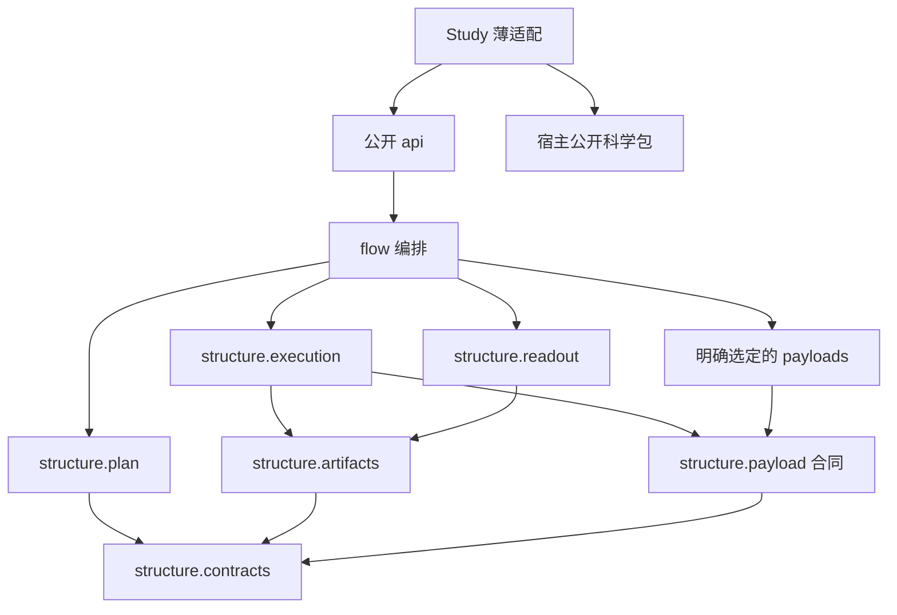

**研究流水线 代码结构设计**
更新日期：2026年10月21日。项目为 [RPipe](https://github.com/DreamSoul-AI/RPipe)，“研究流水线”为建议中文名，待确认。本文将 [架构设计](<研究流水线 架构设计.md>) 的职责落到文件，是待审目标，不是当前目录的复述，也不表示已移动源码。本轮仅改文档和清理明确运行产物。

# 一、结构选择与依赖方向
架构需要声明计划、唯一执行者、产物发布、科学载荷接入和只读分析六类职责。它们共享少量合同对象，规模仍适合一个Python包。保留 `structure/` 表达可组合机制，`flow/` 负责入口与顺序，不增加应用服务层、仓储层、插件注册服务或每个对象一层API。只有真实可选依赖和不同后端故障才拆载荷文件。



箭头表示允许的源码导入。flow在组装点选择载荷实现并注入execution，execution不反向导入flow或猜测Study。宿主公开包不导入Study或RPipe，模板库不静态导入某个正式Study。动态加载仍须由实际声明明确指定，不能绕过来源和接口校验。

# 二、目标目录与每个Python文件
## （一）可执行源码
```text
RPipe/
├─ README.md
├─ AGENTS.md
├─ LICENSE.md
├─ pyproject.toml
├─ src/rpipe/
│  ├─ __init__.py
│  ├─ __main__.py
│  ├─ api.py
│  ├─ structure/
│  │  ├─ __init__.py
│  │  ├─ contracts.py
│  │  ├─ plan.py
│  │  ├─ execution.py
│  │  ├─ artifacts.py
│  │  ├─ payload.py
│  │  └─ readout.py
│  ├─ flow/
│  │  ├─ __init__.py
│  │  ├─ cli.py
│  │  ├─ run.py
│  │  ├─ stages.py
│  │  └─ study.py
│  └─ payloads/
│     ├─ __init__.py
│     ├─ native.py
│     └─ huggingface.py
├─ studies/<name>/
│  ├─ study.yaml
│  ├─ experiment_config.yaml
│  ├─ structure/recipe.py
│  └─ flow/execute.py
├─ tests/rpipe/
│  ├─ test_api.py
│  ├─ test_main.py
│  ├─ structure/
│  │  ├─ test_contracts.py
│  │  ├─ test_plan.py
│  │  ├─ test_execution.py
│  │  ├─ test_artifacts.py
│  │  ├─ test_payload.py
│  │  └─ test_readout.py
│  ├─ flow/
│  │  ├─ test_cli.py
│  │  ├─ test_run.py
│  │  ├─ test_stages.py
│  │  └─ test_study.py
│  └─ payloads/
│     ├─ test_native.py
│     └─ test_huggingface.py
└─ docs/
   ├─ 研究流水线 通用调研.md
   ├─ 研究流水线 架构设计.md
   ├─ 研究流水线 代码结构设计.md
   └─ 研究流水线 研究计划.md
```

树中Study的recipe和execute是有实际适配时才需要的示例，不强制每个Study创建两个空文件。共享静态测试输入按需放 `tests/_data/`，不复制正式Study或历史运行。主工程没有 `tests/README`、Study README/PLAN/报告或第五份规则文档。`__init__.py` 只在公共导出或实际包边界有需要时保留，不以空目录数量验收。

| **Python文件** | **唯一职责和提供接口的含义** | **依赖限制** |
| --- | --- | --- |
| `__init__.py` | 稳定版本和选定公开符号，导入不创建文件或设备资源 | 仅无副作用公开导出 |
| `__main__.py` | 将 `python -m rpipe` 转给CLI，传回退出码 | 只导入flow.cli |
| `api.py` | 暴露声明检查、显式执行/取消、只读读取和汇总入口，区分读写操作 | 可组装flow与structure，不保有第二份状态 |
| `structure/contracts.py` | Study/Plan/Run identity、有效配置、结果、状态、Payload接口与错误类别 | 标准库，不导入其他业务模块或Torch |
| `structure/plan.py` | 纯展开因素/seed、校验依赖，返回不可变计划与冲突诊断 | contracts；不写盘、不创建载荷或启动进程 |
| `structure/execution.py` | 执行准入、自己启动的进程/句柄、取消与终态，首要故障和清理故障分别记录 | contracts、payload、artifacts；不负责科研指标判断 |
| `structure/artifacts.py` | 显式根路径、身份校验、原子文件发布和只读解析原语 | contracts和文件系统；读函数不调用创建函数 |
| `structure/payload.py` | 校验被选载荷的输入输出与恢复条件，把共享输入描述转成只读引用 | contracts；不内置宿主算法或默认选择GPU |
| `structure/readout.py` | 读取已有Run、报告缺失/损坏、按固定Experiment/seed汇总 | contracts、artifacts；不调用execution或载荷 |
| `flow/cli.py` | 参数解析、显式读写命令路由、组装所选后端和退出码 | api之外的内部组装入口；不重复实现状态判断 |
| `flow/run.py` | 将计划、执行器、产物和载荷组装为一次调用，按阶段移交 | structure、stages、study；不另建调度权 |
| `flow/stages.py` | 默认六阶段的有意义步骤，write定稿前完成必需收集，process独立分析 | structure合同，不为每阶段新增一套状态 |
| `flow/study.py` | 按已校验声明加载薄适配，隔离同名模块与清理本次加载对象 | contracts、标准库；不静态导入正式Study |
| `payloads/native.py` | 保留实际使用的原生PyTorch训练/评测及checkpoint适配，委托明确的模型/数据构造器 | contracts、payload及Torch等所选依赖；不导入flow/Study |
| `payloads/huggingface.py` | 需要时适配Trainer生命周期、输出与恢复，延迟加载可选依赖 | contracts、payload及被选第三方；不在无HF环境阻止纯读取 |
| `studies/<name>/structure/recipe.py` | 把本研究声明映射到宿主公开工厂与有效配置 | rpipe.api和宿主公开接口；不复制调度器 |
| `studies/<name>/flow/execute.py` | 如有必要，调用宿主公开任务并转成Payload结果 | rpipe.api和宿主公开接口；不保留通用执行权 |

原生适配不是要求把所有模型代码压入一个巨文件。迁移前逐项保留现有公开行为和数值条件；若模型/数据实现确实复用，留在对应科学包或具有独立输入输出的内聚模块，再在本表补齐其职责。没有实际复用和故障场景，不预建data/model/algorithm/system多层外壳。原生与HF不是本轮新增实现，既有适配能力在重构中不能静默丢失。

公开入口的精确函数名、签名和旧导入兼容表在获准实现时确认，不能按目标树直接删除旧API。当前 `structure/api/`、`flow/runner.py`、阶段子目录仍存在，本轮一字未改。目标 `flow/execute.py` 适配形状也不是当前loader已经支持的合同，迁移必须同时验证旧hook加载、调用顺序和错误传播。

## （二）Study源声明与输出
所有仓共用一个原则：Study是研究入口的适配层，宿主自己的运行时包按其领域组织。dayan回到legacy包、SD使用标准Python包，都不因模板而把科学核心重排为六阶段。

源目录只保存声明、人工维护的真实参数和薄适配。外部数据/权重不进Git，科学输入的小型静态JSON可以留在源目录，其身份和使用条件必须清楚。当前main_exp的两个真实静态JSON暂留旧位置，不借本轮改路径。

```text
studies/<name>/                         # Git：声明与薄适配
<显式运行根>/<study>/<version>/          # 非Git：一次研究版本
  runs/<id>/<attempt>/                  # 有效配置、结果、日志、checkpoint
  summary/                             # 跨Run分析、证据、图与报告
  provenance/                          # 实际源码/输入身份及必要快照
<显式共享输入根>/                        # 原始数据/权重，按身份只读复用
```

运行根由调用方提供，与源码目录分离，不能隐式搜索本机绝对目录。该新路径是目标，当前0.4.1仍在Study下写产物，不能把本图当现有CLI用法。运行过程可以记录实际外部位置，长期AGENTS不写盘符/机器路径。摘要只在通用调研保留一份小表，PR记录本次进展，不把运行目录再变成提交文件清单。

# 三、测试镜像与依赖草案
## （一）镜像和必要路径
`tests/rpipe/structure/test_plan.py` 对应plan的纯展开与冲突，`test_artifacts.py` 对应读取/替换故障，`test_execution.py` 对应重复启动、取消与未知执行状态，`test_readout.py` 对应缺失peer和完整性。flow的测试覆盖组装顺序、Study同名加载隔离与CLI的可观察副作用。native/HF适配只覆盖本仓承诺的生命周期与恢复，不复制上游库内部算子测试。

| **测试文件，均在tests/rpipe下** | **主要合同或失败路径** |
| --- | --- |
| `test_api.py` | 公开读写入口可区分，导入无副作用，旧公开入口兼容按审定表验证 |
| `test_main.py` | 模块入口与CLI参数/退出码一致，不重复执行载荷 |
| `structure/test_contracts.py` | 身份、状态和错误类别的合法/非法表示，未知或坏数据不伪成功 |
| `structure/test_plan.py` | 因素与seed的确定性展开、依赖冲突及零外部副作用 |
| `structure/test_execution.py` | 双启动、取消失败、所属进程回收和旧成功保护 |
| `structure/test_artifacts.py` | 越根路径、身份不符、截断和替换失败，读取不修写 |
| `structure/test_payload.py` | 输入输出适配和恢复条件拒绝，不隐式创建设备或选模型 |
| `structure/test_readout.py` | 缺失/损坏可选数据保留peer，seed不齐和不兼容组不伪完整 |
| `flow/test_cli.py` | 实际参数路由、读命令零写盘、明确退出码和取消信号传递 |
| `flow/test_run.py` | 组装真实计划到终态的有限合成调用，唯一执行权不被另建 |
| `flow/test_stages.py` | 六阶段顺序、write前必要收集、process失败不覆盖科学成功 |
| `flow/test_study.py` | 声明加载、同名模块隔离、坏hook和本次加载对象清理 |
| `payloads/test_native.py` | 本仓原生适配的状态、checkpoint和自身best独立评测 |
| `payloads/test_huggingface.py` | 可选依赖缺失的隔离、Trainer结果与恢复合同，不测试HF内部算法 |

`__init__.py` 的纯导出与导入副作用由公开入口测试覆盖，不递归创建只测命名空间的文件。Study适配有独立行为时，其测试镜像实际 `studies/<name>/structure/recipe.py` 或 `flow/execute.py` 路径；不要求每个Study复制上表，也不复制正式运行数据。

测试不按unit/integration/e2e新增三套目录，同一源路径用标签表达层级。需要跨模块时以主入口的镜像文件承载一个明确调用路径。详细质量场景、标签维度、隔离和CI设计只在 [架构设计](<研究流水线 架构设计.md>) 维护，不再建立测试规范副本。

跨仓固定副本的内部合同由RPipe仓测。宿主只测自己的适配、领域数值行为和所承诺的端到端路径，不复制Rpipe测试辅助脚本。迁移后先跑合成失败路径，再按研究计划扩到科学对照；不为文档改名增加镜像实现的测试。

## （二）Import Linter草案
下面是**目标模块存在后**可接入的INI草案，不是已安装/已执行检查，也不修改当前配置。`forbidden` 默认含间接导入，子包默认展开；本草案利用这一点防止通过第三模块绕路。`protected` 只限制直接导入，不能用来证明全链边界，本草案不混用它。[官方Forbidden合同](https://import-linter.readthedocs.io/en/stable/contract_types/forbidden/)，[Protected语义](https://import-linter.readthedocs.io/en/stable/contract_types/protected/)，2026年10月21日访问。

```ini
[importlinter]
root_package = rpipe

[importlinter:contract:mechanisms-do-not-know-flow]
name = 机制与科学后端不反向依赖编排
type = forbidden
source_modules =
    rpipe.structure
    rpipe.payloads
forbidden_modules =
    rpipe.flow

[importlinter:contract:pure-contracts]
name = 合同不反向依赖机制实现
type = forbidden
source_modules =
    rpipe.structure.contracts
forbidden_modules =
    rpipe.structure.plan
    rpipe.structure.execution
    rpipe.structure.artifacts
    rpipe.structure.payload
    rpipe.structure.readout
    rpipe.payloads

[importlinter:contract:readonly-does-not-execute]
name = 读取不取得执行权
type = forbidden
source_modules =
    rpipe.structure.readout
forbidden_modules =
    rpipe.structure.execution
    rpipe.payloads
```

合同对象放contracts，不放execution，否则只读模块会因取类型而反向依赖执行。宿主仓要禁止公开科学包导入RPipe时，使用其实际root_package和外部包分析选项建立本仓规则，不能照抄虚构包名。动态导入、运行时副作用与文件来源不在静态导入分析的充分保证内，仍需合同测试。

# 四、审后迁移次序和本轮边界
1. 先固定当前入口、结果格式、来源与失败反例，不把旧债务分支作为新实现基线
2. 明确精确API兼容与Run路径迁移，先将纯合同/计划和只读边界分开，再迁移执行权和产物发布
3. 迁移科学载荷和Study薄适配时做同条件数值对照，不能凭文件移动完成认定行为等价
4. RPipe上游检查通过后记录完整提交，整套同步固定副本到下游，核对清单、哈希与许可证。下游不单独修嵌入文件
5. 精简旧路径测试和重复辅助脚本，把必要断言重新映射到本仓合同。源码/测试删除按当时授权执行

本轮仅删除重复文档与明确生成物，保留所有可执行源码、测试、活跃YAML、构建/CI配置和真实静态输入原字节。旧location门、冻结TARGET引用和部分报告导出路径因此需审后迁移，暂未验证目标结构的可运行性、Import Linter、数值、性能或异机行为。MIT许可证保留，不以文档上限删除法律文本。
