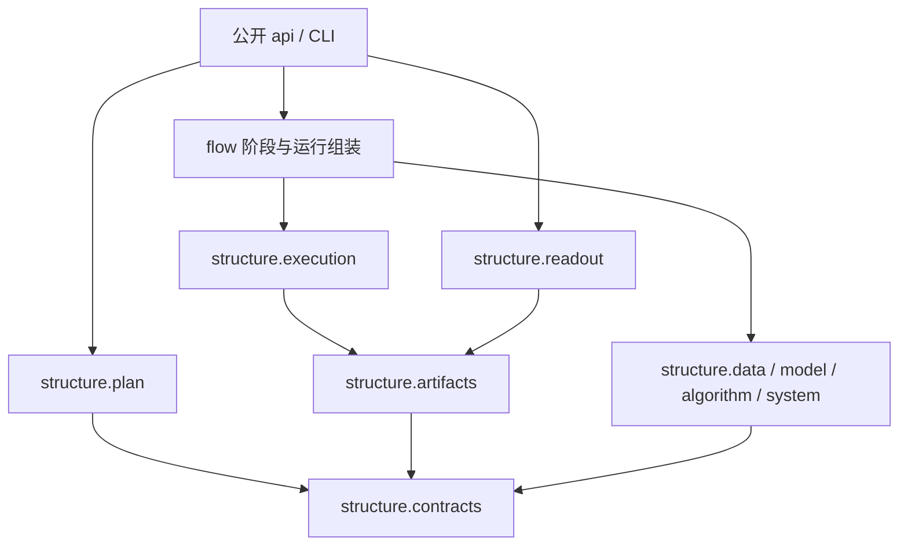

**研究流水线 代码结构设计**
更新日期：2026年10月22日。项目为 [RPipe](https://github.com/DreamSoul-AI/RPipe)。本次修复恢复库内 `structure/`、`flow/` 两柱边界；下表是本分支的落位合同，验证结果以 Draft PR 的固定提交为准。

# 一、设计依据与边界
改版前 [代码总览](https://github.com/DreamSoul-AI/RPipe/blob/ed0d50be4328af3480b54de31243bf507901d033/docs/code/code.md) 明确规定两柱：structure 提供建构与计算组件，flow 组织阶段、生命周期与执行顺序。之前将这些组件整体迁入与两柱平级的第三个目录，破坏了已有边界。本次按职责归回，不在 structure 内保留同名大包，也不为迁移增加兼容转发树。

DreamSoul 的软件架构资料和 CPU 内存清理样板提供质量场景、合同、状态和依赖的描述方法，没有要求增加第三柱。目录决定首先服从 RPipe 已有概念和用户确认的边界。

| 位置 | 职责 | 允许依赖与约束 |
| --- | --- | --- |
| 包根入口 | `__init__.py` 版本、`__main__.py` CLI、`api.py` 公开调用 | 入口可装配两柱；不建立第三个实现包 |
| structure | 声明/配置、执行权机制、产物、读取，以及data/model/algorithm/system组件 | 不导入flow或公开装配api，不静态导入正式Study |
| flow | CLI、原生/HF组装、六阶段、Study加载、导出 | 显式调用structure；具体科学依赖在执行时装载 |
| Study | 研究声明和确有需要的薄适配 | 使用明确公共入口和领域组件，不复制执行框架 |



箭头是源码依赖。`flow/native.py` 负责组装，不供algorithm反向调用；合作取消检查在 `structure/system/runtime.py`。模型构造等可能调用system的明确来源/随机性工具，这些实际依赖保留，不为形式分层再包一遍工厂。

# 二、目录与文件职责
## （一）公共入口与两柱骨架
```text
src/rpipe/
  __init__.py
  __main__.py
  api.py
  structure/
    __init__.py
    contracts.py
    plan.py
    execution.py
    artifacts.py
    readout.py
    comparison.py
    data/
    model/
    algorithm/
    system/
  flow/
    __init__.py
    cli.py
    run.py
    native.py
    huggingface.py
    stages.py
    study.py
    exports.py
```

| 文件 | 实际职责和状态归属 |
| --- | --- |
| `api.py` | plan/run/cancel/make/launch/read/process的公开入口；保留明确读写区分 |
| `structure/contracts.py` | 配置、RunSpec、Budget、Cancellation、RunOutcome；仅标准库，不含未消费的Payload协议 |
| `structure/plan.py` | 纯声明展开、因素/seed与依赖校验，不写盘或装载recipe |
| `structure/execution.py` | RunContext、运行实现的四个入口检查、唯一执行权、所属资源与终态；不选择科学后端 |
| `structure/artifacts.py` | 显式根、身份、配置/JSON原子发布、执行权与共享缓存原语；读取不创建目录 |
| `structure/readout.py` | status/logs/report、Run读取和跨seed统计；不导入执行或科学组件 |
| `flow/cli.py` | 参数、命令路由、退出码 |
| `flow/run.py` | 本Run子进程请求/响应配对、预算、取消、worker与装配注入 |
| `flow/stages.py` | 默认六阶段顺序、配置不变检查和hook时机 |
| `flow/study.py` | recipe/阶段加载，同名模块隔离及本次加载对象的清理 |
| `flow/exports.py` | 显式曲线/TensorBoard导出，不进入只读路径 |

## （二）科学组件及阶段装配
每个包只因下列真实实现存在而建立。data/model/algorithm/system沿用原领域职责，第三方适配留在所属领域；所有数值、checkpoint、来源和清理实现随迁移保留。

| Python文件 | 唯一职责 |
| --- | --- |
| `structure/algorithm/factory.py` | 算法注册、原生/HF选择与hook |
| `structure/algorithm/batch.py` | batch解包和Tensor转移 |
| `structure/system/factory.py` | System构造、设备放置、checkpoint bundle与提交点 |
| `structure/comparison.py` | Tensor、复杂数、大整数、checkpoint和轨迹的深比较 |
| `structure/data/factory.py` | Data与数据注册/构造、迭代器资源归属 |
| `structure/data/prepare.py` | 显式共享输入准备，拒绝隐式下载 |
| `structure/data/profile.py` | 统计文件读取与显式统计输出 |
| `structure/data/resume.py` | sampler、batch游标和生成器状态 |
| `structure/algorithm/evaluation.py` | 原生独立评测循环 |
| `structure/algorithm/evaluation_support.py` | 评测时机、best选择和早停判断 |
| `structure/algorithm/hf_map.py` | 已有HF训练参数映射 |
| `flow/huggingface.py` | 选择HF训练实现并接入默认阶段 |
| `structure/algorithm/transformers_trainer.py` | Trainer的训练、评测、恢复、best和取消 |
| `structure/model/input_norm.py` | 模型输入归一化 |
| `structure/algorithm/kwargs.py` | 已支持调用参数的过滤 |
| `structure/system/logger.py` | 业务日志与本Run句柄关闭 |
| `structure/algorithm/metrics.py` | 已有科学测量公式 |
| `structure/model/architectures.py` | linear/mlp/cnn/resnet等实际模型 |
| `structure/model/factory.py` | Model与模型注册、构造及权重入口 |
| `flow/native.py` | 按prepare/execute/collect/close组装四类组件，恢复本Run注册表 |
| `structure/algorithm/optim.py` | 优化器和scheduler构造 |
| `structure/system/origin.py` | 固定来源、endpoint和下载策略 |
| `structure/algorithm/progress.py` | 训练/评测进度和checkpoint时点 |
| `structure/algorithm/resume.py` | checkpoint恢复条件、RNG与自身train依赖 |
| `structure/system/runtime.py` | 设备/精度/随机性与合作取消检查 |
| `structure/system/torchvision_load.py` | 延迟装载本机torchvision |
| `structure/algorithm/tracker.py` | 轨迹、回滚边界和checkpoint后报告 |
| `structure/algorithm/train.py` | 原生训练数值、更新与提交顺序 |
| `structure/system/transfers.py` | 已有传输策略与第三方SDK适配 |

各包 `__init__.py` 只标识包边界，无递归科学导入。`flow/native.py` 的NativeRun和 `flow/huggingface.py` 的HuggingFaceRun是阶段装配实现；子进程监督在flow/run.py的ProcessRun。四个生命周期方法仍为prepare/execute/collect/close。上下文使用structure.execution.RunContext，不再存在独立的structure/payload.py。

### 已实现公共合同与迁移

- `api.plan(study_dir, *, run_root, version=None) -> tuple[RunSpec,...]`：组装源YAML和实际源码摘要，纯expand只收已解析声明，不装载recipe、不写盘。
- `api.run(spec, *, payload=None, budget=None, cancellation=None) -> RunOutcome`：默认独立科学子进程；显式注入运行实现可做同进程CPU调用，但不接受硬timeout/RSS。`cancel(token)`只请求自己的执行取消。
- `api.make(specs)`：同一Study/version输出根内，配置发布取得本Run执行权，索引发布持有计划锁。`launch(specs, *, budget=None, cancellation=None)`默认串行，unknown停止新派发，eval只接同seed同条件的成功train。
- `read_run(spec)`、`aggregate(specs)`、`report(specs)`、`logs(spec)`是零执行零写读取。Experiment以去seed的有效条件、source/version分组，重复Run/seed拒绝，样本std沿用n-1，缺seed不补零。
- `compare(a,b, *, differences=())`只接受同seed/source/version配对，各条件差异须显式声明。`compare_runs(run_a,run_b, *, atol=0,rtol=0,checkpoints=None,study_dir=None)`保留真实Tensor/optimizer/scheduler/轨迹目录深比较，显式选择此科学接口才加载必要Torch；目录来源不会自动验证/补签；旧recipe定义的pickle类须显式给study_dir（CLI --study-source），科学比较模块只接注入reader，不推断父目录或反向导入flow。
- `process(specs)`只写外部summary并运行Study scope process hook，不重跑science；`flow.exports.write_learning_curves(study_root,index, *, title=None)`、`export_tensorboard(study_root,destination)`是明确派生输出。

旧内部导入不自动恢复，调用方使用本表明确路径，不提供几十层旧import兼容壳。recipe的同名/相对/迁位pickle恢复与已有`flow/<phase>/__init__.py` hook仍保留；同一阶段也支持单文件hook但两形状不能同时存在。prepare.before由Native在system构造后、recipe前调用一次，write hook先于正式发布，其余hook跟随默认阶段。Native注册表按Run隔离恢复。

| 旧用法 | 新行为与明确破坏点 |
| --- | --- |
| Study内隐式runs/shared与自动旧cache迁移 | 所有CLI显式`--run-root`；不自动搬移、回签或重放旧Run |
| `structure.api/*`、控制/科学多层内部导入 | 纯配置取contracts，科学组件取structure的data/model/algorithm/system，研究入口取api |
| make生成脚本/jobs，旧GPU轮次/阶段裁剪 | make只发布有效配置/index；统一launch/run/run-one接入同一owner，不接受旧GPU分配与任意阶段跳过参数 |
| report写源码NUMBERS、process写源码docs | report只呈现；process/`--figures`写外部summary |
| 旧目录compare | CLI必须`--legacy`，保留实际深比较但来源标unverified；显式`--out`才写外部结果 |
| 旧冻结version | 新main_probe/main_exp version，historical_version只存原身份，不覆盖旧成功 |


公开 `run(..., payload=...)` 参数保留现有调用兼容；它接收本次运行实现，不代表第三个源码层。内部旧模块路径和类名迁移，不增加空转发模块。源码路径变化会改变source_digest；旧Run不迁移、不补签、不原地覆盖，调用方显式选新version。

## （三）Study入口
`studies/<name>/study.yaml`、`experiment_config.yaml` 是源声明；实际有recipe时按声明使用根 `recipe.py`。研究计算在Study自己的structure，阶段hook在flow；不要求每个研究建立同样的空树。正式Study、`tests/_data`中的工作进程和动态生成recipe均需同步导入路径。

<a id="二study源声明与输出"></a>

## （四）Study源声明与输出
所有仓共用一个原则：Study是研究入口的适配层，宿主自己的运行时包按其领域组织。dayan回到legacy包、SD使用标准Python包，都不因模板而把科学核心重排为六阶段。

源目录只保存声明、人工维护的真实参数和薄适配。文件按用途和实际消费者分类，不按扩展名判断：

| **用途与消费者** | **保留与归属** |
| --- | --- |
| 正式源码、独立编写的verify/render/诊断脚本 | 属于代码，不能借运行物授权删除；审后按职责归位。正式`src/rpipe/`与固定副本不属于运行快照 |
| 运行档案复制的source树、`.py`、展开配置YAML，旧Run计划绑定、阅读取证、评测CSV | 属于运行/源码快照或证据，归外部运行根，本轮可清理；即使被`provenance.include`引用也不变成源输入，不回签旧Run |
| 真实校准PT、原始数据/权重、实际输入pin/hash与人工维护的科学参数 | 保护原字节和身份，删除另获授权；外部数据归共享输入根，必要小型静态输入归源码侧inputs位置 |
| 第三方原件、法律许可、当前实际打包/接入消费的固定来源元数据 | 保留准确且必要的原字节例外，不能把失效档案或第一方报告冒充该例外 |

当前main_exp的两个真实静态JSON暂留旧位置，不借本轮改路径；审后归源码侧输入位置，不继续在docs累积静态JSON例外。外部数据/权重不进Git，输入身份和使用条件必须清楚。

```text
studies/<name>/                         # Git：声明与薄适配
<显式运行根>/<study>/<version>/          # 非Git：一次研究版本
  runs/<id>/                            # config/result/assets正式科学事实
    attempts/<uuid>/                     # request/response/worker日志/首错及清理记录
  summary/                             # 跨Run分析、证据、图与报告
  provenance/                          # 实际源码/输入身份及必要快照
<显式共享输入根>/                        # 原始数据/权重，按身份只读复用
```

运行根由调用方提供，与源码目录分离，不能隐式搜索本机绝对目录。当前实现已采用显式根；包版本仍为0.4.1，本修复保持Draft。运行过程可以记录实际外部位置，长期AGENTS不写盘符/机器路径。摘要只在通用调研保留一份小表，PR记录本次进展，不把运行目录再变成提交文件清单。


# 三、测试镜像与依赖检查
测试镜像实际模块：data/model/algorithm/system分别对应tests/rpipe/structure同名目录，native/HF阶段装配对应tests/rpipe/flow。比较对应structure/test_comparison.py；原上下文/结果约束测试归到structure/test_execution_results.py。模块有多个独立合同可用后缀分文件，不为命名空间或不存在的源码建立占位测试。

| 测试入口 | 验证合同 |
| --- | --- |
| `tests/rpipe/test_architecture.py` | 仅structure/flow两实现树，structure不反向导入flow/api，包括函数内导入 |
| `tests/rpipe/test_api.py` | plan不装载任何科学领域或后端；公开读写合同 |
| `tests/rpipe/structure/test_execution*.py` | 准入、双启动、取消、原始/清理故障、收集结果与配置不变 |
| `tests/rpipe/structure/test_artifacts*.py` | 原子写、损坏、路径、共享输入与失败时原件保全 |
| `tests/rpipe/structure/test_readout*.py` | 只读、身份、缺seed、n-1聚合和未验证来源 |
| `tests/rpipe/structure/{data,model,algorithm,system}/` | 迁移后的科学组件、恢复、日志、数值和SDK边界 |
| `tests/rpipe/flow/test_native.py`、`test_huggingface.py` | prepare hook、注册表隔离、有限原生/HF集成 |
| `tests/rpipe/flow/test_run.py`、`test_stages.py` | 子进程所属、请求配对、阶段顺序与发布 |
| `tests/studies/`、`tests/package_smoke.py` | 薄适配调用方和实际安装产物 |

层级、目标、成本、优先级与结果类型沿用架构文档和现有marker。统一入口tests/run.py；新目录边界测试是unit/location，自动被现有CPU core CI收集，不改workflow或保护策略。阶段语义、输出、数值及故障断言沿用迁移后的原测试，不能只凭目录检查通过宣告正确。

`.importlinter`继续声明四条规则：structure不依赖flow/api；contracts不依赖实现；plan不依赖执行/产物/读取/科学组件；readout不依赖执行/科学组件。实际Import Linter未安装时不宣称其通过，标准库AST检查只覆盖静态import（含函数内），动态装载和副作用需现有行为测试。

# 四、历史文档与当前使用范围
改版前固定提交 `ed0d50be4328af3480b54de31243bf507901d033` 的35个原文件（33份docs正文及README/AGENTS）已按用户要求恢复成独立本地历史快照，并逐字节核对Git blob。正文、相对目录与历史规范副本均未改写；位置和校验清单见本次PR及交付链接。其完整入口仍可从[固定版本docs](https://github.com/DreamSoul-AI/RPipe/tree/ed0d50be4328af3480b54de31243bf507901d033/docs)读取。

历史概念、结构、Flow、layout、测试、CI和研究材料供恢复设计依据；旧命令、源码/运行目录混放及过去验收数字不能直接当作本版合同。当前功能以本仓现有文档和源码为准；历史快照保留完整分册供对照，当前合同细节继续在相应文档维护。

本次只修复归属、调用方、必要测试与文档，不改变科学算法。硬RSS、注入实现硬超时、外部任意输入字节身份、Windows未知子孙进程和旧Run复用的限制继续保留。GPU、正式MNIST/CIFAR矩阵、长程性能、下游固定副本同步和合并不在本次范围。
