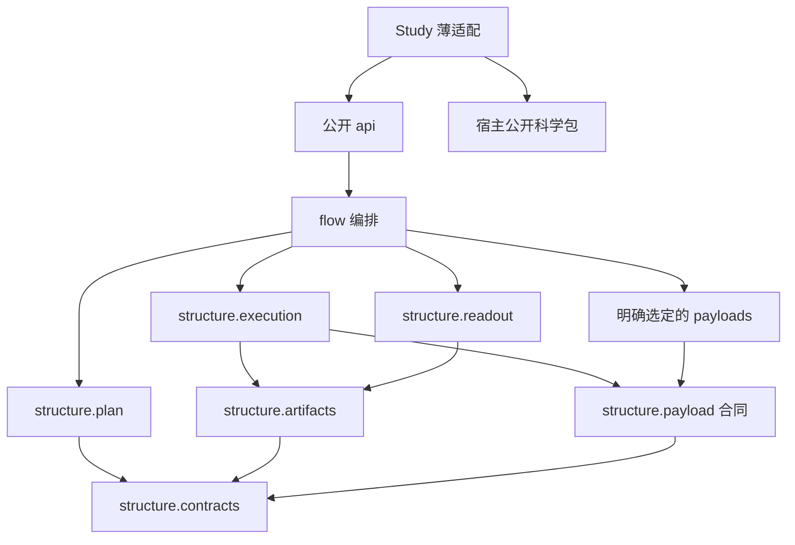

**研究流水线 代码结构设计**
更新日期：2026年10月21日。项目为 [RPipe](https://github.com/DreamSoul-AI/RPipe)，中文名为“研究流水线”。本文将 [架构设计](<研究流水线 架构设计.md>) 的职责落到本次已授权代码试验。第一版迁移自538a2b9；实际通过范围绑定新代码PR的固定HEAD，旧文档Draft保持不动。

# 一、结构选择与依赖方向
架构需要声明计划、唯一执行者、产物发布、科学载荷接入和只读分析六类职责。它们共享少量合同对象，规模仍适合一个Python包。保留 `structure/` 表达可组合机制，`flow/` 负责入口与顺序，不增加应用服务层、仓储层、插件注册服务或每个对象一层API。只有真实可选依赖和不同后端故障才拆载荷文件。



箭头表示允许的源码导入。flow在组装点选择载荷实现并注入execution，execution不反向导入flow或猜测Study。宿主公开包不导入Study或RPipe，模板库不静态导入某个正式Study。动态加载仍须由实际声明明确指定，不能绕过来源和接口校验。

# 二、目标目录与每个Python文件
## （一）可执行源码
```text
RPipe/
├─ README.md
├─ AGENTS.md
├─ LICENSE.md
├─ pyproject.toml
├─ src/rpipe/
│  ├─ __init__.py
│  ├─ __main__.py
│  ├─ api.py
│  ├─ structure/
│  │  ├─ __init__.py
│  │  ├─ contracts.py
│  │  ├─ plan.py
│  │  ├─ execution.py
│  │  ├─ artifacts.py
│  │  ├─ payload.py
│  │  └─ readout.py
│  ├─ flow/
│  │  ├─ __init__.py
│  │  ├─ cli.py
│  │  ├─ run.py
│  │  ├─ stages.py
│  │  ├─ study.py
│  │  └─ exports.py
│  └─ payloads/
│     ├─ __init__.py
│     ├─ native.py
│     └─ huggingface.py
├─ studies/<name>/
│  ├─ study.yaml
│  ├─ experiment_config.yaml
│  ├─ structure/recipe.py
│  └─ flow/execute.py
├─ tests/rpipe/
│  ├─ test_api.py
│  ├─ test_main.py
│  ├─ structure/
│  │  ├─ test_contracts.py
│  │  ├─ test_plan.py
│  │  ├─ test_execution.py
│  │  ├─ test_artifacts.py
│  │  ├─ test_payload.py
│  │  └─ test_readout.py
│  ├─ flow/
│  │  ├─ test_cli.py
│  │  ├─ test_run.py
│  │  ├─ test_stages.py
│  │  └─ test_study.py
│  └─ payloads/
│     ├─ test_native.py
│     └─ test_huggingface.py
└─ docs/
   ├─ 研究流水线 通用调研.md
   ├─ 研究流水线 架构设计.md
   ├─ 研究流水线 代码结构设计.md
   └─ 研究流水线 研究计划.md
```

树中Study的recipe和execute是有实际适配时才需要的示例，不强制每个Study创建两个空文件。共享静态测试输入按需放 `tests/_data/`，不复制正式Study或历史运行。主工程没有 `tests/README`、Study README/PLAN/报告或第五份规则文档。`__init__.py` 只在公共导出或实际包边界有需要时保留，不以空目录数量验收。

| **Python文件** | **唯一职责和提供接口的含义** | **依赖限制** |
| --- | --- | --- |
| `__init__.py` | 稳定版本和选定公开符号，导入不创建文件或设备资源 | 仅无副作用公开导出 |
| `__main__.py` | 将 `python -m rpipe` 转给CLI，传回退出码 | 只导入flow.cli |
| `api.py` | 暴露声明检查、显式执行/取消、只读读取和汇总入口，区分读写操作 | 可组装flow与structure，不保有第二份状态 |
| `structure/contracts.py` | Study/Plan/Run identity、有效配置、结果、状态、Payload接口与错误类别 | 标准库，不导入其他业务模块或Torch |
| `structure/plan.py` | 纯展开因素/seed、校验依赖，返回不可变计划与冲突诊断 | contracts；不写盘、不创建载荷或启动进程 |
| `structure/execution.py` | 执行准入、自己启动的进程/句柄、取消与终态，首要故障和清理故障分别记录 | contracts、payload、artifacts；不负责科研指标判断 |
| `structure/artifacts.py` | 显式根路径、身份校验、原子文件发布和只读解析原语 | contracts和文件系统；读函数不调用创建函数 |
| `structure/payload.py` | 校验被选载荷的输入输出与恢复条件，把共享输入描述转成只读引用 | contracts；不内置宿主算法或默认选择GPU |
| `structure/readout.py` | 读取已有Run、报告缺失/损坏、按固定Experiment/seed汇总 | contracts、artifacts；不调用execution或载荷 |
| `flow/cli.py` | 参数解析、显式读写命令路由、组装所选后端和退出码 | api之外的内部组装入口；不重复实现状态判断 |
| `flow/run.py` | 将计划、执行器、产物和载荷组装为一次调用，按阶段移交 | structure、stages、study；不另建调度权 |
| `flow/stages.py` | 默认六阶段的有意义步骤，write定稿前完成必需收集，process独立分析 | structure合同，不为每阶段新增一套状态 |
| `flow/study.py` | 按已校验声明加载薄适配，隔离同名模块与清理本次加载对象 | contracts、标准库；不静态导入正式Study |
| `payloads/native.py` | 保留实际使用的原生PyTorch训练/评测及checkpoint适配，委托明确的模型/数据构造器 | contracts、payload及Torch等所选依赖；不导入flow/Study |
| `payloads/huggingface.py` | 需要时适配Trainer生命周期、输出与恢复，延迟加载可选依赖 | contracts、payload及被选第三方；不在无HF环境阻止纯读取 |
| `studies/<name>/structure/recipe.py` | 把本研究声明映射到宿主公开工厂与有效配置 | rpipe.api和宿主公开接口；不复制调度器 |
| `studies/<name>/flow/execute.py` | 如有必要，调用宿主公开任务并转成Payload结果 | rpipe.api和宿主公开接口；不保留通用执行权 |

原生适配不是要求把所有模型代码压入一个巨文件。迁移前逐项保留现有公开行为和数值条件；若模型/数据实现确实复用，留在对应科学包或具有独立输入输出的内聚模块，再在本表补齐其职责。没有实际复用和故障场景，不预建data/model/algorithm/system多层外壳。原生与HF不是本轮新增实现，既有适配能力在重构中不能静默丢失。

### 已实现公共合同与迁移

- `api.plan(study_dir, *, run_root, version=None) -> tuple[RunSpec,...]`：组装源YAML和实际源码摘要，纯expand只收已解析声明，不装载recipe、不写盘。
- `api.run(spec, *, payload=None, budget=None, cancellation=None) -> RunOutcome`：默认独立科学子进程；显式注入Payload可做同进程CPU调用，但不接受硬timeout/RSS。`cancel(token)`只请求自己的执行取消。
- `api.make(specs)`：同一Study/version输出根内，配置发布取得本Run执行权，索引发布持有计划锁。`launch(specs, *, budget=None, cancellation=None)`默认串行，unknown停止新派发，eval只接同seed同条件的成功train。
- `read_run(spec)`、`aggregate(specs)`、`report(specs)`、`logs(spec)`是零执行零写读取。Experiment以去seed的有效条件、source/version分组，重复Run/seed拒绝，样本std沿用n-1，缺seed不补零。
- `compare(a,b, *, differences=())`只接受同seed/source/version配对，各条件差异须显式声明。`compare_runs(run_a,run_b, *, atol=0,rtol=0,checkpoints=None,study_dir=None)`保留真实Tensor/optimizer/scheduler/轨迹目录深比较，显式选择此科学接口才加载必要Torch；目录来源不会自动验证/补签；旧recipe定义的pickle类须显式给study_dir（CLI --study-source），科学比较模块只接注入reader，不推断父目录或反向导入flow。
- `process(specs)`只写外部summary并运行Study scope process hook，不重跑science；`flow.exports.write_learning_curves(study_root,index, *, title=None)`、`export_tensorboard(study_root,destination)`是明确派生输出。

旧八个structure多层包、runner/context及六阶段空转发树已退役，调用方真实迁移到上述模块，不提供几十层旧import兼容壳。recipe的同名/相对/迁位pickle恢复与已有`flow/<phase>/__init__.py` hook仍保留；同一阶段也支持单文件hook但两形状不能同时存在。prepare.before由Native在system构造后、recipe前调用一次，write hook先于正式发布，其余hook跟随默认阶段。Native注册表按Run隔离恢复。

| 旧用法 | 新行为与明确破坏点 |
| --- | --- |
| Study内隐式runs/shared与自动旧cache迁移 | 所有CLI显式`--run-root`；不自动搬移、回签或重放旧Run |
| `structure.api/*`、控制/科学多层内部导入 | 纯配置取contracts，科学取扁平payloads，研究入口取api |
| make生成脚本/jobs，旧GPU轮次/阶段裁剪 | make只发布有效配置/index；统一launch/run/run-one接入同一owner，不接受旧GPU分配与任意阶段跳过参数 |
| report写源码NUMBERS、process写源码docs | report只呈现；process/`--figures`写外部summary |
| 旧目录compare | CLI必须`--legacy`，保留实际深比较但来源标unverified；显式`--out`才写外部结果 |
| 旧冻结version | 新main_probe/main_exp version，historical_version只存原身份，不覆盖旧成功 |

实际科学支持保留为以下内聚文件，不再嵌套data/model/algorithm/system工厂壳；均位于`payloads/`，依赖只指向contracts/artifacts及明确科学依赖，禁止回到flow/api。`native.py`与`huggingface.py`负责生命周期选择，其他文件职责如下；测试按主责模块镜像，不复制上游算子测试。

| Python文件 | 真实职责 | 测试镜像（tests/rpipe/payloads/） |
| --- | --- | --- |
| algorithm.py | 算法注册/选择、原生hook协议 | test_algorithm.py |
| batch.py | batch解包与转移 | test_batch.py |
| checkpoints.py | 系统放置、bundle提交点、显式自身train恢复 | test_checkpoints.py / test_train_checkpoint.py |
| comparison.py | Tensor/复杂数/大整数与checkpoint深对照 | test_comparison.py |
| data.py | 离线数据工厂、只回收自己迭代器 | test_data.py |
| data_prepare.py | 显式共享输入准备，拒绝隐式下载 | test_data_prepare.py |
| data_profile.py | 显式输出统计与归一化输入 | test_data_profile.py |
| data_resume.py | 采样与数据状态精确恢复 | test_data_resume.py |
| evaluation.py | 原生完整评测循环 | test_train.py |
| evaluation_support.py | 评测时机、best选择与独立eval | test_evaluation_support.py |
| hf_map.py | 既有HF训练参数映射 | test_hf_map.py |
| huggingface_training.py | Trainer生命周期、step评测/checkpoint/best与取消 | test_huggingface_training.py |
| input_norm.py | 模型输入归一化 | test_input_norm.py |
| kwargs.py | 已支持调用参数过滤 | test_algorithm.py |
| logger.py | 业务日志与自己句柄的关闭 | test_logger.py |
| metrics.py | 原有科学测量公式 | test_metrics.py |
| model_architectures.py | 实际linear/mlp/cnn/resnet实现 | test_models.py |
| models.py | 模型构造和权重入口 | test_models.py |
| optim.py | 优化器和scheduler构造 | test_optim.py |
| origin.py | 既有来源语义 | test_origin.py |
| progress.py | 训练/评测进度 | test_progress.py |
| resume.py | 完整checkpoint恢复条件和自身best依赖 | test_resume.py |
| runtime.py | 本次设备/精度/随机性控制 | test_runtime.py |
| torchvision_load.py | 本机torchvision延迟装载 | test_torchvision_load.py |
| tracker.py | 轨迹、回滚边界和checkpoint后报告 | test_tracker.py |
| train.py | 原生训练数值与提交顺序 | test_train.py / test_train_checkpoint.py |
| transfers.py | 明确Tensor移动与精度转换 | test_runtime.py |

`flow/exports.py`镜像`flow/test_exports.py`，只负责曲线/TensorBoard的显式输出，不进入只读readout依赖链。命名空间`__init__`不递归自测。表中测试职责可由现有同责测试文件合并承载，最终实际清单以PR为准，不新增占位测试。


## （二）Study源声明与输出
所有仓共用一个原则：Study是研究入口的适配层，宿主自己的运行时包按其领域组织。dayan回到legacy包、SD使用标准Python包，都不因模板而把科学核心重排为六阶段。

源目录只保存声明、人工维护的真实参数和薄适配。文件按用途和实际消费者分类，不按扩展名判断：

| **用途与消费者** | **保留与归属** |
| --- | --- |
| 正式源码、独立编写的verify/render/诊断脚本 | 属于代码，不能借运行物授权删除；审后按职责归位。正式`src/rpipe/`与固定副本不属于运行快照 |
| 运行档案复制的source树、`.py`、展开配置YAML，旧Run计划绑定、阅读取证、评测CSV | 属于运行/源码快照或证据，归外部运行根，本轮可清理；即使被`provenance.include`引用也不变成源输入，不回签旧Run |
| 真实校准PT、原始数据/权重、实际输入pin/hash与人工维护的科学参数 | 保护原字节和身份，删除另获授权；外部数据归共享输入根，必要小型静态输入归源码侧inputs位置 |
| 第三方原件、法律许可、当前实际打包/接入消费的固定来源元数据 | 保留准确且必要的原字节例外，不能把失效档案或第一方报告冒充该例外 |

当前main_exp的两个真实静态JSON暂留旧位置，不借本轮改路径；审后归源码侧输入位置，不继续在docs累积静态JSON例外。外部数据/权重不进Git，输入身份和使用条件必须清楚。

```text
studies/<name>/                         # Git：声明与薄适配
<显式运行根>/<study>/<version>/          # 非Git：一次研究版本
  runs/<id>/                            # config/result/assets正式科学事实
    attempts/<uuid>/                     # request/response/worker日志/首错及清理记录
  summary/                             # 跨Run分析、证据、图与报告
  provenance/                          # 实际源码/输入身份及必要快照
<显式共享输入根>/                        # 原始数据/权重，按身份只读复用
```

运行根由调用方提供，与源码目录分离，不能隐式搜索本机绝对目录。本代码分支已采用显式根；包版本0.4.1尚未发布新版，不把本分支等同于已部署dev。运行过程可以记录实际外部位置，长期AGENTS不写盘符/机器路径。摘要只在通用调研保留一份小表，PR记录本次进展，不把运行目录再变成提交文件清单。

# 三、测试镜像与依赖草案
## （一）镜像和必要路径
`tests/rpipe/structure/test_plan.py` 对应plan的纯展开与冲突，`test_artifacts.py` 对应读取/替换故障，`test_execution.py` 对应重复启动、取消与未知执行状态，`test_readout.py` 对应缺失peer和完整性。flow的测试覆盖组装顺序、Study同名加载隔离与CLI的可观察副作用。native/HF适配只覆盖本仓承诺的生命周期与恢复，不复制上游库内部算子测试。

| **测试文件，均在tests/rpipe下** | **主要合同或失败路径** |
| --- | --- |
| `test_api.py` | 公开读写入口可区分，导入无副作用，旧公开入口兼容按审定表验证 |
| `test_main.py` | 模块入口与CLI参数/退出码一致，不重复执行载荷 |
| `structure/test_contracts.py` | 身份、状态和错误类别的合法/非法表示，未知或坏数据不伪成功 |
| `structure/test_plan.py` | 因素与seed的确定性展开、依赖冲突及零外部副作用 |
| `structure/test_execution.py` | 双启动、取消失败、所属进程回收和旧成功保护 |
| `structure/test_artifacts.py` | 越根路径、身份不符、截断和替换失败，读取不修写 |
| `structure/test_payload.py` | 输入输出适配和恢复条件拒绝，不隐式创建设备或选模型 |
| `structure/test_readout.py` | 缺失/损坏可选数据保留peer，seed不齐和不兼容组不伪完整 |
| `flow/test_cli.py` | 实际参数路由、读命令零写盘、明确退出码和取消信号传递 |
| `flow/test_run.py` | 组装真实计划到终态的有限合成调用，唯一执行权不被另建 |
| `flow/test_stages.py` | 六阶段顺序、write前必要收集、process失败不覆盖科学成功 |
| `flow/test_study.py` | 声明加载、同名模块隔离、坏hook和本次加载对象清理 |
| `payloads/test_native.py` | 本仓原生适配的状态、checkpoint和自身best独立评测 |
| `payloads/test_huggingface.py` | 可选依赖缺失的隔离、Trainer结果与恢复合同，不测试HF内部算法 |

`__init__.py` 的纯导出与导入副作用由公开入口测试覆盖，不递归创建只测命名空间的文件。Study适配有独立行为时，其测试镜像实际 `studies/<name>/structure/recipe.py` 或 `flow/execute.py` 路径；不要求每个Study复制上表，也不复制正式运行数据。

测试不按unit/integration/e2e新增三套目录，同一源路径用标签表达层级。需要跨模块时以主入口的镜像文件承载一个明确调用路径。详细质量场景、标签维度、隔离和CI设计只在 [架构设计](<研究流水线 架构设计.md>) 维护，不再建立测试规范副本。

跨仓固定副本的内部合同由RPipe仓测。宿主只测自己的适配、领域数值行为和所承诺的端到端路径，不复制Rpipe测试辅助脚本。迁移后先跑合成失败路径，再按研究计划扩到科学对照；不为文档改名增加镜像实现的测试。

## （二）Import Linter草案
下列INI规则已落`.importlinter`；本机未安装实际Import Linter，本轮不下载，因此仅做有限AST依赖核对，不宣称工具通过。`forbidden` 默认含间接导入，子包默认展开；本草案利用这一点防止通过第三模块绕路。`protected` 只限制直接导入，不能用来证明全链边界，本草案不混用它。[官方Forbidden合同](https://import-linter.readthedocs.io/en/stable/contract_types/forbidden/)，[Protected语义](https://import-linter.readthedocs.io/en/stable/contract_types/protected/)，2026年10月21日访问。

```ini
[importlinter]
root_package = rpipe

[importlinter:contract:mechanisms-do-not-know-flow]
name = 机制与科学后端不反向依赖编排
type = forbidden
source_modules =
    rpipe.structure
    rpipe.payloads
forbidden_modules =
    rpipe.flow

[importlinter:contract:pure-contracts]
name = 合同不反向依赖机制实现
type = forbidden
source_modules =
    rpipe.structure.contracts
forbidden_modules =
    rpipe.structure.plan
    rpipe.structure.execution
    rpipe.structure.artifacts
    rpipe.structure.payload
    rpipe.structure.readout
    rpipe.payloads

[importlinter:contract:readonly-does-not-execute]
name = 读取不取得执行权
type = forbidden
source_modules =
    rpipe.structure.readout
forbidden_modules =
    rpipe.structure.execution
    rpipe.payloads
```

合同对象放contracts，不放execution，否则只读模块会因取类型而反向依赖执行。宿主仓要禁止公开科学包导入RPipe时，使用其实际root_package和外部包分析选项建立本仓规则，不能照抄虚构包名。动态导入、运行时副作用与文件来源不在静态导入分析的充分保证内，仍需合同测试。

# 四、实现边界与验证
本试验从已审文档提交538a2b9派生，移除95个已被实际迁出的旧Python文件，保留science数值与checkpoint真实实现；不是仅搬路径后回调旧整套。代码试验、测试迁移及构建检查绑定PR当前HEAD，证据在Git外，不能用提交输出替代验收。

本机无Import Linter/build前端，不安装依赖；用现有setuptools后端离线构建wheel/sdist、临时环境no-deps安装，分别报告构建与CPU smoke。硬RSS限制不支持；同进程注入无硬超时；Windows含recipe/数据worker的硬超时拒绝。无法确认所属子树停止时保留unknown/busy，不自动抢锁。

真实MNIST/CIFAR矩阵、GPU、长程性能及多平台尚未验证。来源校验覆盖实际源码、声明与有效配置；外部data.path/stats_path仅记录引用，任意外部输入字节漂移尚不保证，既有显式checksum/pin验证仍保留。本次只有明确小CPU Tensor和合成离线证据，参数规模/版本/seed由PR逐例标注；不外推历史研究门。下游固定副本、dev/main、autoMerge与原文档Draft均未更新。MIT及两个真实科学JSON保留原字节。
