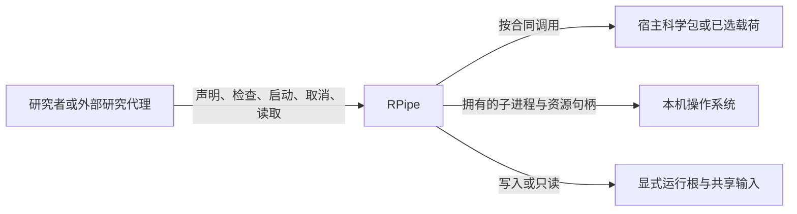
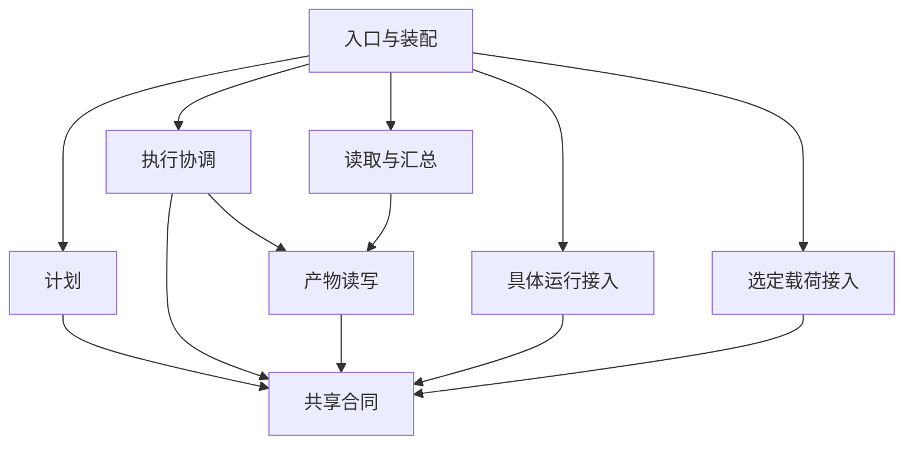
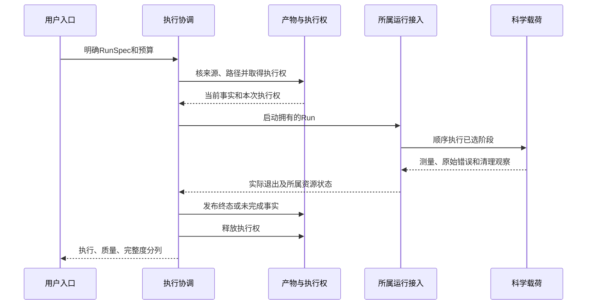
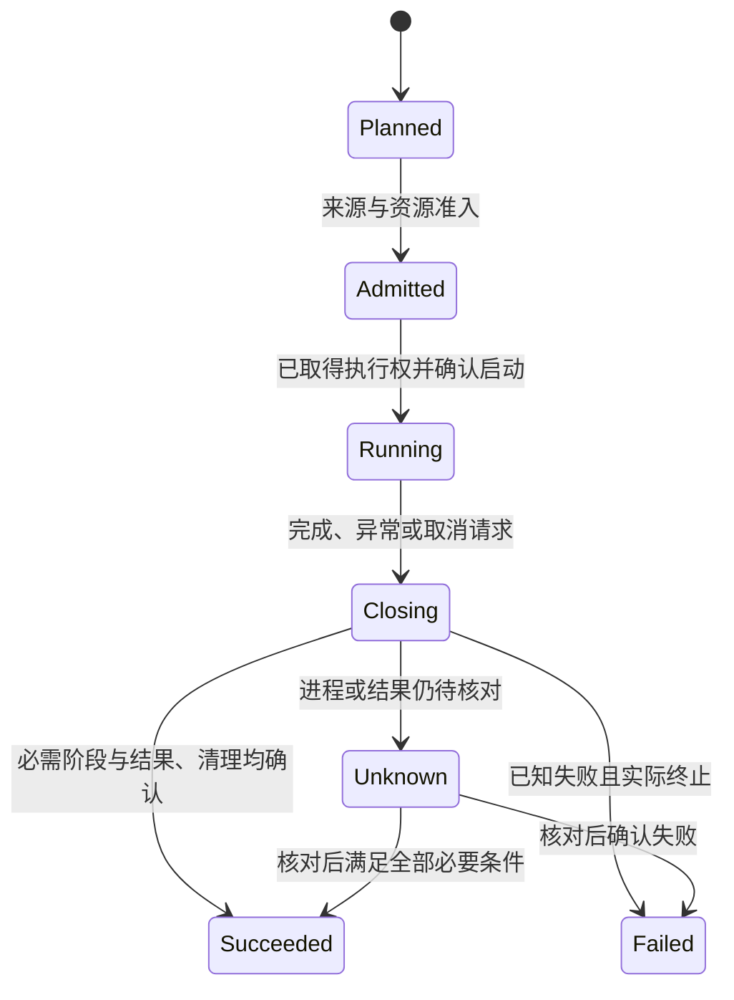

**研究流水线 架构设计**
更新日期：2026年10月21日。项目为 [RPipe](https://github.com/DreamSoul-AI/RPipe)，中文名为“研究流水线”。本文记录已批准的RPipe代码试验职责；实现与实际验证仍须以新代码PR的固定HEAD为准。现有行为与来源见 [通用调研](<研究流水线 通用调研.md>)，文件落位见 [代码结构设计](<研究流水线 代码结构设计.md>)，实验设计只维护于 [研究计划](<研究流水线 研究计划.md>)。

# 一、目标、边界与质量场景
## （一）用户要完成的闭环
研究者声明比较因素、seed、科学载荷和资源限制，先检查计划，再执行明确选择的 Run，读取真实结果并按 Experiment 汇总。RPipe 负责执行与证据合同，研究者负责问题、假设、判据和结论。模板不自动选题、训练模型、购买资源或恢复历史队列。

图一是系统上下文，箭头表示交互。库模块不等于独立进程，也不构成操作系统隔离。默认采用本机单协调进程加必要 Run 子进程，不引入服务、数据库、消息总线、插件市场或跨仓自动调度器。

## （二）质量场景决定职责
以下是目标验收合同，不是本轮已测结果。时间和内存上限由具体计划校准，不能凭本文编造平台通用值。

| **场景** | **触发与期望响应** | **职责决定** | **验收信号** |
| --- | --- | --- | --- |
| Q1 先检查后执行 | 查询状态、读取报告或校验声明 | 读端和计划检查不获得执行权 | 载荷调用、子进程创建和历史结果写入均为 0 |
| Q2 同 Run 只有一个执行者 | 两个入口同时启动同一 Run | 执行协调者持有该 Run 的排他执行权直到收尾 | 最多一个载荷被调用，竞争者明确 busy，不能靠日志猜空闲 |
| Q3 结果对应实际来源 | 已有成功结果，但源码、有效配置或输入身份变化 | 产物边界核对身份，读取者不自行修写 | 不串读旧成功，不补签历史 SHA，不改变原件 |
| Q4 故障不变成成功 | 载荷成功后汇总、日志、清理或持久化失败 | 协调者唯一决定执行终态，各阶段只提交观察 | 原始错误和后置错误均保留，科学质量、执行完成与证据完整度分列 |
| Q5 取消有范围 | 用户取消，或预算耗尽 | 运行接入只管理自己创建且可核验的进程树 | 停止新派发，保留句柄至结束确认，未知副作用不自动重放 |
| Q6 宿主独立演进 | 替换量化、解码、内存运行库而不改变研究流程 | Study 是薄适配，宿主只公开科学能力 | 宿主包不导入 Study 或 RPipe，变化局限于适配及受影响合同 |
| Q7 异机可解释 | 新 checkout 没有原机器权重、日志和 trace | 源码与运行根分开，摘要声明可恢复范围 | clone 不伪装包含原始制品，缺资产明确 unverified，不下载补齐 |

# 二、构建块与状态归属
## （一）最少职责
目标保留六个有实际理由的职责。它们可以由少量 Python 模块实现，不强制每个名词成为类、层或服务。

| **构建块** | **提供与需要的合同** | **拥有的状态与隐藏细节** | **不增加的后果／持续成本** |
| --- | --- | --- | --- |
| 入口与装配 | CLI 和公共 API 转换请求，连接具体组件 | 仅参数和呈现，不维护第二份 Run 终态 | 双入口容易重复业务判断／需维护薄装配 |
| 计划 | 声明 → 校验后的 RunSpec 集合及依赖顺序 | 纯因素展开、seed、预算和有效配置 | 盲目执行畸形声明／需维护配置兼容 |
| 执行协调 | start、cancel、query，通过载荷和运行接入执行 | 当前 Run、阶段、取消请求、执行权和整体终态 | 重复执行或故障错误成功／需明确状态转换 |
| 产物 | 取得执行权、校验来源、读写 Run 事实、发布派生结果 | 路径、格式版本、原子文本发布和资源归属 | 各阶段各写状态造成冲突／需维护磁盘兼容 |
| 科学载荷接入 | prepare、execute、collect 与 close 的有限合同 | 本次模型、数据迭代器、优化器和设备对象 | 模板耦合所有研究方法／仅为真实差异维护接入 |
| 读取与汇总 | status、logs、report、compare、跨 seed 聚合 | 无执行权，派生视图可重建 | 读端重跑实验或混用来源／需维护版本与缺失语义 |

共享合同仅定义 RunSpec、RunObservation、RunOutcome、Budget、Cancellation 和必要调用形状，不成为业务状态中心。诊断复用标准日志能力，测量、checkpoint 和结果各按本身合同保存，不为每一种文件建立存储框架。

## （二）源码依赖与运行调用分开

图二只表示源码导入或类型引用。执行时协调者通过装配注入的载荷与运行合同调用具体实现。结构不反向导入 Flow；库不静态导入任何正式 Study。低层不借一个大门面绕回上层，动态导入也必须遵守边界。

共享输入只含明确不可变的数据和模型来源。模型对象、优化器、scheduler、RNG、sampler、KV/激活、checkpoint 和临时目录归当前 Run，不因引用同一文件就跨 Run 共享可变状态。

# 三、接口与持久化合同
## （一）公共用例
下表是公共用例合同，精确签名与旧导入/CLI破坏点在代码结构设计维护。本分支已实现显式根、唯一执行权及只读边界，不作旧内部导入的drop-in兼容承诺。

| **用例** | **输入 → 输出** | **副作用与失败** |
| --- | --- | --- |
| plan | Study 声明、基础配置、显式运行根 → RunSpec 清单 | 校验可离线完成，不导入重载荷；需要写配置时显式请求并拒绝覆盖冲突 |
| launch / run | 已校验清单或单 RunSpec、预算、取消句柄 → 执行观察 | 先准入和取得执行权，才启动所属进程；busy、身份不符和能力缺失明确拒绝 |
| cancel | 本次执行句柄 → 取消请求及实际停止观察 | 不按同名进程或旧 PID 操作，不承诺撤销已写 checkpoint |
| process | 明确结果集合、聚合规则 → 派生统计及完整度 | 不启动模型；失败保留既有 Run 成功事实，另记派生失败 |
| status / logs / report / compare | 已存事实、筛选条件 → 只读视图或显式导出 | 缺字段和坏文件保留未知，越根引用拒绝；读取不改变 result |

## （二）载荷与阶段合同
阶段语义保持 prepare → execute → collect → summarize → write → process，但不是每个 Study 都要实现六个空 hook。默认链由模板提供，Study 只覆盖有科学职责的点。

| **阶段** | **输入与产出** | **权威与失败约束** |
| --- | --- | --- |
| prepare | 已冻结 RunSpec → 本次运行对象与检查事实 | 不悄悄改配置或下载，失败不进入 execute |
| execute | 本次载荷、预算与取消 → 原生输出及执行观察 | 保留原异常，不把返回 Python 对象当作科学质量通过 |
| collect | 原始输出 → 具有单位/定义的测量 | 无质量阈值时质量为空，不从日志文字推断数字 |
| summarize | 同一次测量 → 可序列化候选摘要 | 只整理，不丢失败或用其它 Run 替换 |
| write | 经过合同检查的事实 → Run 结果提交 | 只有协调者批准的终态可发布；发布失败为证据不完整 |
| process | 已提交 Run 集合 → Run／Experiment／Study 派生摘要 | 完整度与质量分开，不覆写科学原件 |

载荷接入说明输入、返回类型、实际副作用、close 责任、取消检查点及可重试条件。全局注册、导入副作用和默认下载均不属于合法薄接入。运行中的资源无法立即取消时继续追踪，不让 close 抛错掩盖首错。

## （三）身份与磁盘事实
Study 组织比较问题，Experiment 表示不含 seed 的因素组合，Run 表示一次具体执行。内容相同的配置不意味着同一次尝试，重跑必须能分辨实际 attempt、来源和起止状态。是否改变现有 content-derived ID 是实施前兼容决定，当前不改旧身份算法。

每次新运行至少保留有效配置、代码及依赖身份、数据/模型引用及校验值、实际设备/精度、预算、阶段与终态、测量、错误和所属清理结果。不同事实分别记录，不把进程 exit0、完整度 true、质量 pass 合成一个不可解释的布尔值。

运行根显式给定，允许在本机 ignored 位置或外部制品位置保存。源码根 `studies/` 只放声明与可复用科学适配；运行时 `index.json`、`runs/`、`assets/`、`process.json`、图、trace、日志与源码冻结包不入 Git。现有 0.4.1 仍会向 Study 根生成这些对象，文档整理不会改变其路径，未来实现必须提供运行根分离与兼容迁移，不能宣称本轮已经具备。

原子替换只保证所选文件系统条件下的单文件发布，不是多个文件与模型计算的事务。写前检查和哈希不能证明恰好执行一次。关键结果缺失时终态是失败或待核对，恢复先解释事实，再由明确新请求决定是否重跑。

# 四、执行、部署、取消与恢复
## （一）本机有界运行
协调进程拥有调度清单，Run 子进程拥有模型与本次运行资源。默认串行，确需并发时由计划声明资源、限额和依赖。设备可见不等于准入成功，预算需要实际可执行的超时/内存监管责任。无法落实必要限制时，在启动前拒绝，不事后补一个耗时数字冒充监管。

图三表示满足准入的正常调用。执行权失效、取消或结果提交失败均需独立分支，不能将“进入 finally”当作资源已归还。

## （二）状态唯一归属

状态图描述生命周期；实际终态为succeeded/failed/cancelled/unknown，busy是磁盘执行权事实。取消请求是独立事实：启动前接受取消则不调用载荷，运行中取消停止新阶段并通知所属执行器，只有实际结束及必要收尾确认后才能解除 busy。未知不等于停止，读取成功记录不等于可以接管仍活动的 Run。

恢复不从旧命令行或日志重放训练。只有模型、优化器、scheduler、RNG、sampler、精度及代码等原协议都具备且验证兼容时，才接受显式 checkpoint resume。自动队列重启、云资源补开、删除未知产物都不属于首版。

# 五、Study 与下游宿主的共同边界
## （一）源码约定
`studies/<name>/` 只组织一个研究问题的声明和薄适配。`study.yaml` 说明因素、seed 和扩展，`experiment_config.yaml` 是基础配置。`structure/` 放确实只属于该研究的载荷接入和纯计算，`flow/` 放实际需要的阶段适配。没有职责不创建空目录或复制整套模板；可跨研究复用的科学实现放宿主包，通过公共入口导入。

根项目唯一中文研究计划按 Study 分章维护问题、假设、数据、模型、算法、指标、实验设计和资源。Study 不再拥有 PLAN、报告、NUMBERS、逐事交接或规范副本。关键历史数字、哈希和原件定位只在通用调研保留一份小摘要；日常进展写 PR 与提交说明。

## （二）宿主包与固定副本
dayan 使用其 legacy 包的能力边界，SD 使用标准 Python 包布局，量化保留自身科学能力。宿主包不因研究执行需要而被机械切成 RPipe 的两柱，只有研究适配使用上述 Study 约定。

下游保留固定提交的 `src/rpipe/`，不可逐仓修改。通用缺陷只在 RPipe 仓修复、评审并取得确定提交后，另行整包同步源码、许可证与来源元数据，核对全部成员和宿主接入回归。当前不执行同步、不替换 pin、不把源码复制当外部 pip 依赖，也不复制本仓历史测试和辅助脚本。

# 六、与合同对应的测试和 CI/CD
## （一）只测本仓行为
测试镜像目标源码，unit/integration/e2e 用标签区分，公共输入只在真实复用时提取。科学方法自身正确性留给宿主包；RPipe 只验证其载荷合同、证据与生命周期。不要为每个模块复制同一套路径快照/AST字符串测试。

| **合同** | **最小输入与故障** | **必需信号** |
| --- | --- | --- |
| 计划 | 重复因素、无效seed、未知字段、非有限预算、越根路径 | 明确拒绝，零载荷与零进程，无静默默认 |
| 执行权 | 同 Run 双启动、旧成功、身份漂移 | 仅一个执行者，受保护旧文件不变 |
| 阶段链 | prepare/execute/collect/write故障及close再失败 | 首错保留，后续阶段不误执行，终态不伪成功 |
| 取消 | 启动前、阶段间、运行中、停止失败 | 派发/停止事实分列，仅清理所属资源，unknown保持busy |
| 产物 | 写满、截断、来源不符、原子替换故障 | 原件/peer保全，坏数据不被修写成成功 |
| 读取汇总 | 缺Run、坏可选元数据、跨根checkpoint、seed不齐 | 保留缺口，拒绝串读，统计不假装完整 |
| 薄Study | 合成载荷、真实临时文件、有限所属子进程 | 贯通计划到结果，不导入正式科学数据或下载模型 |
| 固定复制接入 | 当前pin清单与合法宿主入口 | 来源字节可核，无模板测试复制，范围不越到科学结论 |

每项需稳定 test_id、独立 attempt、level/type/cost_class/result_type/priority、目标与环境。执行前列已选与必需项、预算和资源，执行后保留逐项结果、setup/call/teardown、缺结果与异常收尾，报告可由磁盘重建。纯测量为 measured、quality为空，普通skip及missing不能当成功。运行证据仅存 ignored 或明确制品位置。

## （二）实施与放行
本轮已获准实现并将旧文档/目录字符串门迁成实际合同测试，保留真实科学、轨迹回滚、checkpoint与原子发布断言。验证按新代码PR固定HEAD报告：本地CPU与有限科学小例、包构建/安装分列；不以这些结果外推正式Study矩阵、GPU、性能或全平台。

未来 CI 先检查文档与依赖边界，再执行受影响离线合同、有限集成及包安装。平台/GPU项只在明确设备和预算下运行，构建、测试与实际提交和制品哈希绑定。已有 Actions 不代表本次通过，不自动更改工作流、保护规则、autoMerge 或发布。

# 七、设计依据与实施差距
2026年10月21日读取 CPU 内存清理固定提交 `6938f10447b250958856a845fc5448aa1185b52d` 的协作约定及三份设计资料，采用“质量场景 → 职责/合同 → 状态 → 依赖 → 运行部署 → 验证”的粒度。另读取关联 DreamSoul 文档库软件架构设计课题的通用调研、大纲、端侧智能体案例和来源索引。只借用其方法，不复制智能体模块或全套 UML/C4/arc42/OCL，也不声称正式 ATAM 或标准符合性。

当前固定 dev 基线为 `ed0d50be4328af3480b54de31243bf507901d033`，旧债务分支仅为历史参考。实现来源保证限定实际源码摘要与有效配置，既有显式输入pin/checksum继续保留；任意外部data.path/stats_path的内容漂移尚未通用核验，Q3的完整输入字节保证仍为未闭合范围。

本代码试验以已审文档538a2b9派生，落实运行根分离、统一执行权/取消及精简职责；只替换本仓必要源码和消费者，不同步其他仓。硬RSS预算不支持；注入载荷无硬超时；Windows recipe/DataLoader子孙无法保证硬终止时准入拒绝或保留unknown/busy。不自动清理未知锁，不回签旧Run。删除非重构相关代码或真实数据仍须Enmao确认。
