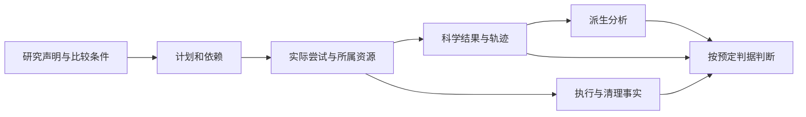

更新日期：2026年10月29日。原综合检索截止2026年10月27日；Windows活状态读取的共享访问与CRT错误机制于10月29日定向补核，不表示其它滚动来源已全部刷新。对象：小型本机研究执行模板。维护机制、方案、来源与当前判断；执行和迁移的详细经过归日期记录，正文保留支撑结论所需的证据摘要、条件与限制，并引用相关记录。实际检索和源码核对范围见 [本轮运行记录](<运行记录 Run Record/2026-10-27 文档核验.md>)。

# 一、问题、范围与判断

研究者需要把声明、代码与输入条件、计算、结果和分析连接起来，并能解释失败、取消、重试和缺项。单个脚本退出成功无法独自回答：结果属于哪次尝试，旧成功是否仍完整，哪些输入没固定，分析失败是否影响科学事实。

本调研覆盖本机顺序执行、不可变共享输入、Run所属资源、科学结果与派生分析分离、身份和读取。集群调度、常驻协作服务、自动选题、GPU分配和模型算法优越性不在当前范围。结论是采用清楚的文件与生命周期合同，按需要借鉴外部跟踪、工作流与来源模型，不为这些路线各建一套内部框架。当前设计落在两份设计文档，工程待办进入开发计划。

# 二、声明、运行与判断为何必须分开

流程规格描述“准备如何计算”，一次运行描述“实际发生了什么”。二者关联但不能替代，工作流及其组件和运行各自需要能识别的版本与元数据。这一划分也是 [FAIR计算工作流建议](https://www.nature.com/articles/s41597-025-04451-9) 的核心对象区分。

图中的箭头表示信息依赖，不是所有文件都在最后一次性写入。科学结果、整体执行和派生分析各有状态，状态未知或证据缺失时不推定成功。有效配置、源码、输入、环境与实际精度共同限定可比条件，版本字符串和seed不能单独证明相同实验。

可将一次观察抽象为 $O=(S,C,D,E,A,Y)$：$S$为声明，$C$为代码身份，$D$为输入身份，$E$为环境条件，$A$为实际尝试，$Y$为输出及其解释。该表达是本报告的组织模型，不是外部标准字段或新增schema。即使其中某部分可验证，也不能补齐另一部分的未知。

# 三、工程机制与失败边界

## （一）执行权与资源所属

执行者应拥有本次尝试的进程/句柄和发布权，读取者只观察。输入准备锁与Run执行权用途不同，释放缓存锁不等于计算和清理完成。取消是停止新派发并处理所属资源，不是撤销已产生的全部副作用。

Windows Job可以将关联进程作为一组管理，子进程继承及breakaway有明确条件，不能从根进程退出推断整棵树已停止。RPipe的显式监管须在放行前建立所属关系，失败时保留unknown，不扫描或终止不属于本次的进程。[Microsoft Job Objects](https://learn.microsoft.com/en-us/windows/win32/procthread/job-objects)

## （二）发布与持久化

单文件完整写入临时对象后再替换，可收窄读取半文件的窗口。Python的os.replace允许在权限条件满足时替换既有文件，但跨文件系统可能失败，文档说明的成功原子重命名也不等于目录事务或断电持久性。[Python3.13 os.replace](https://docs.python.org/3.13/library/os.html#os.replace)

Windows 文件能否被再次打开，还受已有句柄的访问和共享方式约束，重命名/删除也涉及共享条件。因此原子替换可保护内容完整，却不保证每次按路径打开活文件均成功。[Microsoft 文件共享条件](https://learn.microsoft.com/en-us/windows/win32/fileio/creating-and-opening-files)、[CreateFile 共享标志](https://learn.microsoft.com/en-us/windows/win32/api/fileapi/nf-fileapi-createfilea)。CRT 的 errno 不等于原生系统错误码；需要区分原因时，应在受控调用前清理 CRT 错误状态、失败后立即读取对应系统码，不能只凭 PermissionError 或 EACCES 推断 ACL 问题。[Microsoft _get_doserrno](https://learn.microsoft.com/en-us/cpp/c-runtime-library/reference/get-doserrno?view=msvc-170)。

本仓当前判断是：只对明确属于本次的活进度观察、且已识别的共享/锁冲突作短暂有界重试，每次重核取消与剩余时间，不凭旧进度继续派发。格式、身份和其它权限错误保留原错，持续共享失败也不当作成功。该选择不扩展为所有读取的全局重试；实际环境、并发反例与未取得原始码的失败边界见[入口交付运行记录](<运行记录 Run Record/2026-10-29 入口取消与制品交付验证.md>)。

因此，科学结果、执行索引与执行权应可保守解释：部分发布和异常清理保留原件、首次错误及清理错误，不能靠“最后一个文件存在”伪造整体完成。来源校验在执行前和写入边界进行，路径保护解析实际目标，不能只比较字符串。

## （三）来源与可复现条件

来源模型需要解释输入、活动、产物与责任主体的关系，而不只是存一个哈希。[W3C PROV-DM](https://www.w3.org/TR/2013/REC-prov-dm-20130430/) 提供实体、活动、主体及派生关系的概念模型。对本项目的采用是明确这些关系和缺口，并不因此实现或宣称PROV格式符合性。

PyTorch区分随机源控制与非确定性算法，且不保证跨发布、平台或CPU/GPU相同结果。实际比较还须记录数值精度、数据顺序和恢复状态，不能用同seed替代这些条件。[PyTorch2.14 Reproducibility](https://docs.pytorch.org/docs/2.14/notes/randomness.html) 仅作为机制依据，不升级本项目依赖。

## （四）读取、汇总与结论

读取区分缺失、损坏和合法值，不补零、不触发重跑。汇总保留缺seed和每点实际样本数，执行失败与有效科学观察分列。统计口径须明确样本标准差与总体标准差，绘图阴影不自动等于置信区间。模型泛化和科学方法贡献由研究设计判断，工程合同通过不替代它们。

# 四、可复用路线与代价

| **路线** | **直接机制与依据** | **适合的问题及采用边界** |
| --- | --- | --- |
| 本机声明、执行权与文件合同 | 当前RPipe的纯计划、所属生命周期、身份与只读观察，源码落点见代码结构设计 | 易于嵌入小研究仓库和检查原件，但恢复、并发、平台清理与发布语义须自己验证，不具备集群服务能力 |
| MLflow实验跟踪 | Runs记录参数、指标和产物，Experiment组织查询，后端可本地或服务化。[MLflow Tracking](https://mlflow.org/docs/latest/ml/tracking/) | 适合集中检索和比较；跟踪记录与本项目的执行权/取消合同是不同问题。是否通过适配满足同一故障协议尚待实测，不能推定支持或缺失 |
| Snakemake规则工作流 | 通过input/output规则推导任务依赖，可定义protected、temp、ensure和retries。[Snakemake9.27.1 Rules](https://snakemake.readthedocs.io/en/v9.27.1/snakefiles/rules.html) | 适合文件依赖分析和可替换步骤。目录输出和临时文件清理需要匹配所有权，自动重试需要核副作用，不与本项目unknown不重放的语义混同 |
| 可交换运行来源 | Workflow Run RO-Crate用不同粒度关联执行、输入、输出和代码。[WRROC官方说明](https://www.researchobject.org/workflow-run-crate/) | 适合跨系统交换/归档来源。可以作为未来导出候选，不需要为阅读既有Run先引入RDF或全套来源服务 |

上述路线可组合，不能按工具功能数量排序。MLflow不是任务所有权协议，文件DAG不是科学质量判据，来源包也不是独立复现成功。比较须先统一输入、终态、失败与重试的含义，再讨论结果或成本。

# 五、面向本项目的取舍

1. 继续采用structure提供能力、flow组织装配与时序，计划/读取保持无执行副作用，科学对象只归当前Run
2. 明确科学结果、执行事实与派生分析的权威，未知不自动接管或重放，先保全原件和错误再提供诊断
3. 共享输入与可变状态分离，显式pin已声明输入，缺口显示未验证，不以源码摘要冒充全部科学身份
4. 外部来源交换、服务查询和异构调度只在真实需求与公平协议明确后采用，不为候选生态预建空适配

这些是基于当前需求和机制的工程判断，不是速度、可靠性或新颖性实测。研究主张、对照和判读见 [研究计划](<研究计划 Research Plan 研究流水线.md>)，职责合同见 [架构设计](<架构设计 Architecture Design 研究流水线.md>)。

# 六、来源版本与结论范围

直接来源包括：Python3.13接口文档、Microsoft Job文档及本次定向补核的文件共享/CRT正文、W3C PROV-DM 2013正式推荐、PyTorch2.14、Snakemake9.27.1、MLflow滚动Tracking页和WRROC官方概览。版本固定来源不与滚动页拼成统一运行环境。本文没有安装或运行外部工具，不给符合性、性能或外部故障能力结论，实际访问、定向阅读范围与失败保存在运行记录。
